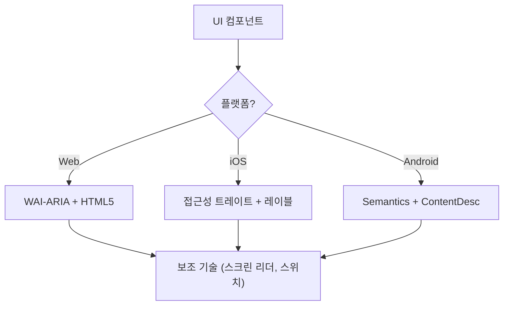

# 접근성 (WCAG 2.2)

이 스킬은 스크린 리더, 스위치 컨트롤, 키보드 내비게이션을 사용하는 사용자를 포함한 모든 사용자를 위해 디지털 인터페이스가 인지 가능(Perceivable), 운용 가능(Operable), 이해 가능(Understandable), 견고(Robust)하도록 보장합니다(POUR). WCAG 2.2 성공 기준의 기술적 구현에 초점을 맞춥니다.

## 사용 시점

- Web, iOS, Android용 UI 컴포넌트 명세를 정의할 때.
- 기존 코드에서 접근성 장벽이나 규정 준수 격차를 감사할 때.
- Target Size (Minimum), Focus Appearance 같은 새로운 WCAG 2.2 기준을 구현할 때.
- 상위 수준의 디자인 요구사항을 기술 속성(ARIA 역할, 트레이트, 힌트)에 매핑할 때.

## 핵심 개념

- **POUR 원칙**: WCAG의 기반 (Perceivable, Operable, Understandable, Robust).
- **시맨틱 매핑**: 일반 컨테이너 대신 내장 접근성을 제공하는 네이티브 요소를 사용하기.
- **접근성 트리**: 보조 기술이 실제로 "읽는" UI의 표현.
- **포커스 관리**: 키보드/스크린 리더 커서의 순서와 가시성 제어.
- **레이블과 힌트**: `aria-label`, `accessibilityLabel`, `contentDescription`으로 맥락 제공.

## 동작 방식

### 1단계: 컴포넌트 역할 식별

기능적 목적을 파악합니다(예: 버튼인가, 링크인가, 탭인가?). 커스텀 역할을 쓰기 전에 사용 가능한 가장 시맨틱한 네이티브 요소를 사용합니다.

### 2단계: 인지 가능한 속성 정의

- 텍스트 명암비가 **4.5:1**(일반) 또는 **3:1**(큰 텍스트/UI)을 충족하는지 확인합니다.
- 이미지, 아이콘 등 텍스트가 아닌 콘텐츠에 대체 텍스트를 추가합니다.
- 반응형 리플로우를 구현합니다(400% 확대 시에도 기능 손실 없음).

### 3단계: 운용 가능한 컨트롤 구현

- 최소 **24x24 CSS 픽셀** 대상 크기를 보장합니다(WCAG 2.2 SC 2.5.8).
- 모든 상호작용 요소가 키보드로 접근 가능하고 보이는 포커스 표시기를 갖는지 확인합니다(SC 2.4.11).
- 드래그 동작에 대한 단일 포인터 대안을 제공합니다.

### 4단계: 이해 가능한 로직 보장

- 일관된 내비게이션 패턴을 사용합니다.
- 설명적인 오류 메시지와 수정 제안을 제공합니다(SC 3.3.3).
- 같은 데이터를 두 번 묻지 않도록 "중복 입력 방지"(SC 3.3.7)를 구현합니다.

### 5단계: 견고한 호환성 검증

- 올바른 `Name, Role, Value` 패턴을 사용합니다.
- 동적 상태 업데이트를 위해 `aria-live` 또는 라이브 영역을 구현합니다.

## 접근성 아키텍처 다이어그램



## 플랫폼 간 매핑

| 기능               | Web (HTML/ARIA)          | iOS (SwiftUI)                        | Android (Compose)                                           |
| :----------------- | :----------------------- | :----------------------------------- | :---------------------------------------------------------- |
| **기본 레이블**    | `aria-label` / `<label>` | `.accessibilityLabel()`              | `contentDescription`                                        |
| **보조 힌트**      | `aria-describedby`       | `.accessibilityHint()`               | `Modifier.semantics { stateDescription = ... }`             |
| **액션 역할**      | `role="button"`          | `.accessibilityAddTraits(.isButton)` | `Modifier.semantics { role = Role.Button }`                 |
| **실시간 업데이트** | `aria-live="polite"`     | `.accessibilityLiveRegion(.polite)`  | `Modifier.semantics { liveRegion = LiveRegionMode.Polite }` |

## 예시

### Web: 접근 가능한 검색

```html
<form role="search">
  <label for="search-input" class="sr-only">Search products</label>
  <input type="search" id="search-input" placeholder="Search..." />
  <button type="submit" aria-label="Submit Search">
    <svg aria-hidden="true">...</svg>
  </button>
</form>
```

### iOS: 접근 가능한 액션 버튼

```swift
Button(action: deleteItem) {
    Image(systemName: "trash")
}
.accessibilityLabel("Delete item")
.accessibilityHint("Permanently removes this item from your list")
.accessibilityAddTraits(.isButton)
```

### Android: 접근 가능한 토글

```kotlin
Switch(
    checked = isEnabled,
    onCheckedChange = { onToggle() },
    modifier = Modifier.semantics {
        contentDescription = "Enable notifications"
    }
)
```

## 피해야 할 안티 패턴

- **Div 버튼**: 역할과 키보드 지원 없이 클릭 이벤트에 `<div>`나 `<span>`을 사용하는 것.
- **색상에만 의존한 의미 전달**: 오류나 상태를 색상 변화(예: 테두리를 빨간색으로 변경)_만_으로 표시하는 것.
- **포커스가 갇히지 않는 모달**: 모달이 포커스를 가두지 않아 모달이 열려 있는 동안 키보드 사용자가 배경 콘텐츠를 탐색할 수 있는 경우. 포커스는 반드시 갇혀 있어야 하며 `Escape` 키 또는 명시적 닫기 버튼으로 빠져나갈 수 있어야 합니다(WCAG SC 2.1.2).
- **중복된 대체 텍스트**: 대체 텍스트에 "Image of..." 또는 "Picture of..."를 사용하는 것(스크린 리더가 이미 "이미지" 역할을 알려 줌).

## 모범 사례 체크리스트

- [ ] 상호작용 요소가 **24x24px**(Web) 또는 **44x44pt**(네이티브) 대상 크기를 충족합니다.
- [ ] 포커스 표시기가 명확하게 보이고 고대비입니다.
- [ ] 모달은 열려 있는 동안 **포커스를 가두고**, 닫힐 때 깔끔하게 해제합니다(`Escape` 키 또는 닫기 버튼).
- [ ] 드롭다운과 메뉴는 닫힐 때 트리거 요소로 포커스를 복원합니다.
- [ ] 폼은 텍스트 기반 오류 제안을 제공합니다.
- [ ] 아이콘만 있는 모든 버튼에 설명적인 텍스트 레이블이 있습니다.
- [ ] 텍스트 크기를 조정했을 때 콘텐츠가 올바르게 리플로우됩니다.

## 참고 자료

- [WCAG 2.2 Guidelines](https://www.w3.org/TR/WCAG22/)
- [WAI-ARIA Authoring Practices](https://www.w3.org/TR/wai-aria-practices/)
- [iOS Accessibility Programming Guide](https://developer.apple.com/documentation/accessibility)
- [iOS Human Interface Guidelines - Accessibility](https://developer.apple.com/design/human-interface-guidelines/accessibility)
- [Android Accessibility Developer Guide](https://developer.android.com/guide/topics/ui/accessibility)

## 관련 스킬

- `frontend-patterns`
- `design-system`
- `liquid-glass-design`
- `swiftui-patterns`
