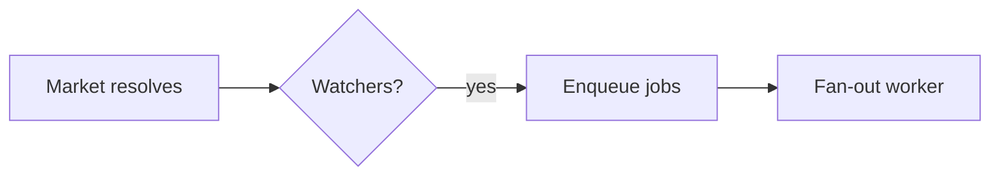

# Plan Canvas

계획과 시각적 아티팩트를 위한 검토 루프입니다. 당신이 아티팩트를 작성하면, 사람은 브라우저에서 이를 검토하며 정확히 원하는 요소에 주석을 달고, 채팅하고, **Approve plan / Request changes**(계획 승인 / 변경 요청) 판정을 내립니다. 그동안 당신은 사람의 피드백을 JSON으로 돌려주는 단일 CLI 호출에서 대기합니다.

[lavish-axi](https://github.com/kunchenguid/lavish-axi)에서 영감을 받았으며, 외부 의존성 없이 `/plan` 확인 게이트를 중심으로 ECC 네이티브로 다시 구현했습니다.

## 사용 시점

- `/plan`으로 계획 아티팩트(`.claude/plans/*.plan.md`)를 방금 작성했고, CONFIRM(승인) 결정이 필요할 때입니다. 캔버스의 판정이 타이핑한 "yes/proceed"를 대신합니다.
- 사용자가 변경할 대상을 *가리켜야* 할 때입니다. 디자인, 비교, 보고서, 또는 로컬 `.md` / `.html` 아티팩트를 검토하는 경우입니다.
- 사용자가 `/plan-canvas`, 시각적 검토, 또는 "브라우저에서 열어줘"를 요청할 때입니다.

다음 용도에는 사용하지 마세요: diff 코드 리뷰(`/code-review`), 웹 앱 실행, 원격 URL. 캔버스는 로컬 아티팩트 파일만 제공합니다.

## 동작 방식

CLI는 `ecc-plan-canvas`로 호출합니다. 이는 `ecc-universal` 패키지가 제공하는 bin으로, 전역 설치 또는 플러그인 설치 후 PATH에 올라옵니다(플러그인 설치의 경우 `node "$CLAUDE_PLUGIN_ROOT/scripts/plan-canvas.js"`도 동작합니다). 검토 대상 프로젝트에서 실행하세요. 어느 작업 디렉터리에서든 동작합니다. 이 도구는 모든 세션이 공유하는, 분리된(detached) loopback 서버(`127.0.0.1:4517`)를 관리하며, 아티팩트 경로를 키로 사용하므로 세션 ID를 추적할 필요가 없습니다.

워크플로는 단순한 CLI + JSON 루프이므로 모델과 하네스에 독립적입니다. 셸 명령을 실행하고 stdout을 읽을 수 있는 에이전트라면 누구든 같은 방식으로 구동할 수 있습니다(Claude Code, Codex, Cursor, Gemini, OpenCode, Copilot). 하네스가 스킬을 노출하는 방식대로 트리거하면 됩니다. 예를 들어 Claude Code에서는 `/plan-canvas`, Codex에서는 `$plan-canvas`를 쓰거나, `ecc-plan-canvas` 명령을 직접 실행하세요.

```bash
# 1. 사용자의 브라우저에서 아티팩트를 엽니다 (즉시 반환됩니다)
ecc-plan-canvas open .claude/plans/feature.plan.md

# 2. 사람이 응답할 때까지 블록됩니다. 계속 실행해 두고, 중단되면 다시 실행하세요.
#    대기 중인 피드백은 절대 유실되지 않습니다.
ecc-plan-canvas await .claude/plans/feature.plan.md
```

### 계속 듣고 있기: 아무도 듣지 않으면 사람은 빈 의자에 대고 말하게 됩니다

`await`이 세션에 실제로 대기 중일 때만 피드백이 당신에게 전달됩니다. 턴이 끝났는데 듣고 있는 것이 없으면, 메시지는 큐에 쌓이고, 사람 입장에서는 메시지를 보내도 아무 일도 일어나지 않는 것처럼 보입니다.

따라서 하네스가 지원하는 경우 **`await`을 백그라운드 작업으로 실행하세요**(Claude Code에서는 `run_in_background: true`를 준 Bash 호출). 이렇게 하면 피드백이 도착하는 순간 종료되고, 하네스가 JSON을 전달해 주므로 포그라운드 호출과 함께 죽지 않고 여러 턴에 걸쳐 루프가 유지됩니다. 포그라운드 `await`도 동작하지만, 하네스의 시간 제한에 걸릴 때까지만 유효합니다.

두 가지 안전장치가 있지만, 위 내용을 건너뛰어도 된다는 핑계가 되지는 않습니다.

- `ecc-plan-canvas pending`은 듣는 사람 없이 큐에 쌓인 피드백을 나열합니다. 무언가를 놓쳤는지 불확실할 때마다 확인하세요.
- `stop:plan-canvas-pending` 훅은 캔버스 피드백이 전달되지 않은 동안 당신의 턴이 끝나는 것을 막고, 메시지를 전달합니다. 이 훅에서 피드백을 읽고 있다면, 너무 일찍 듣기를 멈춘 것입니다.

사람이 행동하면 `await`은 JSON을 출력합니다.

```json
{
  "status": "feedback",
  "items": [
    { "kind": "annotation", "text": "Split this into two phases",
      "anchor": { "selector": "h2:nth-of-type(3)", "tag": "h2", "snippet": "Phase 2: Migration" } },
    { "kind": "verdict", "verdict": "request-changes" }
  ]
}
```

- `kind: "chat"`: 자유 형식 메시지입니다. 터미널이 아니라 캔버스에서 답하세요.
- `kind: "annotation"`: 요소에 연결된 피드백입니다. `anchor.selector`와 `anchor.snippet`은 사람이 가리킨 대상을 보여 줍니다. 사람이 문단을 드래그해 선택했다면 `anchor.textRange.text`에 그 내용이 담깁니다.
- `kind: "verdict"`: `approve`는 계획이 CONFIRMED(확정)되었다는 뜻입니다. 폴링을 멈추고, 세션을 끝내고, 구현을 시작하세요. `request-changes`는 아티팩트를 수정하라는 뜻입니다(캔버스가 실시간으로 다시 불러옵니다). 루프는 계속 유지하세요.

**3. 항상 캔버스에서 응답한 뒤**, 계속 듣고 있으세요. 명령 하나로 둘 다 처리할 수 있습니다.

```bash
ecc-plan-canvas await <file> --reply "Split Phase 2 as requested. Take a look."
```

사람의 모든 메시지에는 캔버스에서 응답해야 합니다. "On it, rewriting the risk table now." 같은 한 줄짜리 답이라도 마찬가지입니다. 채팅 패널이 조용하면 캔버스가 고장 난 것과 구별할 수 없게 되는데, 이 루프가 막으려는 바로 그 실패입니다. 터미널에만 답하지 말고 캔버스에서 답하세요.

작업하는 동안에는 활동 표시기로 채팅을 정직하게 유지하세요.

```bash
# 애니메이션 "agent is thinking..." 말풍선; 긴 작업 중에는 주기적으로 갱신하세요
ecc-plan-canvas typing <file> --state thinking
# 답변이 도착하기 직전에 "agent is typing..."으로 전환하세요
ecc-plan-canvas typing <file> --state typing
```

`await`은 피드백 묶음을 전달하는 순간 `thinking`을 설정해 줍니다. `--reply`를 보내면 표시가 지워집니다. 두 상태 모두 자동으로 만료되므로, 에이전트가 충돌해도 사람이 영원히 점만 보고 있는 대신 정직하게 "queued"로 표시됩니다. 수정 작업이 1분 이상 걸리면 `thinking`을 갱신하세요.

**4. 검토가 끝나면 종료**합니다: `ecc-plan-canvas end <file>`.

## 다이어그램 (Mermaid)

계획의 일부가 흐름, 아키텍처, 시퀀스, 상태 머신, ER 모델, 또는 의존성 그래프라면, ASCII 아트나 긴 산문 대신 펜스 코드 블록 ` ```mermaid `로 작성하세요. 캔버스는 이를 사람이 가리킬 수 있는 테마 다이어그램으로 렌더링합니다. 그림이 문단보다 빨리 읽히는 경우에 사용하세요. 단순한 목록이나 표에는 건너뛰세요.

````markdown

````

다이어그램은 ECC 다크 테마와 강조 색 팔레트로 렌더링됩니다. Mermaid는 고정된 CDN에서 브라우저로 로드됩니다. 이것이 사용 불가능한 경우(오프라인), 블록은 소스를 그대로 보여 주므로 검토가 막히지 않습니다. 에어갭(air-gapped) 환경에서는 `ECC_PLAN_CANVAS_MERMAID_URL`이 로컬 미러를 가리키도록 설정하세요.

## 규칙

- Markdown 아티팩트는 ECC의 계획 템플릿으로 렌더링됩니다(Mermaid 블록 포함). `.html` 아티팩트는 주석 레이어가 주입된 상태로 그대로 렌더링됩니다. HTML 작성 지침이 필요하면 `frontend-design-direction` 및 `artifact-design` 스킬을 사용하세요.
- 수정하려면 아티팩트 파일을 편집하세요. 캔버스는 저장 시 실시간으로 다시 불러옵니다. 새로고침을 위해 `open`을 다시 실행하지 마세요.
- `{"status": "ended", "endedBy": "user"}`(또는 피드백 묶음의 `sessionEnded: true`)는 사용자가 검토를 닫았다는 뜻입니다. 폴링을 멈추고, 남은 업데이트는 채팅으로 전달하며, 다시 열지 마세요. 해당 세션에 대한 일반 `open`은 거부됩니다. 사용자가 재개를 요청했을 때만 `--reopen`을 전달하세요.
- 보조 자산(이미지, CSS)은 아티팩트 옆에 있어야 하며 상대 경로로 참조해야 합니다.
- 서버는 loopback 전용이며 30분 동안 유휴 상태이면 종료됩니다(`ECC_PLAN_CANVAS_IDLE_MS`). `stop`은 명시적으로 서버를 종료합니다. 상태는 `~/.claude/plan-canvas/`(`ECC_PLAN_CANVAS_STATE_DIR`)에 저장됩니다.

## 예시

**계획 승인 흐름**: `/plan`이 `.claude/plans/notifications.plan.md`를 작성하고, 확인을 기다려야 합니다.

```bash
ecc-plan-canvas open .claude/plans/notifications.plan.md
ecc-plan-canvas await .claude/plans/notifications.plan.md
# → {"status":"feedback","items":[{"kind":"verdict","verdict":"approve"}]}
ecc-plan-canvas end .claude/plans/notifications.plan.md
# 계획이 확정되었습니다 — 구현을 시작하세요
```

**수정 루프**: 피드백이 도착하면 파일을 수정하고, 응답한 뒤, 계속 듣습니다.

```bash
# await이 주석을 반환함 → .plan.md를 편집합니다 (캔버스가 실시간으로 다시 불러옵니다)
ecc-plan-canvas await <file> --reply "Reworked the risk table."
# → 다음 응답이 올 때까지 다시 블록됩니다
```

## 안티패턴

- `--timeout-ms`로 루프에서 폴링하는 것. 이 옵션은 테스트용입니다. 대신 일반 `await`을 계속 실행해 두세요.
- 검토가 아직 열려 있는데 `await` 없이 턴을 끝내는 것. 사람이 "메시지를 보냈는데 아무 일도 없었다"고 경험하는 유일한 실패가 바로 이것입니다.
- 피드백을 읽고 터미널에만 답하는 것. 사람은 캔버스를 보고 있습니다.
- 사용자가 종료한 뒤 "그냥 보여 주려고" 다시 여는 것.
- 계획 전체를 채팅에 붙여넣으면서 캔버스도 여는 것. 캔버스를 선택하고, 터미널 요약은 한 줄로 유지하세요.
- 상태 파일에서 캔버스 채팅을 파싱하는 것. 필요한 모든 것은 `await`을 통해 도착합니다.

설계 노트와 기원: [docs/design/plan-canvas.md](../../docs/design/plan-canvas.md).
