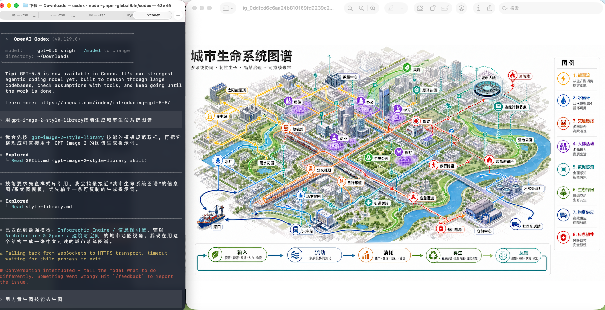

# GPT-Image2 스타일 라이브러리

이 Skill은 사용자의 이미지 생성 의도를 awesome-gpt-image-2 스타일 라이브러리를 이용해 바로 제작에 쓸 수 있는 GPT-Image2 프롬프트로 바꿉니다.

## 출력 예시



요청 예시: `gpt-image-2-style-library 스킬로 도시 생명 시스템 맵 생성`

## 참조 자료

- 템플릿이나 스타일을 고르기 전에 `references/style-library.md`를 읽습니다.
- 이 참조 문서는 저장소의 `data/style-library.json`에서 생성됩니다.
- 템플릿 이름, 범주, 대표 이미지, 스타일 태그가 중요한 경우 기억보다 참조 문서를 우선합니다.

## 워크플로

1. 사용자의 언어를 감지하고 같은 언어로 답합니다.
2. 사용자가 만들려는 대상 유형을 파악합니다. 제품, 포스터, UI, 인포그래픽, 브랜드, 사진, 일러스트, 캐릭터, 장면, 역사, 문서, 특수 과업 등이 있습니다.
3. 요청을 다음 순서로 맞춥니다: 템플릿 범주, 시각 스타일 태그, 장면 태그, 가장 가까운 사례.
4. 가장 적합한 템플릿 하나가 분명하면 바로 사용합니다. 가능한 템플릿이 여러 개면 이유를 짧게 붙여 두세 가지 옵션을 제시하고 사용자 선택을 기다립니다.
5. 최종 프롬프트를 다음 블록으로 구성합니다.
   - 주제와 과업
   - 구성과 레이아웃
   - 시각 스타일과 재료
   - 텍스트와 레이블 요구사항
   - 화면 비율과 출력 형식
   - 제약과 제외 요소
6. 선택한 템플릿 이름과 도움이 되는 사례 ID를 포함합니다.

## 기본 출력

- 복사해 사용할 수 있는 프롬프트를 먼저 제공합니다.
- 제약은 구체적으로 씁니다. 정확한 문구, 화면 비율, 읽을 수 있는 레이블, 레이아웃 위계, 피해야 할 결과물을 지정합니다.
- 중국어 요청에는 사용자가 영어를 원한다고 하지 않는 한 최종 프롬프트를 중국어로 씁니다.
- 영어 요청에는 사용자가 중국어를 원한다고 하지 않는 한 최종 프롬프트를 영어로 씁니다.
- 여러 개념을 요청하면 템플릿 하나를 유지하고 주제, 구성, 팔레트, 장면을 바꿉니다.

## 유지보수

원본 저장소가 바뀌면 다음을 실행합니다.

```bash
npm run generate:style-skill
```

Skill을 로컬 Codex Skill 폴더에 설치하려면 다음을 실행합니다.

```bash
npm run install:skill
```
