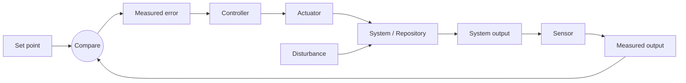

# 제어 루프 분류 체계

설계하기 전에 에이전트 루프를 제어 시스템으로 설명할 때 이것을 사용하세요. 그래야 "에이전트가 가끔 실행된다"는 식이 아니라 관찰 가능하고, 제한되고, 리뷰 가능한 루프가 됩니다.

아래의 모든 예시는 **논의를 촉발하기 위한 설명**이지 추천이 아닙니다. 적절한 센서, 컨트롤러, 액추에이터는 사용자의 코드베이스와 이미 쓰고 있는 도구에 전적으로 달려 있습니다. 가정하지 말고 인터뷰에서 알아내세요.

## 네 가지 컴포넌트

이 네 가지(및 이들이 섬기는 설정값)를 전면에 두세요. 나머지 용어는 주머니에 넣어 두세요.

- **설정값(Set point)**: 코드베이스 속성의 원하는 최종 상태. 불변식("이 경계를 넘어 import하는 모듈이 없을 것"), 임계값("`core`의 커버리지 ≥ 80%"), 또는 방향("실행마다 발생 횟수 감소").

- **센서(Sensor)**: 루프가 현재 상태와 설정값과의 차이를 측정하는 방법. 코드베이스에 대해 보고하는 거의 모든 것이 될 수 있습니다. 정적 분석 또는 린트 도구, 구조적/AST 검색, 타입 체커, 테스트 스위트, 텔레메트리나 에러 쿼리, 코드 검색 쿼리, 커스텀 스크립트, 또는 코드를 검사하는 에이전트. 사용자와 논의할 트레이드오프(규칙으로 강제할 것이 아님): 측정이 얼마나 안정적이고 반복 가능한지, 실행 비용이 얼마인지, 조용히 비활성화될 수 있는지. 컨트롤러가 반복적으로 활용할 수 있는 출력을 목표로 하세요.

- **컨트롤러(Controller)**: 루프가 측정값을 다음 변경으로 바꾸는 방법. 변경은 저위험이고 리뷰 가능한 수준이어야 합니다. 컨트롤러는 *지금 무엇을 하고 무엇을 미룰지*를 결정합니다. 어떤 대상인지, 몇 개인지, 어떤 순서인지. 완전히 결정론적인 것(발견 사항을 정렬해서 하나를 고르는 스크립트)부터 완전히 에이전트적인 것(자연어 기준에서 고르는 에이전트)까지 있으며, 그 사이에 데이터 기반 변형도 있습니다(예: 운영 에러가 몰린 곳을 기준으로 우선순위 정하기). 이것이 루프 출력으로부터 **시간이 지나며 튜닝하게 될** 부분입니다. 단순하게 시작하세요.

- **액추에이터(Actuator)**: 변경을 적용하는 주체. 코딩 에이전트(Claude Code, Codex, OpenCode, CodeLayer 등)와 저장소 로컬 스킬이 CI에서 실행되어 PR을 엽니다.

- **교란(Disturbance)**: 루프 밖에서 시스템을 바꾸는 모든 것. 팀원의 커밋, 의존성 업데이트, 생성된 코드, 불안정한 테스트, 대규모 리팩터링. 루프는 이것들에도 *불구하고* 진전해야 합니다.

## 컴포넌트는 경계가 흐려질 수 있습니다

실제로는, 특히 에이전트를 쓸 때 경계가 흐려지는데, 그것은 괜찮습니다.

- **센서 + 컨트롤러 융합:** 문제를 보고하면서 영향도 순으로 정렬하는 도구는 두 가지 일을 모두 하는 것입니다.
- **컨트롤러 + 액추에이터 융합:** 다음 대상을 고르고 그것을 변경하는 단일 에이전트 프롬프트.

사용자에게 실제로 필요한 루프를 설계하세요. 존재하지 않는 분리를 억지로 만들어내지 마세요.

## 더 넓은 그림

이 모든 것을 명시적으로 이름 붙일 일은 드물지만, 루프에 대해 추론할 때 도움이 됩니다.

- **측정 출력(Measured output)**: 센서가 만드는 신호 (예: 발견 사항 목록, 개수, 점수).
- **측정 오차(Measured error)**: 설정값과 측정 출력 사이의 차이 (예: 임계값을 넘는 발견 사항, 또는 기준선 대비 새 발견 사항).
- **컨트롤러 출력(Controller output)**: 이번 반복에 대해 선택된 작업 (예: "이 패키지들의 이 N개 대상을 처리").
- **시스템 입력/출력(System input / output)**: 액추에이터가 만드는 패치/커밋/PR, 그리고 그 결과로 나타나는 저장소 상태와 검증 및 리뷰.

## 각 컴포넌트를 먼저 로컬에서 실행하기

컴포넌트가 무엇이든, CI를 연결하기 전에 각각을 손으로 독립적으로 실행할 수 있게 만드세요. 센서를 실행해 출력을 읽고, 그 출력에 대해 컨트롤러를 실행하고, 선택된 대상에 대해 액추에이터를 실행합니다. 워크플로는 사용자가 이미 로컬에서 실행할 수 있는 조각들만 조율해야 합니다. 그래야 루프를 디버깅할 수 있습니다.

## 고려할 추가 루프 요소

- **흐름 제어(PR 제한)**: 이 루프의 열린 PR이 이미 있으면 예약 실행을 멈춰서, 루프가 리뷰 속도를 앞지르지 않도록 합니다.
- **댐퍼(회귀 게이트)**: 센서 출력을 기준선과 비교하는 검사(보통 PR이나 main으로의 push에서 실행)로, 루프가 점진적으로 개선하는 동안 문제가 *더 나빠지지* 않도록 합니다. 제안하되, 모든 루프에 필요하지는 않습니다.
- **범위 게이트**: 액추에이터를 안전한 디렉터리로 제한합니다. 명시적으로 선택되지 않는 한 생성된 파일, 벤더링된 코드, 고위험 패키지는 제외합니다.
- **배치 크기**: 실행당 발견 사항/파일/패키지 수로 상한을 두어 diff를 리뷰 가능하게 유지합니다.
- **메모리**: 향후 실행을 이끄는 지속적인 리뷰어 피드백과 알려진 오탐(일회성 로그가 아님).

## 인터뷰용 설계 질문

1. 어떤 속성을 몰고 가며, 설정값은 무엇인가요?
2. 이 저장소(또는 그 도구)에서 무엇이 차이를 반복 가능하게 측정할 수 있나요? 각 옵션의 트레이드오프는 무엇인가요?
3. 이번 실행에서 조치할 가치가 있는 오차는 무엇으로 간주하며, 리뷰 가능한 증분 하나는 얼마나 큰가요?
4. 컨트롤러는 대상을 어떻게 우선순위화하고 선택해야 하며, 시간이 지나며 이를 어떻게 튜닝할 것인가요?
5. 어떤 코딩 에이전트가 액추에이터인가요? 어떤 자격 증명이 필요하며, 어떤 골든 패턴을 따라야 하나요?
6. 액추에이터가 시스템을 개선했다는 것을 무엇이 증명하나요?
7. 루프가 무시하거나, 감수하거나, 댐핑해야 할 교란은 무엇인가요? 회귀 게이트를 원하나요?
8. 실행 간에 무엇을 메모리로 이월해야 하나요?
9. CI에 들어가기 전에 각 컴포넌트를 로컬에서 어떻게 실행하나요?
