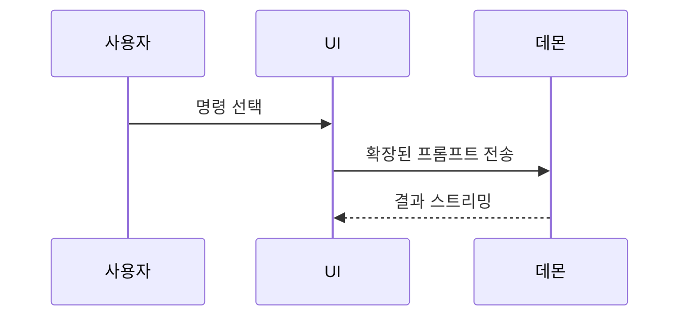

현재 대화의 주제를 시각적으로 이해하도록 돕습니다. 서두는 생략하고 설명은 짧게 합니다. 핵심 내용을 명확히 보여줄 수 있는 가장 작은 관점을 고릅니다.

- 로직이나 알고리즘은 의사코드로 보여줍니다.

```text
on(save)
  if content is unchanged
    return cached result
  write new content
  return fresh result
```

- 런타임 제어 흐름은 호출 트리로 보여줍니다.

```text
submitForm
  createSession
    persistPrompt
    launchAgent
  navigateToSession
```

- UI 구조는 중요한 상태와 모듈 경계를 포함한 컴포넌트 트리로 보여줍니다.

```tsx
<SessionPage> (apps/example/src/routes/session.tsx)
  useSessionEvents()
  <SessionToolbar>
    <RunSkillButton> (packages/ui)
```

- 파일의 책임이나 넓은 리팩터링은 얕은 파일 트리로 보여줍니다.

```text
src/
├── commands/       # 사용자 동작을 파싱함
├── sessions/       # 세션 상태를 소유함
└── transport/      # API 요청을 보냄
```

- 컴포넌트 상호작용, 제어 흐름, 데이터 흐름은 Mermaid로 보여줍니다.



- 핵심이 무엇이 바뀌는지이고 주변 구조가 이미 존재할 때는 `diff`를 사용합니다. diff의 형태를 주제에 맞춥니다.

컴포넌트 변경의 경우:

```diff
 <SessionPage>
   useSessionEvents()
   <SessionToolbar>
+    <RunSkillButton />
   <SessionTimeline>
+    <SkillResultCard />
```

파일 레이아웃 변경의 경우:

```diff
 src/
 ├── commands/
+│   └── show-me.ts       # 슬래시 명령을 확장함
 ├── sessions/
-└── transport.ts
+└── transport/
+    ├── client.ts
+    └── stream.ts
```

호출 트리나 호출 스택 변경의 경우:

```diff
 submitForm
   createSession
     persistPrompt
+    expandSkillMention
     launchAgent
-  navigateToSession
+  navigateToSession
+    subscribeToEvents
```

상태나 제어 흐름 변경의 경우:

```diff
 on(save)
-  write content
+  if content is unchanged
+    return cached result
+  write new content
+  invalidate cache
```

대부분이 새로운 코드이거나, 생략된 맥락 때문에 소유권이나 순서가 가려질 때, 또는 사용자에게 복사 가능한 목표 형태가 필요할 때는 블록 전체를 보여줍니다.

```ts
function expandSkill(command: string): string {
  const skillName = command.slice(1)
  return `use the ${skillName} skill`
}
```

- 시각적 UI, 레이아웃, 상태 비교, 또는 Mermaid로 표현하기에는 너무 복잡한 개념은 집중된 HTML 파일 하나를 작성합니다. 요점에 맞다면 다이어그램, 인포그래픽, 짧은 슬라이드 데크 중 무엇이든 됩니다. 제품의 색, 글꼴, 간격, 컴포넌트에 맞추고, 실제 레이블과 데이터를 사용하며, 데스크톱과 모바일을 모두 지원합니다. 그다음 사용자를 위해 파일을 엽니다.

```
Bash(open path/to/show-me-{description}.html)
```

### 안내

각 시각 자료는 그것을 뒷받침하는 짧은 텍스트 바로 옆에 둡니다. 사용자의 현재 질문에 답하는 데 필요한 호출, 파일, props, 상태, 경계만 남기거나, 현재 논의 지점에서 해결해야 할 선택지만 남깁니다.

이 중 하나를 사용해도 되고 여러 개를 사용해도 됩니다. 모두 사용할 가능성은 낮습니다. 판단에 따라 쓰고, 사용자를 압도하지 않도록 합니다.
