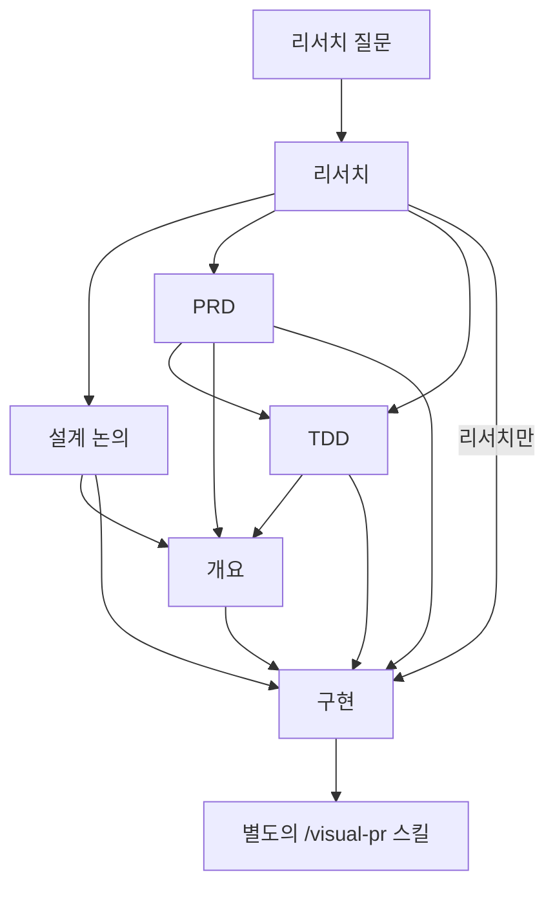

# 워크플로 선택

리서치는 현재 존재하는 것을 확정하고, 설계는 무엇을 바꿀지 결정하며, 구현은 합의된 결과를 만듭니다. 사용자에게 유용한 검토 지점을 주는 가장 짧은 경로를 사용합니다.

## 네 가지 시작 흐름

각 흐름은 기본적으로 리서치 질문과 리서치로 시작합니다.



| 흐름 | 리서치 이후 | 일반적인 다음 단계 | 기타 선택 |
| --- | --- | --- | --- |
| 설계 논의 | 제품 및 기술 선택을 함께 논의 | 개요, 그다음 구현 | 바로 구현 |
| PRD | 제품 해결책 정의 | TDD, 그다음 개요와 구현 | 개요 또는 바로 구현 |
| TDD | 기술적 접근 방식 정의 | 개요, 그다음 구현 | 바로 구현 |
| 리서치만 | 구현으로 진행 | 리서치를 바탕으로 구현 | 유용하다면 설계나 개요 추가 |

- 설계 논의는 제품 선택과 기술 선택을 한 문서에 함께 담습니다. 명확한 선택지가 몇 개 있는 변경에 적합합니다.
- PRD 다음에 TDD를 진행하면 사용자에게 보이는 결과와 기술적 접근을 분리합니다. 제품상 열린 질문이 있는 더 큰 기능에 적합합니다.
- TDD는 바로 기술적 선택으로 들어갑니다. 원하는 동작이 이미 명확한 수정, 정리, 리팩터링에 적합합니다.
- 리서치만 진행하면 현재 시스템에 대한 질문에 답한 뒤, 설계 단계를 건너뛰고 구현으로 넘어갑니다.

사용자는 어느 단계에서든 시작할 수 있습니다. 리서치나 설계 단계 이후에는 개요를 만들거나 바로 구현할 수 있습니다. 충분히 확정된 상세 내용이 있다면 PRD에서 바로 개요나 구현으로 넘어갈 수도 있습니다.

## 각 단계의 명확한 역할

| 단계 | 결과 | 검토 지점 |
| --- | --- | --- |
| 리서치 질문 | 정확한 출처 포인터가 포함된 현재 동작에 대한 집중 질문 | 사용자가 리서치 전에 범위를 다듬을 수 있음 |
| 리서치 | 실제 코드, 테스트, 사용 가능한 자료에서 얻은 발견 사항 | 사용자가 설계 전에 사실을 확인할 수 있음 |
| 설계 논의 | 현재 상태, 원하는 상태, 선택지, 합의된 선택 사항 | 사용자가 설계 선택을 확정함 |
| PRD | 제품 문제, 성공 지표, 사용자에게 보이는 해결책 | 사용자가 제품 해결책을 승인함 |
| TDD | 컴포넌트들이 상호작용하는 방식, 그다음 코드와 테스트의 형태 | 사용자가 시스템 설계, 그다음 프로그램 설계를 승인함 |
| 개요 | 순서가 정해진 단계들. 각 단계는 테스트 가능한 결과, 영향받는 파일, 점검 항목을 가짐 | 사용자가 범위와 단계 순서를 검토함 |
| 구현 | 합의된 문서에 기반한 코드와 테스트 | 점검과 사용자 테스트로 결과를 확인함 |

## 문서가 세션 간 컨텍스트를 전달함

기본적으로 각 단계는 별도의 컨텍스트 창에서 진행합니다. 다음 단계로 넘기기 전에 현재 결정, 사용자 승인, 해결되지 않은 질문을 문서에 저장합니다. 다음 명령에는 작업 디렉터리와 선택한 흐름을 포함합니다. 예를 들면 다음과 같습니다.

```text
/rpi research .agents/artifacts/task-retries; next: PRD then TDD
/rpi make a PRD .agents/artifacts/task-retries; flow: PRD then TDD
/rpi make an outline .agents/artifacts/task-retries
/rpi implement .agents/artifacts/task-retries
```

사용자는 여기서 계속 진행하거나, 다음 명령을 실행하기 전에 컴팩션할 수도 있습니다. 피드백은 현재 세션에서 또는 새 `/rpi` 호출을 통해, 그 선택 사항을 소유한 문서에 반영합니다.

```text
/rpi update the TDD .agents/artifacts/task-retries to use the existing worker queue
```
