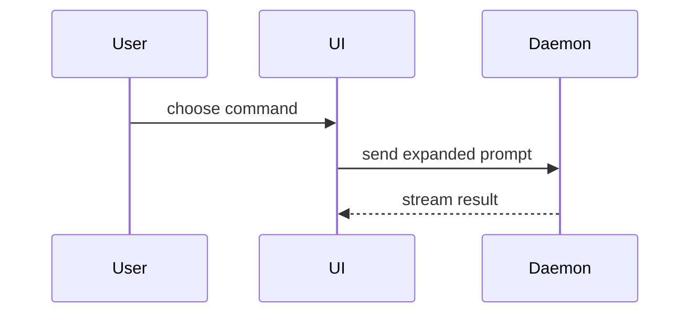

현재 대화의 주제를 시각적으로 이해하도록 도우세요. 서두는 생략하고 설명 문장은 짧게 유지하세요. 핵심 요점을 명확히 보여주는 가장 작은 뷰를 고르세요.

- 로직이나 알고리즘은 의사 코드로 보여주세요:

```text
on(save)
  if content is unchanged
    return cached result
  write new content
  return fresh result
```

- 런타임 제어 흐름은 호출 트리로 보여주세요:

```text
submitForm
  createSession
    persistPrompt
    launchAgent
  navigateToSession
```

- UI 구조는 중요한 상태와 모듈 경계를 포함한 컴포넌트 트리로 보여주세요:

```tsx
<SessionPage> (apps/example/src/routes/session.tsx)
  useSessionEvents()
  <SessionToolbar>
    <RunSkillButton> (packages/ui)
```

- 파일의 책임이나 넓은 리팩터링은 얕은 파일 트리로 보여주세요:

```text
src/
├── commands/       # 사용자 동작을 파싱
├── sessions/       # 세션 상태를 소유
└── transport/      # API 요청을 전송
```

- 컴포넌트 상호작용, 제어 흐름, 데이터 흐름은 Mermaid로 보여주세요:



- 핵심이 무엇이 바뀌는지이고 기존 형태가 이미 존재한다면 `diff`를 사용하세요. diff 형태를 주제에 맞추세요.

컴포넌트 변경의 경우:

```diff
 <SessionPage>
   useSessionEvents()
   <SessionToolbar>
+    <RunSkillButton />
   <SessionTimeline>
+    <SkillResultCard />
```

파일 레이아웃 변경의 경우:

```diff
 src/
 ├── commands/
+│   └── show-me.ts       # 슬래시 명령을 확장
 ├── sessions/
-└── transport.ts
+└── transport/
+    ├── client.ts
+    └── stream.ts
```

호출 트리나 호출 스택 변경의 경우:

```diff
 submitForm
   createSession
     persistPrompt
+    expandSkillMention
     launchAgent
-  navigateToSession
+  navigateToSession
+    subscribeToEvents
```

상태나 제어 흐름 변경의 경우:

```diff
 on(save)
-  write content
+  if content is unchanged
+    return cached result
+  write new content
+  invalidate cache
```

- 대부분이 새로운 내용이거나, 생략된 맥락 때문에 소유 관계나 순서가 가려지거나, 사용자에게 복사 가능한 목표 형태가 필요할 때는 블록 전체를 보여주세요:

```ts
function expandSkill(command: string): string {
  const skillName = command.slice(1)
  return `use the ${skillName} skill`
}
```

- 시각적 UI, 레이아웃, 상태 비교, 또는 Mermaid로는 너무 복잡한 개념이라면 집중된 HTML 아티팩트를 하나 만드세요. 제품의 색상, 타이포그래피, 간격, 컴포넌트에 맞추고, 실제 라벨과 데이터를 사용하며, 데스크톱과 모바일을 모두 지원하세요. 그런 다음 인라인으로 표시하세요:

```task-artifact
.humanlayer/tasks/{task-slug}/show-me-{description}.html
```

- 각 시각 자료는 그것을 뒷받침하는 짧은 텍스트 바로 옆에 두세요. 사용자의 현재 질문에 답하는 데 필요한 호출, 파일, prop, 상태, 경계만 남기세요.
