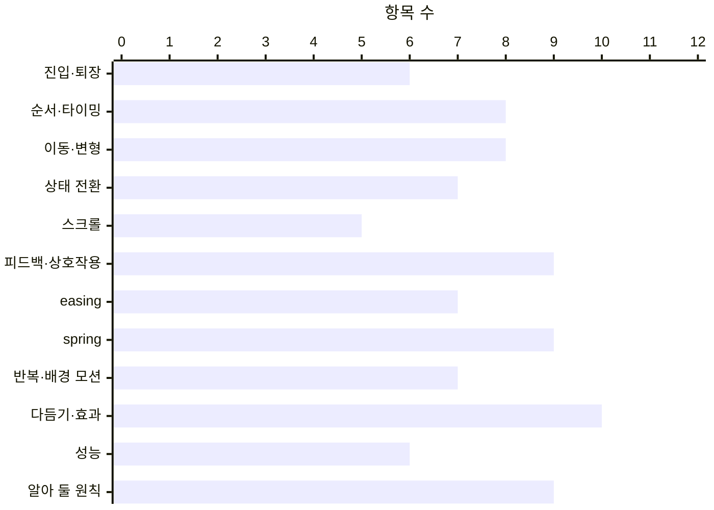

# animation-vocabulary 스킬은 에이전트를 어떻게 바꾸나 {#animation-vocabulary-skill}

`animation-vocabulary`를 쓰면 에이전트는 사용자가 흐릿하게 묘사한 모션 효과에 정확한 이름을 붙여 준다. "popover가 열릴 때 통통 튀는 거"를 들으면 `Pop in`을, "iOS에서 당기면 버티다 돌아오는 스크롤"을 들으면 `Rubber-banding`을 답한다. 답은 스킬 안의 용어집 91개 항목에서만 고르고, 정의는 고쳐 쓰지 않고 그대로 인용하며, 짧게 끝낸다.

- 켜지는 때: 사용자가 "이걸 뭐라고 불러?"라고 묻거나, 이름을 모르는 모션 효과를 묘사하며 AI나 디자이너에게 요청할 정확한 말을 원할 때다. 호출 제한 필드는 없다.
- 강제하는 것: 키워드가 아니라 의도로 읽고, 용어집 정의를 그대로 인용하고, 용어집에 없는 말은 지어내지 않는다.
- 출력: `**용어** — 정의` 한 줄. 여러 개가 맞으면 가장 맞는 것 하나와 대안 1~2개를 차이 한 줄과 함께 준다.
- 쓰면 안 되는 때: 효과를 설계하거나 구현할 때다. description이 "이름 붙이기용이지 설계·구현용이 아니다"라고 범위를 긋는다.

@answer scope="design/emilkowalski/animation-vocabulary · 원본 텍스트 1개 13,425B · 커밋 4e3fc89 · 지시상 동작"
@meta locale=ko
@source vb-fm title="design/emilkowalski/animation-vocabulary/SKILL.md · 13425B · frontmatter" path=design/emilkowalski/animation-vocabulary/SKILL.md lines=1:4
@source vb-init title="SKILL.md · 첫 응답" path=design/emilkowalski/animation-vocabulary/SKILL.md lines=8:14
@source vb-purpose title="SKILL.md · 한 줄 목적" path=design/emilkowalski/animation-vocabulary/SKILL.md lines=16:16
@source vb-quick title="SKILL.md · Quick Start 출력 형식" path=design/emilkowalski/animation-vocabulary/SKILL.md lines=18:26
@source vb-instr title="SKILL.md · 지시 6개" path=design/emilkowalski/animation-vocabulary/SKILL.md lines=28:35
@source vb-ex title="SKILL.md · 예시 3개" path=design/emilkowalski/animation-vocabulary/SKILL.md lines=37:62
@source vb-ghead title="SKILL.md · 용어집 머리말(/vocabulary 페이지와 동기화)" path=design/emilkowalski/animation-vocabulary/SKILL.md lines=64:66
@source vb-c1 title="SKILL.md · Entrances & Exits" path=design/emilkowalski/animation-vocabulary/SKILL.md lines=68:74
@source vb-c2 title="SKILL.md · Sequencing & Timing" path=design/emilkowalski/animation-vocabulary/SKILL.md lines=76:84
@source vb-c3 title="SKILL.md · Movement & Transforms" path=design/emilkowalski/animation-vocabulary/SKILL.md lines=86:94
@source vb-c4 title="SKILL.md · Transitions Between States" path=design/emilkowalski/animation-vocabulary/SKILL.md lines=96:103
@source vb-c5 title="SKILL.md · Scroll" path=design/emilkowalski/animation-vocabulary/SKILL.md lines=105:110
@source vb-c6 title="SKILL.md · Feedback & Interaction" path=design/emilkowalski/animation-vocabulary/SKILL.md lines=112:121
@source vb-c7 title="SKILL.md · Easing" path=design/emilkowalski/animation-vocabulary/SKILL.md lines=123:130
@source vb-c8 title="SKILL.md · Spring Animations" path=design/emilkowalski/animation-vocabulary/SKILL.md lines=132:141
@source vb-c9 title="SKILL.md · Looping & Ambient Motion" path=design/emilkowalski/animation-vocabulary/SKILL.md lines=143:150
@source vb-c10 title="SKILL.md · Polish & Effects" path=design/emilkowalski/animation-vocabulary/SKILL.md lines=152:162
@source vb-c11 title="SKILL.md · Performance" path=design/emilkowalski/animation-vocabulary/SKILL.md lines=164:170
@source vb-c12 title="SKILL.md · Principles to Know" path=design/emilkowalski/animation-vocabulary/SKILL.md lines=172:181
@source an-ease title="design/emilkowalski/animate/SKILL.md · 정의 비교용 easing 표" path=design/emilkowalski/animate/SKILL.md lines=100:110
@source an-reduce title="design/emilkowalski/animate/SKILL.md · 정의 비교용 reduced motion" path=design/emilkowalski/animate/SKILL.md lines=169:169
@source an-desc title="design/emilkowalski/animate/SKILL.md · r49 확인용 description" path=design/emilkowalski/animate/SKILL.md lines=3:3

## 언제 켜지고, 언제 쓰면 안 되나 {#trigger}

@code source=vb-fm language=yaml

이 스킬에는 호출 제한 필드가 없어서, 모델이 `description`을 참고해 스스로 켤 수 있다. 판정: `description`은 판단용 설명이라, "what's it called" 같은 말이 나온다고 반드시 켜지지는 않는다.

구체적인 질문 없이 처음 불리면, 에이전트는 정해진 한 문장("I'm ready to put a name to any motion effect you describe…")만 답하고 사용자가 물을 때까지 기다린다.

대상은 웹 애니메이션과 모션 효과의 이름이다. 효과를 설계하거나 만드는 일은 범위 밖이라고 description이 직접 적는다. 원문은 그 일을 맡을 스킬의 이름을 적지 않는다. 원장은 구현 쪽 스킬인 `animate`와 `같은 계열`(r49)로 잇는다.

사람이 개입하는 곳은 질문 하나뿐이다. 사용자가 효과를 묘사하면 에이전트가 이름을 준다. 원문에는 되묻기 단계가 없고, 더 길게 설명하는 것은 사용자가 요청할 때만 한다.

## 에이전트는 어떻게 이름을 고르나 {#how}

@workflow id=vocab-flow title="이름 고르기"
| v-desc | 사용자 묘사 | external |
| v-intent | 의도로 읽기 | backend |
| v-match | 딱 맞는 항목? | backend |
| v-many | 후보가 여럿? | backend |
| v-one | 용어 하나 인용 | backend |
| v-alt | 최선 + 대안 1~2 | backend |
| v-near | 가장 가까운 용어 | backend |
| v-desc > v-intent | |
| v-intent > v-match | |
| v-match > v-many | 예 |
| v-match > v-near | 아니오 |
| v-many > v-one | 아니오 | emphasis |
| v-many > v-alt | 예 |

@steps id=vocab-steps
| v-desc | 사용자 묘사 | 사용자는 기술 이름 대신 보이거나 느껴지는 것("springy", "slides off", "draws itself in")으로 말한다. | vocab-flow | v-desc |
| v-intent | 의도로 읽기 | 에이전트는 단어가 아니라 그 감각을 용어집 항목에 맞춘다. | vocab-flow | v-intent |
| v-match | 딱 맞는 항목? | 용어집 안에서만 찾는다. 정말 없는 용어는 지어내지 않고 없다고 말한다. 다만 용어집의 말로 개념을 설명할 수는 있다. | vocab-flow | v-match |
| v-many | 후보가 여럿? | 비슷한 용어가 경쟁하면 차이를 대조해 사용자가 고르게 한다. 원문이 든 짝은 `Clip-path`와 `Mask`, `Pop in`과 `Bounce`, `Shared element transition`과 `Layout animation`이다. | vocab-flow | v-many |
| v-one | 용어 하나 인용 | 용어를 맨 앞에 두고 용어집 정의를 고치지 않고 그대로 인용한다. 이름을 묻는 질문에는 이름만 주고, 요청이 있을 때만 더 설명한다. | vocab-flow | v-one |
| v-alt | 최선 + 대안 1~2 | 가장 맞는 용어를 먼저, 대안 1~2개를 그 차이 한 줄과 함께 준다. | vocab-flow | v-alt |
| v-near | 가장 가까운 용어 | 가장 가까운 용어를 대고 근사치라고 분명히 말한다. 또는 용어집의 말로 효과를 묘사한다. 원문 예는 "`scale-in` 진입의 `stagger`"다. | vocab-flow | v-near |

원문 예시 3개는 이 흐름을 그대로 보여 준다.

| 사용자 묘사(원문 예) | 에이전트 답 |
| --- | --- |
| popover가 가운데가 아니라 누른 버튼에서 자라 나오는 것 | `Origin-aware animation` 한 줄 |
| 이미지 하나가 다른 이미지로 바뀌는 것 | `Morph`, 대안 `Crossfade`(같은 자리에서 겹쳐 사라지고 나타나면)와 `Shared element transition`(요소가 옮겨 가며 바뀌면) |
| iOS에서 너무 당기면 버티다 돌아오는 스크롤 | `Rubber-banding` 한 줄 |

## 용어집에는 무엇이 있나 {#glossary}

용어집은 12개 분류, 91개 항목이다. 원문은 이 목록이 "프로젝트의 `/vocabulary` 페이지"를 그대로 옮긴 사본이고, 한쪽이 바뀌면 둘을 맞추라고 적는다. 그 페이지가 어느 프로젝트의 것인지는 `원문에 명시 없음`이고, 이 저장소 밖이다.

| 분류(원문 이름) | 대표 항목 |
| --- | --- |
| Entrances & Exits | `Fade in / Fade out`, `Slide in`, `Scale in`, `Pop in`, `Reveal` |
| Sequencing & Timing | `Keyframes`, `Stagger`, `Orchestration`, `Fill mode`, `Stepped animation` |
| Movement & Transforms | `Translate`, `Skew`, `3D tilt / Flip`, `Transform origin`, `Origin-aware animation` |
| Transitions Between States | `Crossfade`, `Morph`, `Shared element transition`, `Layout animation`, `Direction-aware transition` |
| Scroll | `Scroll reveal`, `Scroll-driven animation`, `Parallax`, `View transition` |
| Feedback & Interaction | `Press / Tap feedback`, `Hold to confirm`, `Swipe to dismiss`, `Rubber-banding`, `Shake / Wiggle` |
| Easing | `Ease-out`, `Ease-in`, `Ease-in-out`, `Linear`, `Asymmetric easing` |
| Spring Animations | `Stiffness / Tension`, `Damping`, `Perceptual duration`, `Velocity`, `Interruptible animation` |
| Looping & Ambient Motion | `Marquee`, `Alternate (yoyo)`, `Pulse`, `Float`, `Idle animation` |
| Polish & Effects | `Clip-path`, `Mask`, `Line drawing`, `Number ticker`, `Tabular numbers` |
| Performance | `Frame rate (FPS)`, `Jank`, `Compositing`, `will-change`, `Layout thrashing` |
| Principles to Know | `Anticipation`, `Squash & stretch`, `Frequency of use`, `Spatial consistency`, `Reduced motion` |

수치는 용어집에 거의 없다. 있는 것은 `Frame rate (FPS)` 항목의 "60fps가 기준, 새 디스플레이는 120fps"와, `Keyframes` 항목의 예 0%, 50%, 100%뿐이다.

판정: 정의를 "그대로 인용"하라는 지시 때문에, 한국어 사용자에게도 영어 정의가 그대로 나갈 가능성이 크다. 번역해서 줘도 되는지는 `원문에 명시 없음`이다.

## 다른 스킬과 어떻게 이어지나 {#relations}

이 스킬은 원장의 어느 묶음에도 속하지 않는 독립 스킬이다. 원장의 역할은 `안내`다. 관계는 하나다.

| 상대 | 종류 | 근거 방식 | 내용 | rel-id |
| --- | --- | --- | --- | --- |
| `animate` | 같은 계열 | 명시-역할 | 이 스킬은 "이름 붙이기용이지 설계·구현용이 아니다"라고 범위를 긋고, 구현 역할은 이름 없이 언급한다. `animate`는 애니메이션을 처음부터 만들고 구현을 쓰는 스킬이다. 서로 이름을 부르지 않고, 넘기라는 지시도 없다 | r49 |

판정: 이 스킬은 첫 응답에서 지식이 Emil Kowalski의 애니메이션 철학에서 왔다고 밝힌다. 그런데 몇몇 정의는 같은 철학을 담은 `animate`의 규칙과 결이 다르다. 이 스킬은 정의를 그대로 인용하므로, 사용자가 이 이름을 들고 `animate`를 쓸 때 어긋남이 그대로 전해질 수 있다.

| 항목 | 이 스킬의 정의 | `animate`의 규칙 |
| --- | --- | --- |
| `Reduced motion` | 모션을 줄이거나 **없애서** 사용자 설정을 존중한다 | 0이 아니라 "더 적고 부드럽게"다. 이해를 돕는 전환은 남긴다 |
| `Linear` | UI에는 피하고 spinner나 marquee에만 쓴다 | marquee와 progress 같은 일정한 움직임에 `linear`를 쓴다 |
| `Ease-out` | 대부분의 UI와 사용자 반응의 기본값이다 | {good:같다} 들어오고 나갈 때와 기본값이 `ease-out`이다 |

## 이 분석의 범위와 한계 {#audit}

- 읽은 텍스트 파일은 1개, 13,425B다. `SKILL.md`를 모두 읽었다. 이 스킬 폴더에는 references나 scripts가 없다. 구조·표본만 본 파일은 없다.
- 비교·관계 확인용으로 `animate/SKILL.md`의 3줄, 100~110줄, 169줄만 읽었다.
- 제외한 파일: 번역본 `SKILL.ko.md`(16,701B)는 열지 않았다. 바이너리 파일은 없다.
- 원문 대조 범위: 활성화 제한 1개(호출 제한 필드 없음)와 첫 응답 규칙, 출력 형식, 지시 6개, 예시 3개, 용어집 12개 분류의 항목 수(합계 91)와 수치 2곳을 모두 대조했다. 항목 수는 `- **`로 시작하는 줄을 분류마다 세어 얻었다. 관계 행 r49는 원장과 원문을 다시 대조했고 같다.
- 분석 중 바뀐 파일: 없음. 작업 트리는 commit `4e3fc89` 그대로다.
- 사람 검토: 미실시.

@callout level=open-question title="확인하지 못한 것"
- 용어집과 동기화한다는 `/vocabulary` 페이지는 이 저장소 밖이라 두 목록이 지금 같은지 확인하지 않았다.
- 정의를 그대로 인용하라는 지시와 한국어 사용자에게 답하는 상황이 만났을 때 에이전트가 번역하는지는 실행해 보지 않았다.
- 용어집에 없는 효과를 물었을 때 근사치 표시가 실제로 붙는지는 확인하지 않았다.
