```mermaid title="tier별 합격선과 측정 mean SSIM (expected.json 기록값)"
xychart-beta
  x-axis ["T1 title card", "T2 multi scene", "T3 data driven"]
  y-axis "SSIM" 0.85 --> 1
  bar "합격선" [0.95, 0.95, 0.90]
  bar "측정 mean" [0.974, 0.986, 0.953]
```

# remotion-to-hyperframes는 다른 도구의 영상 작업을 HyperFrames로 어떻게 옮기나? {#r2hf-page}

`remotion-to-hyperframes`는 Remotion 같은 다른 도구로 만든 영상 코드나 render 결과를 HyperFrames 프로젝트로 옮기고, 원본과 frame 단위로 대조하게 하는 스킬이다.

- description은 Remotion을 먼저 들고, Motion Canvas, Lottie, Three.js, p5.js, canvas, 순수 HTML/CSS animation과 Manim, After Effects, Blender의 render도 대상으로 든다. 쓰는 때는 port, convert, migrate, reuse 요청이다.
- 에이전트는 각 부분을 Native, Hosted, Media 중 가장 높은 수준으로 넣고 쓴 수준을 기록한다. Native는 원본과 SSIM으로 대조하고, 못 옮긴 것은 `TRANSLATION_NOTES.md`에 쓰고, 마지막 메시지에 수준·Studio에서 바꿀 수 있는 것·대조 결과를 적는다.
- blocker가 있는 Remotion 소스는 근사하지 않고 번역을 멈춘다. composition 여러 개를 한꺼번에 옮기지 않고, HDR·가변 frame rate·Remotion Studio props panel은 범위 밖이다.
- 이 폴더의 텍스트 파일 74개를 끝까지 읽었다. Hosted의 seek 규약이 든 `runtimes.md`는 다른 스킬 소속이라 열지 않았으므로 **부분 분석**이다.

@answer scope="부분 분석 · 폴더 안 텍스트 74개 · 실행 없이 읽기만"
@meta locale=ko repo_url=https://github.com/kanggihoo/skills-analize repo_revision=243a9028dc78fe13c6f64b1a5c199bc9939ccc06
@source fm title="frontmatter" path=hyperframes/remotion-to-hyperframes/SKILL.md lines=1:4
@source plugin title="plugin 안내" path=hyperframes/remotion-to-hyperframes/SKILL.md lines=6:6
@source beacon title="usage beacon" path=hyperframes/remotion-to-hyperframes/SKILL.md lines=8:8
@source levels title="세 수준 표" path=hyperframes/remotion-to-hyperframes/SKILL.md lines=10:20
@source n1 title="Native 1: lint" path=hyperframes/remotion-to-hyperframes/SKILL.md lines=24:24
@source n2 title="Native 2: 번역" path=hyperframes/remotion-to-hyperframes/SKILL.md lines=25:25
@source n3 title="Native 3: 편집 가능하게" path=hyperframes/remotion-to-hyperframes/SKILL.md lines=26:26
@source n4 title="Native 4: 대조" path=hyperframes/remotion-to-hyperframes/SKILL.md lines=27:27
@source n5 title="Native 5: 번역 노트" path=hyperframes/remotion-to-hyperframes/SKILL.md lines=28:28
@source maptable title="API별 reference 표" path=hyperframes/remotion-to-hyperframes/SKILL.md lines=30:39
@source catalog title="registry 검색" path=hyperframes/remotion-to-hyperframes/SKILL.md lines=41:41
@source hosted title="Hosted 절" path=hyperframes/remotion-to-hyperframes/SKILL.md lines=43:45
@source media title="Media 절" path=hyperframes/remotion-to-hyperframes/SKILL.md lines=47:49
@source final title="최종 메시지" path=hyperframes/remotion-to-hyperframes/SKILL.md lines=51:51
@source hf-route title="이 스킬을 가리키는 줄" path=hyperframes/hyperframes/SKILL.md lines=79:79
@source hf-lifecycle title="온디맨드 스킬 목록" path=hyperframes/hyperframes/references/skill-lifecycle.md lines=7:8
@source e-block title="blocker 목록" path=hyperframes/remotion-to-hyperframes/references/escape-hatch.md lines=8:22
@source e-interop title="interop 동작" path=hyperframes/remotion-to-hyperframes/references/escape-hatch.md lines=24:38
@source e-msg title="권고 메시지" path=hyperframes/remotion-to-hyperframes/references/escape-hatch.md lines=40:83
@source e-warn title="warning만 있을 때" path=hyperframes/remotion-to-hyperframes/references/escape-hatch.md lines=85:108
@source e-both title="blocker와 warning이 함께 있을 때" path=hyperframes/remotion-to-hyperframes/references/escape-hatch.md lines=110:115
@source lim-refuse title="거절하는 React 패턴" path=hyperframes/remotion-to-hyperframes/references/limitations.md lines=8:22
@source lim-vol title="음량 ramp" path=hyperframes/remotion-to-hyperframes/references/limitations.md lines=26:38
@source lim-loop title="Loop와 상태 있는 자식" path=hyperframes/remotion-to-hyperframes/references/limitations.md lines=40:51
@source lim-img title="Img crossOrigin" path=hyperframes/remotion-to-hyperframes/references/limitations.md lines=53:62
@source lim-pres title="custom presentation" path=hyperframes/remotion-to-hyperframes/references/limitations.md lines=64:75
@source lim-lazy title="React.lazy" path=hyperframes/remotion-to-hyperframes/references/limitations.md lines=77:85
@source lim-works title="항상 되는 패턴" path=hyperframes/remotion-to-hyperframes/references/limitations.md lines=87:100
@source lim-never title="번역하지 않는 범위" path=hyperframes/remotion-to-hyperframes/references/limitations.md lines=102:112
@source lim-notes title="번역 노트 형식" path=hyperframes/remotion-to-hyperframes/references/limitations.md lines=114:136
@source lint-doc title="lint 설명과 규칙 목록" path=hyperframes/remotion-to-hyperframes/scripts/lint_source.py lines=1:36
@source lint-pkg title="UI 패키지 목록" path=hyperframes/remotion-to-hyperframes/scripts/lint_source.py lines=63:72
@source lint-effect title="useEffect deps matcher" path=hyperframes/remotion-to-hyperframes/scripts/lint_source.py lines=111:121
@source lint-hook title="custom hook matcher" path=hyperframes/remotion-to-hyperframes/scripts/lint_source.py lines=124:136
@source lint-ui title="UI import matcher" path=hyperframes/remotion-to-hyperframes/scripts/lint_source.py lines=139:146
@source lint-rules title="규칙 정의" path=hyperframes/remotion-to-hyperframes/scripts/lint_source.py lines=149:241
@source lint-paren title="괄호 짝 찾기의 한계" path=hyperframes/remotion-to-hyperframes/scripts/lint_source.py lines=244:253
@source lint-main title="검사 범위와 종료 코드" path=hyperframes/remotion-to-hyperframes/scripts/lint_source.py lines=314:366
@source eval-tools title="도구 표" path=hyperframes/remotion-to-hyperframes/references/eval.md lines=7:14
@source eval-flow title="fixture 하나의 흐름" path=hyperframes/remotion-to-hyperframes/references/eval.md lines=16:40
@source eval-read title="summary.json 읽는 법" path=hyperframes/remotion-to-hyperframes/references/eval.md lines=42:64
@source eval-thr title="임계값 경험칙" path=hyperframes/remotion-to-hyperframes/references/eval.md lines=66:75
@source eval-fail title="diff 실패 처리" path=hyperframes/remotion-to-hyperframes/references/eval.md lines=77:88
@source eval-ci title="CI 연동 현황" path=hyperframes/remotion-to-hyperframes/references/eval.md lines=90:95
@source tim-conv title="frame을 초로" path=hyperframes/remotion-to-hyperframes/references/timing.md lines=7:21
@source tim-interp title="interpolate" path=hyperframes/remotion-to-hyperframes/references/timing.md lines=23:60
@source tim-spring title="spring 표" path=hyperframes/remotion-to-hyperframes/references/timing.md lines=62:80
@source tim-ease title="easing 표" path=hyperframes/remotion-to-hyperframes/references/timing.md lines=82:109
@source tim-color title="색 tween" path=hyperframes/remotion-to-hyperframes/references/timing.md lines=111:124
@source tim-count title="count-up" path=hyperframes/remotion-to-hyperframes/references/timing.md lines=126:158
@source tim-stagger title="stagger" path=hyperframes/remotion-to-hyperframes/references/timing.md lines=160:177
@source seq-core title="Sequence의 뜻" path=hyperframes/remotion-to-hyperframes/references/sequencing.md lines=6:16
@source seq-root title="Composition과 AbsoluteFill" path=hyperframes/remotion-to-hyperframes/references/sequencing.md lines=18:59
@source seq-seq title="Sequence를 host로" path=hyperframes/remotion-to-hyperframes/references/sequencing.md lines=61:104
@source seq-nest title="중첩 Sequence" path=hyperframes/remotion-to-hyperframes/references/sequencing.md lines=106:131
@source seq-series title="Series" path=hyperframes/remotion-to-hyperframes/references/sequencing.md lines=133:174
@source seq-fade title="scene 경계 crossfade" path=hyperframes/remotion-to-hyperframes/references/sequencing.md lines=176:199
@source seq-loop title="Loop" path=hyperframes/remotion-to-hyperframes/references/sequencing.md lines=201:225
@source seq-freeze title="Freeze" path=hyperframes/remotion-to-hyperframes/references/sequencing.md lines=227:237
@source seq-tracks title="병렬 track" path=hyperframes/remotion-to-hyperframes/references/sequencing.md lines=239:251
@source med-path title="asset 경로" path=hyperframes/remotion-to-hyperframes/references/media.md lines=3:19
@source med-audio title="Audio" path=hyperframes/remotion-to-hyperframes/references/media.md lines=21:68
@source med-video title="Video" path=hyperframes/remotion-to-hyperframes/references/media.md lines=70:110
@source med-img title="Img" path=hyperframes/remotion-to-hyperframes/references/media.md lines=112:123
@source med-iframe title="IFrame" path=hyperframes/remotion-to-hyperframes/references/media.md lines=125:139
@source med-delay title="delayRender" path=hyperframes/remotion-to-hyperframes/references/media.md lines=141:152
@source med-nofile title="파일이 아닌 asset" path=hyperframes/remotion-to-hyperframes/references/media.md lines=154:166
@source tr-series title="TransitionSeries의 겹침" path=hyperframes/remotion-to-hyperframes/references/transitions.md lines=9:37
@source tr-table title="presentation 표" path=hyperframes/remotion-to-hyperframes/references/transitions.md lines=39:50
@source tr-timing title="timing 변환" path=hyperframes/remotion-to-hyperframes/references/transitions.md lines=52:60
@source tr-shader title="shader-transition" path=hyperframes/remotion-to-hyperframes/references/transitions.md lines=62:81
@source tr-custom title="custom presentation" path=hyperframes/remotion-to-hyperframes/references/transitions.md lines=83:114
@source lot-pattern title="Lottie 번역 형태" path=hyperframes/remotion-to-hyperframes/references/lottie.md lines=3:47
@source lot-dot title="Lottie asset과 dotLottie" path=hyperframes/remotion-to-hyperframes/references/lottie.md lines=49:87
@source lot-ae title="After Effects 한계" path=hyperframes/remotion-to-hyperframes/references/lottie.md lines=107:116
@source lot-loop title="Lottie loop" path=hyperframes/remotion-to-hyperframes/references/lottie.md lines=118:124
@source fonts-noise title="font 잡음" path=hyperframes/remotion-to-hyperframes/references/fonts.md lines=3:6
@source fonts-google title="Google Fonts" path=hyperframes/remotion-to-hyperframes/references/fonts.md lines=8:35
@source fonts-local title="local font" path=hyperframes/remotion-to-hyperframes/references/fonts.md lines=37:58
@source fonts-sys title="system font fallback" path=hyperframes/remotion-to-hyperframes/references/fonts.md lines=60:74
@source fonts-inter title="Inter 권고" path=hyperframes/remotion-to-hyperframes/references/fonts.md lines=76:80
@source fonts-weights title="weight 적재와 subsetting" path=hyperframes/remotion-to-hyperframes/references/fonts.md lines=89:112
@source par-sync title="동기 calculateMetadata" path=hyperframes/remotion-to-hyperframes/references/parameters.md lines=6:43
@source par-async title="비동기 calculateMetadata" path=hyperframes/remotion-to-hyperframes/references/parameters.md lines=45:60
@source par-default title="defaultProps" path=hyperframes/remotion-to-hyperframes/references/parameters.md lines=62:79
@source par-array title="배열 prop" path=hyperframes/remotion-to-hyperframes/references/parameters.md lines=81:113
@source par-num title="숫자·boolean prop" path=hyperframes/remotion-to-hyperframes/references/parameters.md lines=115:145
@source par-zod title="Zod 검증" path=hyperframes/remotion-to-hyperframes/references/parameters.md lines=147:155
@source par-derived title="파생 값" path=hyperframes/remotion-to-hyperframes/references/parameters.md lines=157:172
@source api-trans title="transition 매핑" path=hyperframes/remotion-to-hyperframes/references/api-map.md lines=79:88
@source api-box title="composition root와 box-sizing" path=hyperframes/remotion-to-hyperframes/references/api-map.md lines=14:36
@source api-react title="React 패턴 표" path=hyperframes/remotion-to-hyperframes/references/api-map.md lines=121:132
@source api-dist title="분산 render" path=hyperframes/remotion-to-hyperframes/references/api-map.md lines=134:145
@source smoke title="lint smoke test" path=hyperframes/remotion-to-hyperframes/scripts/tests/smoke.sh
@source boxtest title="box-sizing test" path=hyperframes/remotion-to-hyperframes/scripts/tests/boxSizing.test.mjs
@source run-diff title="corpus diff 판정" path=hyperframes/remotion-to-hyperframes/assets/test-corpus/run.sh lines=147:163
@source run-agg title="corpus 집계" path=hyperframes/remotion-to-hyperframes/assets/test-corpus/run.sh lines=199:245
@source t1 title="tier 1 기대값" path=hyperframes/remotion-to-hyperframes/assets/test-corpus/tier-1-title-card/expected.json
@source t2 title="tier 2 기대값" path=hyperframes/remotion-to-hyperframes/assets/test-corpus/tier-2-multi-scene/expected.json
@source t3 title="tier 3 기대값" path=hyperframes/remotion-to-hyperframes/assets/test-corpus/tier-3-data-driven/expected.json
@source t3-stage title="tier 3 root 속성" path=hyperframes/remotion-to-hyperframes/assets/test-corpus/tier-3-data-driven/hf-src/index.html lines=25:36
@source t4 title="tier 4 기대값" path=hyperframes/remotion-to-hyperframes/assets/test-corpus/tier-4-escape-hatch/expected.json
@source t4-readme title="tier 4 설명" path=hyperframes/remotion-to-hyperframes/assets/test-corpus/tier-4-escape-hatch/README.md
@source t4-validate title="tier 4 검증 script" path=hyperframes/remotion-to-hyperframes/assets/test-corpus/tier-4-escape-hatch/validate.sh lines=68:96

## 에이전트는 어떤 수준으로 코드를 가져오나? {#level-behavior span=12}

에이전트는 가져올 부분마다 세 수준 중 하나를 고르고, 골랐다는 사실을 기록한다. 원문은 "각 부분을 그것이 지원하는 가장 높은 수준으로" 가져오라고 한다. 아래 그림은 그 선택을 분석자가 질문 순서로 풀어 그린 것이다. 판정

@workflow id=level-choice title="가져오는 수준 고르기"
| beacon | 시작 beacon | external |
| clock | wall-clock·network 의존? | backend |
| html | HTML+GSAP 가능? | backend |
| frame | 임의 frame 그림? | backend |
| native | Native 번역 | backend |
| hosted | Hosted 유지 | backend |
| media | Media 클립 | backend |
| beacon > clock | |
| clock > media | 예 |
| clock > html | 아니오 |
| html > native | 예 | emphasis |
| html > frame | 아니오 |
| frame > hosted | 예 |
| frame > media | 아니오 |

이 그림은 핵심 경로만 그렸다. 세 수준 모두 마지막 메시지로 끝나지만 그림에는 넣지 않았고, 그 내용은 그림 아래 문단에 적었다.

Remotion 소스의 blocker 때문에 Native에서 Hosted로 빠지는 가지는 다음 패널에서, Native 안의 번역과 대조는 그다음 패널에서 따로 그린다. 질문 순서는 원문이 아니라 분석자의 배치다. 판정

@steps id=level-steps
| s-beacon | 시작 beacon | 스킬이 시작되면 에이전트는 `npx hyperframes events --skill=remotion-to-hyperframes`를 한 번 실행하라는 지시를 받는다. 이 명령은 스킬 이름을 CLI의 일반 telemetry와 함께 보내고, 로그인 상태면 계정에 연결되며, opt-out 설정을 따른다. 같은 머리말에서 HyperFrames plugin 안이면 `../hyperframes/references/plugin-installation.md`의 plugin execution rules를 따르라고 한다. 이 분석은 이 명령을 실행하지 않았다. 사용자에게 먼저 알리거나 동의를 구하라는 문구는 원문에 명시 없음. 이 단계가 끝나면 에이전트는 받은 코드나 footage를 부분으로 나눠 수준을 고른다. 판정 | level-choice | beacon |
| s-clock | wall-clock·network 의존? | 에이전트는 가져올 부분이 wall-clock 시간, 실시간 physics, network 중 하나에 기대는지 먼저 확인한다. 하나라도 기대면 그 부분은 Media로만 가져올 수 있다. 이유는 HyperFrames가 요청받은 시각의 frame을 그리는 방식이라, 시간 흐름이나 바깥 응답에 기대는 코드가 같은 frame을 다시 그리지 못하기 때문이라고 읽힌다. 판정 원문은 이 문장을 수준 표 아래의 제약으로 적고, 어느 순서로 검사하라는 말은 하지 않는다. 이 질문을 맨 앞에 둔 것은 분석자의 배치다. 판정 | level-choice | clock |
| s-html | HTML+GSAP 가능? | 에이전트는 이 부분이 HTML과 GSAP로 바뀔 수 있는 코드인지 본다. 원문이 Native로 드는 것은 대부분의 Remotion, HTML/CSS/GSAP animation, 단순한 Motion Canvas다. 바뀔 수 있으면 Native로 간다. Native를 먼저 묻는 이유는 원문이 가장 높은 수준을 고르라고 하고, Native만 Studio에서 모든 element를 고칠 수 있으며 variables, catalog, presets가 적용되기 때문이다. "단순한 Motion Canvas"가 어디까지인지 기준은 원문에 명시 없음. 바뀔 수 없으면 다음 질문으로 간다. | level-choice | html |
| s-frame | 임의 frame 그림? | 에이전트는 코드가 브라우저에서 요청받은 임의의 frame을 그릴 수 있는지 본다. 원문이 Hosted로 드는 예는 canvas, p5.js, Three.js, Lottie, WebGL과 그 밖의 JS animation이다. 그릴 수 있으면 Hosted로, 그릴 수 없으면 Media로 간다. Media는 video나 frame을 출력하는 모든 것이고 Manim, After Effects, Blender, PIL, moviepy를 예로 든다. | level-choice | frame |
| s-native | Native 번역 | Native는 코드를 HTML + GSAP로 번역한 뒤 원본과 frame 단위로 대조하는 수준이다. 에이전트는 Remotion이면 lint를 먼저 돌리고, 번역하고, 편집 가능하게 만들고, 대조하고, 못 옮긴 것을 노트에 쓴다. 이 다섯 동작은 아래 두 패널에서 하나씩 풀어 쓴다. Native로 들어온 부분은 Studio에서 모든 element를 편집할 수 있다. | level-choice | native |
| s-hosted | Hosted 유지 | Hosted는 코드를 그대로 두고 HyperFrames가 시계를 쥐게 하는 수준이다. HyperFrames는 주어진 시각의 frame을 그리게 한다. 에이전트가 지키는 조건은 세 가지다. requestAnimationFrame loop나 timer를 시간 원본으로 쓰지 않고, 난수는 seed를 고정하고, 다른 곳에서 길이가 정해지지 않으면 root에 `data-duration`을 둔다. seek 규약과 Lottie, Three.js, anime.js, WAAPI, CSS animation용 adapter는 `../hyperframes/references/runtimes.md`에 있다고 가리키지만, 이 분석은 그 파일을 열지 않았다. Studio에서 바꿀 수 있는 것은 timing, 위치, 노출한 parameter다. | level-choice | hosted |
| s-media | Media 클립 | Media는 먼저 다른 도구에서 file로 render한 뒤 그 file을 clip으로 쓰는 수준이다. 원문이 보이는 형태는 `<video class="clip" data-has-audio="true" src="assets/x.mp4" ...>`이고, 소리가 없으면 `data-has-audio` 대신 `muted`를 붙인다. 원문은 그 밖에 필요한 것이 없다고 한다. 파일에 audio stream이 없는데 `data-has-audio="true"`를 붙이면 render가 `ASSET_MEDIA_TYPE_MISMATCH`로 중단된다. 이 경고는 Remotion `<Video>` 번역 절에 있고, Media 절에는 없다. Studio에서는 자르기, 배치, layer만 바꿀 수 있고 안의 pixel은 못 바꾼다. | level-choice | media |

세 수준 모두 마지막은 같다. 에이전트는 마지막 메시지에 가져온 부분마다 쓴 수준, 사람이 Studio에서 바꿀 수 있는 것, frame 대조가 어떻게 나왔는지를 적는다. description은 "원본과 frame 단위로 검증"한다고 하지만, 본문에서 대조 방법을 적은 곳은 Native 절뿐이다. Hosted와 Media 부분을 어떻게 대조하는지는 원문에 명시 없음.

## Remotion 소스는 번역 전에 어떻게 걸러내나? {#gate span=12}

Remotion 소스를 받은 에이전트는 번역하기 전에 `lint_source.py`를 돌려 blocker가 있는지 본다. blocker가 있으면 번역을 멈추고 사용자에게 길을 고르게 하고, 없으면 warning을 정리한 뒤 Native 번역으로 간다.

@workflow id=blocker-gate title="Remotion 소스 사전 점검"
| lint | lint 실행 | backend |
| blk | blocker 있나? | backend |
| stop | 번역 중단 | security |
| interop | interop 호스팅 | backend |
| refactor | 소스 정리 | backend |
| warn | warning 처리 | backend |
| next | Native 번역으로 | external |
| lint > blk | |
| blk > stop | 예 | security |
| blk > warn | 아니오 | emphasis |
| stop > interop | 전체를 |
| stop > refactor | 먼저 |
| warn > next | | emphasis |

그림은 핵심 경로만 그렸다. 소스 정리 뒤에 lint를 다시 돌리는지는 원문에 명시 없어 간선을 그리지 않았다. composition이 여러 개일 때 사용자가 하나를 고르는 일은 이 그림에 넣지 않고 "무엇을 강제하고 금지하나" 패널에 적었다.

@steps id=gate-steps
| s-lint | lint 실행 | Remotion 소스를 받으면 에이전트는 번역보다 먼저 `python3 <SKILL_DIR>/scripts/lint_source.py <source dir>`를 돌린다. 입력은 폴더나 파일 하나이고, 스크립트는 `.ts`, `.tsx`, `.jsx`, `.js` 파일만 훑으며 `node_modules`는 건너뛴다. 규칙마다 정규식이나 작은 matcher가 파일 전체 문자열에서 위치를 찾고, 지적 하나는 severity, 줄, 열, 규칙 id, message, recommendation을 가진다. 경로가 없으면 오류를 내고 종료 코드 2로 끝난다. blocker가 있으면 종료 코드 1, 없으면 0이다. lint 지시는 Remotion에만 붙어 있고 다른 도구의 코드에 대한 사전 점검은 원문에 명시 없음. | blocker-gate | lint |
| s-blk | blocker 있나? | 에이전트는 지적 중 blocker가 있는지 본다. blocker는 다섯 규칙이다. `useState`, `useReducer`, 비어 있지 않은 deps를 가진 `useEffect`·`useLayoutEffect`, Promise를 돌려주는 `calculateMetadata`, MUI·Chakra·Mantine·antd·shadcn·Radix·NextUI 같은 React UI 라이브러리 import다. 원문이 드는 이유는 이 패턴들이 seek로 frame을 결정적으로 그리는 모델을 깨서 번역하면 조용히 틀린 결과가 나온다는 것이다. blocker가 하나만 있어도 나머지가 깨끗해도 번역을 시도하지 않는다. deps가 빈 `useEffect(fn, [])`는 mount 때 한 번만 도는 것이라 blocker가 아니다. | blocker-gate | blk |
| s-stop | 번역 중단 | blocker가 있으면 에이전트는 번역 결과를 만들지 않고 사용자에게 권고를 보여 준다. 원문은 근사 번역을 하지 말라고 한다. 권고 문구는 lint 결과의 `recommendation` 필드를 그대로 보여 주라고 한다. 이 문구는 blocker 규칙마다 다르게 조정돼 있다. 사람이 읽는 lint 출력은 끝에 "do not attempt translation" 권고를 찍는다. 원문이 사용자에게 남기는 선택은 둘이다. 전체에 interop를 쓰거나, 소스에서 blocker 패턴을 먼저 걷어내는 것이다. 사용자에게 어떻게 묻는지, 질문 도구를 쓰는지는 원문에 명시 없음. 설명용 예시: 사용자가 Remotion 폴더를 주고 옮겨 달라고 했는데 소스에 `useState` 호출이 있다고 하자(입력은 지어낸 것). lint는 `r2hf/use-state` blocker를 내고 종료 코드 1로 끝나므로 에이전트는 번역하지 않고 권고를 보여 줘야 한다. | blocker-gate | stop |
| s-interop | interop 호스팅 | interop는 Remotion 코드를 고치지 않고 HyperFrames가 구동하게 하는 방식이다. 원문이 적은 순서는 다섯 가지다. 사용자 코드를 React와 `@remotion/player`와 함께 esbuild로 묶고, HyperFrames composition HTML 안에 Remotion `<Player>`를 mount하고, mount 때 player를 일시정지하고, `window.__hfRemotion`에 `seekTo(frame)`, `pause()`, `durationInFrames`, `fps`를 등록하고, HyperFrames render loop가 frame마다 `seekTo(frame)`을 부른다. 결과로 custom hook, `useState`, `useEffect`, MUI component도 Remotion의 React reconciler가 그리므로 동작한다고 한다. 구현은 외부 PR #214에 있고 이 분석은 그 PR을 읽지 않았다. 이 방식이 SKILL.md의 Hosted 수준과 같은 것인지는 원문에 명시 없음. SKILL.md는 blocker를 "host them"이라고만 쓴다. 판정: 둘을 같은 계열로 읽는다. | blocker-gate | interop |
| s-refactor | 소스 정리 | 소스를 먼저 고치는 길이다. lint의 `recommendation`이 규칙마다 방법을 준다. `useEffect` deps는 side-effect 작업을 build step으로 옮기고, `calculateMetadata`는 build 시점에 metadata를 풀어 concrete 값을 넘기고, third-party UI는 영향받는 component를 HTML+CSS로 다시 쓰는 것이다. 원문은 이 정리를 사용자가 하는 일로 쓴다. 에이전트가 소스를 대신 고치는지는 원문에 명시 없음. | blocker-gate | refactor |
| s-warn | warning 처리 | blocker가 없으면 에이전트는 warning을 버리거나 inline하고 그 사실을 기록한다. `@remotion/lambda` import와 `renderMediaOnLambda(...)` 호출은 버리고 `TRANSLATION_NOTES.md`에 적는다. HyperFrames는 단일 머신이기 때문이다. `delayRender` 호출은 버린다. HyperFrames가 asset 준비를 기다리기 때문이다. `useCallback`과 `useMemo`는 wrapper를 버리고 안의 식을 그대로 쓴다. 로컬 custom hook은 `useCurrentFrame`에서 파생하는 순수한 것이면 본문을 inline하고, state나 effect를 쓰면 포기한다. info 등급인 `staticFile("x")`는 `assets/x`로, `interpolateColors`는 GSAP color tween으로 옮긴다. | blocker-gate | warn |
| s-next | Native 번역으로 | warning을 정리한 에이전트는 다음 패널의 Native 번역으로 넘어간다. 이 단계에서 넘겨받는 것은 blocker가 없다는 점검 결과와 버린 항목의 기록이다. 판정: 기록은 이후 `TRANSLATION_NOTES.md`로 모인다. | blocker-gate | next |

## Native 번역은 어떤 순서로 진행하고 어떻게 검증하나? {#native-loop span=12}

Native로 가는 부분에서 에이전트는 번역하고, 편집 가능하게 만들고, 원본과 대조하고, 실패하면 원인을 읽고, 못 옮긴 것을 노트에 쓴다. SKILL.md는 다섯 단계를 번호로 적는다.

@workflow id=native-flow title="Native 번역과 대조"
| translate | 번역 | backend |
| editable | 편집 가능하게 | backend |
| probe | render 없이 채점 | backend |
| render | render 후 전체 채점 | backend |
| pass | 합격? | backend |
| diagnose | 실패 원인 읽기 | backend |
| notes | 번역 노트 | backend |
| translate > editable | |
| editable > probe | |
| probe > render | |
| render > pass | |
| pass > notes | 예 | emphasis |
| pass > diagnose | 아니오 | security |
| diagnose > translate | 고친 뒤 다시 | |

그림은 핵심 경로만 그렸다. 되돌림 간선(`고친 뒤 다시`)은 분석자의 해석이다. 원문은 실패 원인을 읽는 법만 적고 수정 뒤 다시 render와 diff를 돌리라는 문장은 쓰지 않는다. 판정

노트를 합격 뒤에만 쓴다는 말도 원문에는 없다. 5단계가 4단계 뒤에 번호로 놓였을 뿐이다. 판정

@steps id=native-steps
| s-translate | 번역 | 에이전트는 소스를 `/hyperframes` 계약에 맞춰 번역한다. scene마다 sub-composition 하나를 만들고, 시간은 초(`frame / fps`)로 쓰고, asset 경로는 root 기준 상대 경로로 쓴다. API마다 대응은 `references/api-map.md`에 있다고 가리킨다. 루트 `index.html`의 `<style>`에는 Remotion render page의 규칙 `* { box-sizing: border-box; }`를 한 번 넣는다. 빼면 border와 padding이 있는 모든 element가 그만큼 커진다. 원문 예시에서 `width:200px;height:100px;padding:20px;border:10px` box는 Remotion과 규칙을 넣은 포트에서 200 x 100이고, 규칙이 없으면 260 x 160이다. 소스에서 만난 API마다 읽을 reference는 SKILL.md 표가 정한다. 소스가 쓴 이름 붙은 시각 효과는 손으로 만들기 전에 `npx hyperframes catalog --query "<the visual, in English>" --json`으로 검색한다. 이 검색은 설치 없이 registry 전체를 순위로 돌려준다. 시간 변환은 런타임이 아니라 번역할 때 한 번만 한다. | native-flow | translate |
| s-editable | 편집 가능하게 | 에이전트는 번역 결과를 Studio에서 고칠 수 있게 만든다. SKILL.md는 소스의 props를 `data-composition-variables`로 만들고 `data-var-text`, `data-var-src`, `var(--id)`로 묶으라고 한다. `Sequence`는 timed clip이나 sub-composition이 되고, 재사용 component는 sub-composition 하나를 `data-variable-values`로 여러 번 mount한다. 같은 폴더의 reference는 다르게 쓴다. `defaultProps`의 scalar 값을 root `#stage`의 `data-*` 속성으로 옮기고, 배열은 반복 markup으로 펼치라고 한다. tier 3 fixture도 root에 `data-title` 같은 속성을 둔다. 우선순위는 원문에 명시 없음. 판정: 두 지시를 함께 따르는지 하나만 따르는지 원문만으로는 정할 수 없다. | native-flow | editable |
| s-probe | render 없이 채점 | 에이전트는 `npx hyperframes diff <original.mp4> . --at <t,…>`로 render하지 않고 지정한 시각에서 프로젝트를 원본과 비교한다. 모든 scene과 모든 cut의 양쪽 시각을 골라 점수를 본다. eval 문서의 예는 `npx hyperframes diff <baseline.mp4> hf-src --at 0.5,2,4.1`이다. 비교 대상인 Remotion 쪽 mp4는 `Config.setVideoImageFormat("png")`와 `Config.setColorSpace("bt709")`로 render해야 한다. 아니면 diff가 encoder 차이를 재며 그 값이 약 0.05 SSIM이다. 기본 JPEG는 full-range인 yuvj420p를 써서 HyperFrames의 limited-range yuv420p와 어긋난다는 것이 이유다. `original.mp4`를 사용자가 주는지 에이전트가 Remotion으로 직접 render하는지는 원문에 명시 없음. | native-flow | probe |
| s-render | render 후 전체 채점 | 이어서 에이전트는 HyperFrames 프로젝트를 render하고 `npx hyperframes diff <original.mp4> <hf.mp4>`로 모든 frame을 채점한다. 결과는 frame별 SSIM, frame마다 가장 나쁜 cell, cut 목록, 최악 순간 sheet다. 가장 나쁜 cell은 4x4 격자에서 고르고, 늦게 나온 element나 색이 다른 element 하나가 여기서 드러난다. `summary.json`의 `ssim.mean`은 머리 숫자이고, `ssim.p05`는 대부분의 frame이 넘는 값이고, `worst`는 가장 낮은 순간과 실패한 cell의 위치다. 원본과 결과에서 hard cut의 개수가 다르면 sequencing 문제다. | native-flow | render |
| s-pass | 합격? | 에이전트는 `pass`가 참인지 본다. 참이려면 `--min-mean`, `--min-p05`, `--min-cell`, cut, 길이의 모든 조건을 넘어야 하고, 하나라도 못 넘으면 `diff`가 종료 코드 1로 끝난다. SKILL.md는 임계값을 "complexity tier별로 `references/eval.md`에 있다"고 가리키지만, `eval.md`에는 tier별 숫자가 없다. 경험칙(측정 p05보다 약 0.02 낮게)과 예시 0.95만 있다. tier별 숫자는 fixture의 `expected.json`에 있다. tier 1 0.95, tier 2 0.95, tier 3 0.90이다. 실제 번역에서 에이전트가 쓸 임계값을 어떻게 정하는지는 원문에 명시 없음. 통과했다면 노트 단계로, 실패했다면 원인 읽기로 간다. | native-flow | pass |
| s-diagnose | 실패 원인 읽기 | diff가 실패하면 에이전트는 세 가지를 순서대로 한다. 먼저 `diff/worst.jpg`를 본다. 최악 순간을 나란히 놓고 실패한 cell에 상자를 쳐서, 구조 문제(scene 길이 틀림, element 빠짐)인지 외관 문제(font weight, 약간의 timing 어긋남)인지 가린다. 다음으로 `diff/ssim.log`로 어느 frame이 실패했는지 본다. 나쁜 frame이 scene 중간에 몰리면 animation 문제이고, scene 경계에 몰리면 sequencing 문제다. 마지막으로 해당 reference를 다시 읽는다. spring과 easing은 `timing.md`, scene 경계는 `sequencing.md`, asset 로딩은 `media.md`다. 원문은 여기서 끝나며 고친 뒤 다시 돌리는 동작은 쓰지 않는다. 판정 | native-flow | diagnose |
| s-notes | 번역 노트 | 에이전트는 깔끔히 옮기지 못한 것, 곧 버린 음량 ramp, 근사한 presentation, 대체한 font를 `TRANSLATION_NOTES.md`에 쓴다. 파일은 HyperFrames 출력 옆에 두고, 항목마다 Remotion 패턴, 줄 번호, 번역 방식을 적는다. 끝에는 이 단서가 중요하면 runtime interop를 고려하라는 문장을 넣는다. 음량 ramp가 대표 사례다. `data-automation` volume lane으로 쓰거나 `ffmpeg afade`로 소리 파일에 굽는다. ramp를 버리면 소리만 달라지고 영상은 같아 SSIM이 통과하므로 반드시 표시해야 한다. 이 노트를 쓴 뒤 에이전트는 위 그림의 "최종 보고"로 마무리한다. | native-flow | notes |

tier 세 개의 합격선과 측정 mean은 다음과 같다. 숫자는 각 fixture의 `expected.json`에 적힌 값이고, 측정 일자는 2026-09-18이다. 이 분석이 재현한 값이 아니다.

tier 3의 0.953은 count-up을 `power3.out`(quartic)으로 번역했을 때 잰 값이다. 원문은 `power2.out`으로 고친 번역은 측정하지 않았다고 쓰고, 반올림한 숫자를 같은 frame 시각에서 따로 비교하라고 한다.

## 언제 켜지고, 어떤 경우에 쓰지 않나? {#activation span=12}

스킬 머리말에는 `name`과 `description`만 있다. 호출을 제한하는 필드(`disable-model-invocation` 등)는 원문에 명시 없음.

@code source=fm language=yaml

description은 모델이 이 스킬을 쓸지 판단할 때 참고하는 설명이다. 특정 단어가 있으면 켜진다는 뜻이 아니다.

원문이 직접 정한 호출 경로는 두 가지다. 하나는 모델이 description을 보고 다른 도구의 영상 작업을 가져오는 요청에 이 스킬을 고르는 경로다. 다른 하나는 안내 스킬 `hyperframes`가 "Remotion source: `/remotion-to-hyperframes`" 한 줄로 이 스킬을 가리키는 경로다.

이 스킬은 온디맨드 스킬이라 설치돼 있지 않을 수 있다. 사용자가 `npx hyperframes skills update <name>`으로 설치한다.

폴더 이름은 Remotion만 드러내지만 description의 범위는 더 넓다. Motion Canvas, Lottie, Three.js, p5.js, canvas, 순수 HTML/CSS animation과 Manim, After Effects, Blender의 render도 든다. 판정

원문에는 "이 요청에는 쓰지 말라"는 문장이 없다. 대신 번역을 멈추거나 범위 밖으로 둔다고 적은 경우가 있고, 그 목록은 "무엇을 강제하고 금지하고, 언제 쓰면 안 되나?" 패널에 있다.

description은 "existing video code or footage"를 가져오는 일을 말하는데, footage를 가져오는 일과 영상 파일 하나를 다시 만드는 다른 스킬의 일 사이 경계는 원문에 명시 없음.

## Remotion 요소는 무엇으로 바뀌나? {#mapping span=12}

번역 중 에이전트는 소스에서 만난 API마다 아래 reference를 연다. SKILL.md는 이 대응을 한 표로 정한다.

| 소스에서 만난 API | 읽을 파일 |
| --- | --- |
| `Composition`, `defaultProps`, `schema`, `calculateMetadata` | `references/parameters.md` |
| `Sequence`, `Series`, `Loop`, `AbsoluteFill`, `Freeze` | `references/sequencing.md` |
| `useCurrentFrame`, `interpolate`, `spring`, `Easing`, `interpolateColors` | `references/timing.md` |
| `Audio`, `Video`, `Img`, `IFrame`, `staticFile`, `delayRender` | `references/media.md` |
| `TransitionSeries`, `@remotion/transitions` | `references/transitions.md` |
| `@remotion/lottie` | `references/lottie.md` |
| `@remotion/google-fonts`, `Font.loadFont`, `@font-face` | `references/fonts.md` |
| 옮길 수 없는 것 | `references/limitations.md` |

구조와 시간 배치는 `sequencing.md`가 정한다. `Sequence`는 `useCurrentFrame()`을 `F`만큼 밀고 자식을 `[F, F+D]` 구간으로 자르는 좌표 변환이다. HyperFrames에는 요소별 current frame이 없어서 중첩 구조가 같은 부모 아래 scene host 목록으로 펴진다.

| Remotion | HyperFrames |
| --- | --- |
| `<Composition>` | root `
`에 `data-composition-id`, `data-start="0"`, `data-duration`, `data-fps`, `data-width`, `data-height`를 둔다. `data-start="0"`이 없으면 lint 경고가 난다. |
| `<AbsoluteFill style>` | `position:absolute; inset:0`인 div에 나머지 style을 그대로 옮긴다. |
| `<Sequence from durationInFrames>` | root에는 host만 두고 scene 내용은 `compositions/<name>.html`에 둔다. host는 `data-start`와 `data-duration`을 초로, `data-track-index`를 가진다. |
| 중첩 `<Sequence>` | offset을 더해 host 하나로 합친다. 60과 30 frame이 겹친 안쪽 구간 `[60+30, 60+30+60] = [90, 150]`은 fps 30에서 `data-start="3"`, `data-duration="2"`다. |
| `<Series>` | 형제 host를 만들고 `data-start`를 누적한다. 60, 120, 90 frame이면 시작은 0, 2, 6초이고 길이는 2, 4, 3초다. |
| `<Loop>` | 유한한 GSAP `repeat`로 쓴다. `repeat = max(0, floor(남은 시간 / 한 주기) - 1)`이다. 유한 횟수가 필요한 이유는 HyperFrames가 길이가 정해진 composition을 frame 단위로 seek하기 때문이다. |
| `<Freeze>` | wrapper를 버린다. 애니메이션이 이미 명시적 GSAP tween으로 움직이므로 freeze는 "이 element를 tween하지 않는다"는 뜻이 된다. |
| 병렬 layer | `data-track-index`를 다르게 준다. 원문 예는 배경 0, overlay 1, audio 2이고, 이어지는 scene은 같은 index를 쓸 수 있다. |

설명용 예시: composition이 10초이고 한 주기가 1초인 spinner를 3초부터 돌린다고 하자(수는 지어낸 것). 남은 시간은 10 - 3 = 7초이므로 `repeat = max(0, floor(7 / 1) - 1) = 6`이고, GSAP repeat 6은 모두 7번 재생이라 7초를 채운다.

scene 사이 경계는 두 가지로 처리한다. Remotion `Sequence`와 HyperFrames는 둘 다 기본이 hard cut이다. scene 하나는 자기 지역 시간의 끝에서 `gsap.set`으로 스스로 숨을 수 있다.

부드러운 crossfade는 scene 하나의 timeline이 자기 파일만 보기 때문에 root timeline에서 host에 건다. 0.5초 crossfade 예시는 1.5초 지점에서 앞 scene의 opacity를 0으로, 뒤 scene을 1로 0.5초 동안 바꾼다.

timing은 원문이 "가장 영향이 큰 reference"라고 부른다. easing과 timing을 틀리면 다른 어떤 번역 선택보다 SSIM이 많이 떨어진다.

| Remotion | HyperFrames |
| --- | --- |
| frame | `time_seconds = frame / fps`. fps 30이면 15 frame은 0.5초, 90 frame은 3.0초다. |
| `interpolate` 선형 | `gsap.to`나 `fromTo`에 `ease: "none"`을 쓴다. 시작값을 CSS가 이미 정하지 않으면 `fromTo`다. |
| `extrapolate` | Remotion 기본은 `extend`이고 GSAP은 끝 값을 유지한다. `clamp`는 같고 `extend`는 입력 범위를 직접 늘려야 한다. |
| 구간 여러 개 | `[0, 15, 75, 90]`을 `[0, 1, 1, 0]`으로 보내는 fps 30 예시는 시작 0, 0.5, 2.5초의 tween 셋(길이 0.5, 2.0, 0.5초)이다. |
| `interpolateColors` | GSAP이 `color`, `backgroundColor`, `borderColor`를 직접 tween한다. |
| count-up | `{ v: 0 }` 객체를 tween하고 `onUpdate`가 `textContent`를 쓴다. `1 - (1-t)^3`은 `power2.out`이다. |
| `delayInFrames={i * 12}` | timeline offset `i * (12 / fps)`초다. fps 30이면 0.4초씩이다. |

count-up에서 `power2.out`의 중간값은 `1 - 0.5^3 = 0.875`이고 `power3.out`은 `1 - 0.5^4 = 0.9375`다. 원문은 최종 숫자뿐 아니라 같은 frame 시각의 표시 숫자도 비교하라고 한다. 그럴듯해 보여도 너무 일찍 올라가는 counter를 SSIM만으로는 놓칠 수 있다.

spring은 가장 손실이 큰 번역이다. 아래 표의 대응은 근사다.

| Remotion `spring` config | GSAP | 검증 |
| --- | --- | --- |
| `damping 12, stiffness 100, mass 1` | `back.out(1.4)`, 약 0.7초 | tier 2, tier 3 title에서 검증했다. |
| `damping 14, stiffness 90, mass 1` | `back.out(1.2)`, 약 0.7초 | tier 3 StatCard에서 검증했다. |
| `damping 8, stiffness 200` | `back.out(2.0)` 또는 `elastic.out(1, 0.5)`, 약 0.6초 | 검증하지 않았다. 약 0.05 SSIM을 예산으로 잡는다. |
| `overshootClamping: true` | `power3.out`, 약 0.6초 | 검증하지 않았다. |

원문은 overshoot 경험식 `back.out(N) ≈ (stiffness / damping^2) * 1.4`를 주고 "대략적이니 눈으로 맞추라"고 덧붙인다. 판정: 이 식에 검증된 두 config를 넣으면 `1.4 x 100 / 144 = 0.97`과 `1.4 x 90 / 196 = 0.64`가 나와 검증된 1.4, 1.2와 다르다. 에이전트는 식이 아니라 표를 따르는 편이 안전하다.

easing은 표로 대응한다. 정수 N이 1부터 5인 `Easing.poly(N)`은 `power<N-1>`이고, 다른 지수는 easing 함수를 직접 쓴다(ease-out은 `(t) => 1 - (1 - t) ** N`).

| Remotion | GSAP |
| --- | --- |
| `Easing.in(Easing.linear)` | `ease: "none"` |
| `Easing.out(Easing.cubic)` | `power2.out` |
| `Easing.inOut(Easing.cubic)` | `power2.inOut` |
| `Easing.bezier(a,b,c,d)` | `CustomEase.create("c", "M0,0 C${a},${b} ${c},${d} 1,1")`. CustomEase plugin이 필요하다. |
| `Easing.elastic(bounciness)` | `elastic.out(${bounciness}, 0.3)` |
| `Easing.bounce` | `bounce.out` |
| `Easing.back(s)` | `back.in(${s})` |
| `Easing.out(Easing.back(s))` | `back.out(${s})`. Remotion 기본 `s`는 1.70158이고 GSAP에는 이 값을 명시한다. |

위 표의 근거는 `timing.md`의 easing 표와 설명이다.

media는 `media.md`가 정한다. `staticFile("x.png")`는 root에서 `assets/x.png`, `compositions/` 안 scene 파일에서는 `../assets/x.png`다. 파일은 `remotion-src/public/x`에서 `hf-src/assets/x`로 복사한다.

| Remotion | HyperFrames |
| --- | --- |
| `<Audio src volume>` | `<audio data-start data-duration data-track-index data-volume src>`. `data-start`와 `data-duration`은 필수이고, trim이 없으면 composition 전체 길이를 쓴다. |
| `startFrom={60}`, `endAt={180}`, `playbackRate` | fps 30이면 `data-trim-start="2"`, `data-trim-end="6"`, `data-playback-rate`다. frame 값은 초로 바꾼다. |
| `volume={(f) => ...}` | `<audio>`에 `data-automation` volume lane을 둔다. 형식은 `/media-use`의 `references/mixing.md`에 있다. `data-volume`은 정적 기준값이다. |
| `<Video>`, `<OffthreadVideo>` | `<video playsinline>`이다. `playsinline`은 autoplay 정책 때문에 항상 붙인다. off-thread 변형은 일반 `<video>`로 합쳐진다. |
| `<Video>`의 소리 | 파일에 audio stream이 있고 소스가 `muted`나 `volume={0}`이 아닐 때만 `data-has-audio="true"`를 붙이고, 아니면 `muted`를 붙인다. |
| `` | ``이고 width와 height는 정수 px로 반올림한다. |
| `<IFrame>` | `<iframe>`이다. HyperFrames가 중첩 iframe을 감지하면 deterministic BeginFrame 모드 대신 screenshot 모드로 자동 전환한다. render가 느려지지만 결과는 눈으로 맞다. |
| `delayRender()`, `continueRender()` | 버린다. image, video, font, Lottie가 모두 load 완료를 스스로 알린다. |
| Buffer, dataURL, `URL.createObjectURL` | 번역 때 `hf-src/assets/`에 file로 쓴다. 100 KB 미만의 작은 asset만 data URL로 넣을 수 있고 audio/video는 file을 권한다. |

audio stream 유무는 `ffprobe -v error -select_streams a -show_entries stream=codec_type -of csv=p=0 <file>`로 확인하고, 출력이 비어 있지 않으면 소리가 있다.

transition은 `transitions.md`가 정한다. `TransitionSeries`는 겹침이 있는 `Series`다. 15 frame transition이 60 frame scene 사이에 있으면 뒤 scene은 `60 - 15 = 45` frame, 곧 fps 30에서 1.5초에 시작하고 두 scene의 길이는 각각 2초다.

| Remotion presentation | HyperFrames |
| --- | --- |
| `fade()` | `gsap.to(opacity)` crossfade를 손으로 쓴다. |
| `slide({direction: "from-right"})` | 들어오는 scene에 `translateX: "100%"`에서 0으로, 나가는 scene에 `"-100%"`로 tween한다. |
| `wipe({direction: "from-left"})` | 들어오는 scene에 `clip-path: inset(0 100% 0 0)`에서 `inset(0 0 0 0)`으로 tween한다. |
| `clockWipe()`, `iris()` | HyperFrames의 `sdf-iris` shader-transition을 쓴다(`npx hyperframes add sdf-iris`). |
| `flip()` | `rotateY` 180도를 두 scene에 나눠 tween한다. |
| `cube()` | `cinematic-zoom`을 쓰거나 `rotateY`와 `transform-origin`으로 손으로 만든다. |
| `none()` | transition 없이 경계에서 hard cut이다. |

`linearTiming`은 `ease: "none"`이고 easing을 주면 위 easing 표를 따른다. `springTiming`은 `back.out(1.4)`, 약 0.7초다. frame 수는 `/fps`로 초로 바꾼다.

시각적으로 풍부한 transition(iris, ripple, zoom, glitch)에는 shader-transition이 더 풍부한 결과를 낸다고 한다. custom presentation은 `style={...}`의 수식을 꺼내 GSAP tween으로 쓴다. 내부에서 `useCurrentFrame()`으로 단순 progress 곡선 밖의 것을 움직이면 번역 불가로 보고 interop로 포기한다.

parameter는 `parameters.md`가 정한다.

| Remotion | HyperFrames |
| --- | --- |
| 동기 `calculateMetadata` | 번역 시점에 `defaultProps`로 계산해 구체 값을 쓴다. `durationInFrames` 90, fps 30이면 `data-duration="3"`이다. |
| 스칼라 `defaultProps` | root `#stage`의 `data-*` 속성이다. `propName`은 `data-prop-name`이고 값은 `dataset.propName`으로 읽는다. |
| 배열·객체 prop | JSON을 `data-` 속성에 넣지 않는다. 런타임이 해석하지 않기 때문이다. 반복 markup으로 펼치고 instance마다 스칼라 값을 `data-*`와 CSS custom property로 준다. |
| 숫자 prop | `dataset` 값은 문자열이므로 읽을 때 `Number(...)`로 바꾼다. |
| boolean prop | `data-dark-mode="true"`와 속성 유무 중 하나를 골라 일관되게 쓴다. 원문은 속성 유무 쪽이 HTML답다고 한다. |
| Zod `schema` | HTML에 없다. 번역 시점에 검증하고 잘못된 값이면 HTML을 만들기 전에 오류로 멈춘다. |
| props에서 계산한 파생 값 | 번역 시점에 계산해 HTML이나 `data-` 속성에 굽는다. 사소하지 않은 파생은 정적 text로 펼친다. |

scene sub-composition 파일 안에서는 root `#stage`를 조회할 수 없다. scene에는 host의 `data-variable-values`로 prop을 넘기고, scene 안에서 `window.__hyperframes.getVariables()`로 읽으며, 기본값은 scene composition 요소의 `data-composition-variables`로 선언한다.

Lottie와 font는 `lottie.md`와 `fonts.md`가 정한다.

| Remotion | HyperFrames |
| --- | --- |
| `@remotion/lottie` | 내장 Lottie adapter로 간다. 번역은 `autoplay: false`로 만들고 `window.__hfLottie.push(anim)`으로 등록한다. HyperFrames가 seek로 재생을 구동하기 때문이다. |
| Lottie JSON | webpack import를 걷고 JSON을 `assets/`로 복사해 경로로 연결한다. |
| dotLottie(binary) | ESM build를 쓰고, 같은 release의 `dist/index.js`와 `dist/dotlottie-player.wasm`을 `hf-src/lib/dotlottie-web/`로 복사한다. 원문이 적은 버전은 0.81.0이다. |
| `loop={true}` | player에 `loop: true`를 준다. adapter가 composition 시간을 애니메이션 길이로 감는다. 재생 속도 scaling은 없어서 기본이 아닌 속도는 asset에 구워 넣고 render 결과를 확인한다. |
| `@remotion/google-fonts/<Family>` | `<head>`의 Google Fonts `<link>`로 옮긴다. `loadFont` 인자에서 family와 weight를 뽑는다. |
| `Font.loadFont` | `@font-face` 규칙으로 옮기고 font 파일을 `hf-src/assets/`에 복사한다. |
| 여러 weight | CSS에 실제로 쓰인 `font-weight`는 전부 적재하고, 소스가 적재했지만 쓰지 않는 weight는 버린다. subsetting은 손대지 않는다. |
| system font fallback | Remotion과 HyperFrames가 서로 다른 sans-serif로 fallback해서 약 0.025 mean SSIM의 잡음이 생긴다. 맞추려면 같은 font를 명시해 적재한다. |
| sans-serif를 줄 때 | Inter를 쓴다. Inter는 Chromium 버전이 달라도 같게 그려진다고 한다. |

## 무엇을 강제하고 금지하고, 언제 쓰면 안 되나? {#rules span=12}

원문이 의무로 적은 것과 권고로 적은 것을 나눠 본다. 의무에 가까운 문장은 "never approximate"(근사하지 않는다), "`data-start`와 `data-duration`은 필수", "`playsinline`은 항상 붙인다"처럼 쓰여 있다.

@callout level=warning title="번역하지 않거나 사용자에게 넘기는 경우"
| blocker가 하나라도 있으면 나머지가 깨끗해도 번역을 시도하지 않는다. |
| 상태가 있는 `<Loop>` 자식이나, 내부에서 `useCurrentFrame()`을 읽는 custom presentation은 포기하고 interop를 권한다. |
| `<Composition>`이 여럿이면 한 번에 하나만 번역하고, 어느 것인지 사용자에게 고르게 한다. |

| 상황 | 원문이 정한 처리 |
| --- | --- |
| 상태가 있는 `<Loop>` 자식(반복 간 counter, randomness seed) | 자식이 반복마다 완전히 결정적일 때만 번역한다. `repeat: -1`은 root가 유한한 `data-duration`을 선언했을 때만 쓴다. |
| `` | 번역 시점에 asset을 내려받아 inline한다. 인증 header가 필요한 private 이미지는 HyperFrames renderer에서 안 된다. |
| 순수한 custom presentation | 변환 수식이 progress에서만 나오면 GSAP tween으로 번역한다. |
| `React.lazy` | async라 결정적 render 모델과 맞지 않으므로 일반 import로 번역한다. 결과 composition은 코드를 모두 처음부터 담는다. |
| Lottie가 쓰는 After Effects 기능 | expression, 대부분의 Effects, Normal·Add·Multiply 밖의 blend mode, luma matte, 대부분의 3D는 Remotion과 HyperFrames 양쪽에서 깨진다. 원문은 이를 번역 문제가 아닌 Lottie 한계로 본다. |
| HDR, 가변 frame rate, Remotion Studio props panel | 설계상 범위 밖이다. HDR은 Remotion에 대응 기능이 없고, 두 도구 모두 일정한 fps를 가정하고, props panel은 HyperFrames Studio에 다른 기반이 필요하다. |

항상 번역되는 패턴도 원문이 적는다. `AbsoluteFill`과 `Sequence`(어떤 중첩이든), `useCurrentFrame()` 파생, `<Audio>`·`<Video>`·``·`<IFrame>`의 단순 prop, `staticFile()`, prop만으로 정해지는 순수 subcomponent, 순수 custom hook, `@remotion/lottie`, `@remotion/google-fonts`, 동기 `calculateMetadata`, 내장 presentation의 `TransitionSeries`다.

사람이 개입하는 곳은 원문에서 세 군데다.

@list ordered=true
| composition이 여러 개일 때 어느 것을 옮길지 고른다. |
| blocker를 만났을 때 interop를 쓸지 소스를 정리할지 정한다. |
| 마지막 메시지의 수준, Studio에서 바꿀 수 있는 것, 대조 결과를 읽는다. |

승인 절차나 질문 도구의 사용은 원문에 명시 없음.

lint의 한계는 코드에서 읽을 수 있다. 판정: 아래 항목은 스크립트를 읽고 내린 해석이며 실행해 확인하지 않았다.

@list
| 규칙 이름은 "animation을 구동하는" `useState`라고 하지만 정규식은 `useState(`나 `useState<` 호출을 모두 잡는다. animation과 무관한 `useState`도 blocker가 된다. |
| UI 라이브러리는 패키지 이름이 목록의 접두어와 같을 때만 잡는다. 목록에는 `@mui/material`, `@mui/icons-material`, `@chakra-ui/react`, `@mantine/core`, `antd`, `@shadcn/ui`, `@radix-ui`, `@nextui-org/react`가 있다. 프로젝트 안으로 복사한 shadcn component는 `@shadcn/ui`로 import되지 않으면 걸리지 않을 수 있다. |
| `useEffect`의 deps 검사는 괄호 짝을 문자열 literal만 건너뛰며 찾는다. 주석이나 template literal 속 `${...}`의 괄호는 처리하지 않는다고 스스로 적는다. |

tier 4는 렌더 없이 lint만 검증한다. 사례 8개에서 blocker 사례가 5개, warning만 있는 사례가 3개이며, blocker 지적은 최소 7건, warning 지적은 최소 6건이 나와야 한다.

사례별 `skill_action`은 네 가지다. `refuse_translation_recommend_interop`, `drop_lambda_code_translate_remainder_if_clean`, `translate_after_dropping_wrappers`, `inline_hook_body_if_pure`다. 검증 script는 기대한 규칙이 최소 횟수만큼 나왔는지, blocker 유무가 종료 코드와 맞는지만 본다.

expected.json의 설명은 "기대한 규칙이 나오고 다른 것은 없어야 통과"라고 쓰지만 script는 예상 밖 규칙이 나오는지는 검사하지 않는다. 판정

@facts id=test-gates
| lint smoke test | clean fixture는 blocker 0개와 종료 코드 0, blocker fixture는 종료 코드가 0이 아니고 blocker 3개 이상이어야 통과한다. |
| box-sizing test | `SKILL.md`와 `api-map.md`에 규칙 설명이 있고, tier 1·2·3의 ported root마다 규칙이 정확히 한 번 있는지 본다. |
| corpus 집계 | render 도구가 없어 건너뛴 tier는 통과가 아니다. 건너뜀이 하나라도 있으면 집계 종료 코드가 0이 아니다. |
| corpus diff 통과 조건 | `--min-mean <tier 임계값> --min-p05 0 --min-cell 0`으로 mean만 통과 조건이다. |

## 흐름 속 위치는 어디인가? {#position span=12}

이 스킬은 묶음 `start-from-reference`에 속하고 역할은 선택지다. 안내 스킬 `hyperframes`가 요청이 Remotion source일 때 `/remotion-to-hyperframes`를 가리키고(R07), 이 스킬은 번역 중에 `/hyperframes` 계약, registry 검색, `/media-use`의 mixing reference를 참고한다(R15, R17, R19). 전체 흐름은 `skill-explainers/hyperframes/_group-start-from-reference/start-from-reference.html`에 있다.

@workflow id=position-flow title="흐름 속 위치"
| guide | hyperframes 안내 | backend |
| self | remotion-to-hyperframes | backend |
| reg | hyperframes-registry | backend |
| mu | media-use | backend |
| guide > self | Remotion source | emphasis |
| self > reg | 이름 붙은 시각 효과 | |
| self > mu | ramp 형식 | |

그림은 `/hyperframes` 계약 참고(R15), plugin 규칙 참고(R13), 같은 계열(R28)을 생략했다. 아래 표에 있다.

| rel-id | 종류 | 내용 | 조건·강도 |
| --- | --- | --- | --- |
| R07 | 넘김, 받는 것 | `hyperframes`가 입력이 Remotion source일 때 이 스킬을 가리킨다. | 안내표 한 줄. 강제 문구는 원문에 명시 없음. 온디맨드 스킬이라 설치돼 있지 않을 수 있고, 사용자가 `npx hyperframes skills update <name>`으로 설치한다. |
| R15 | 참고, 따르는 것 | Native는 `/hyperframes` 계약으로 번역하고, Hosted는 `../hyperframes/references/runtimes.md`의 seek 규약을 본다. | 결과물은 HTML+GSAP 프로젝트다. |
| R17 | 참고, 넘기는 것 | 이름 붙은 시각 효과를 손으로 만들기 전에 `npx hyperframes catalog --query`로 검색한다. | 스킬 이름이 아니라 명령으로 지목한다. 근거 방식은 명시-역할이다. |
| R19 | 참고, 넘기는 것 | 음량 ramp의 `data-automation` lane 형식은 `/media-use`의 `references/mixing.md`를 본다. | 대안으로 `ffmpeg afade`가 있다. |
| R13 | 참고, 따르는 것 | HyperFrames plugin 안이면 `../hyperframes/references/plugin-installation.md`의 plugin execution rules를 따른다. | 조건은 plugin 안일 때뿐이다. |
| R28 | 같은 계열 | `reverse-any-video`와 직접 연결은 없다. 둘 다 기존 작업을 HyperFrames로 가져와 원본과 frame 단위로 대조한다. | 근거 방식은 추론이다. |

## 어디까지 읽고 무엇을 확인하지 못했나? {#audit span=12}

이 스킬 폴더에서 `*.KO.md`를 뺀 파일은 76개이고, 이 중 0바이트 파일 2개(`assets/.gitkeep`, `scripts/.gitkeep`)를 빼면 텍스트 파일 74개를 끝까지 읽었다. 합계는 168254바이트이고 부분 읽음과 구조·표본만 본 파일은 0개다. 바이너리 파일도 0개다.

tier 2 fixture가 쓰는 PNG와 WAV는 `setup.sh`가 실행 때 만들기 때문에 폴더에 없다. 번역본 `*.KO.md`는 이 폴더에 없고 열지도 않았다. 파일 74개의 경로, 바이트, 역할은 `skill-explainers/hyperframes/remotion-to-hyperframes/files.md`에 있다. 분석 중 바뀐 파일은 없었다.

이 페이지가 출처로 올린 파일의 바이트 수다. 목록에 없는 파일은 `files.md`에 있다.

| 파일 | 바이트 |
| --- | --- |
| `hyperframes/remotion-to-hyperframes/SKILL.md` | 5188 |
| `references/api-map.md` | 16476 |
| `references/escape-hatch.md` | 5403 |
| `references/eval.md` | 4409 |
| `references/fonts.md` | 3246 |
| `references/limitations.md` | 5042 |
| `references/lottie.md` | 5044 |
| `references/media.md` | 4528 |
| `references/parameters.md` | 4916 |
| `references/sequencing.md` | 6992 |
| `references/timing.md` | 7021 |
| `references/transitions.md` | 4500 |
| `scripts/lint_source.py` | 12978 |
| `scripts/tests/smoke.sh` | 1495 |
| `scripts/tests/boxSizing.test.mjs` | 939 |
| `assets/test-corpus/run.sh` | 8598 |
| `assets/test-corpus/tier-1-title-card/expected.json` | 1791 |
| `assets/test-corpus/tier-2-multi-scene/expected.json` | 2117 |
| `assets/test-corpus/tier-3-data-driven/expected.json` | 3343 |
| `assets/test-corpus/tier-3-data-driven/hf-src/index.html` | 1757 |
| `assets/test-corpus/tier-4-escape-hatch/expected.json` | 2784 |
| `assets/test-corpus/tier-4-escape-hatch/README.md` | 2825 |
| `assets/test-corpus/tier-4-escape-hatch/validate.sh` | 3534 |
| `hyperframes/hyperframes/SKILL.md`(다른 스킬, 79줄 한 줄만 확인) | 7481 |
| `hyperframes/hyperframes/references/skill-lifecycle.md`(다른 스킬, 7~8줄만 확인) | 4926 |

lint, smoke test, validate, corpus `run.sh`, `setup.sh`, `npx hyperframes` 명령은 하나도 실행하지 않았다. 코드와 문서를 읽은 분석이고 SSIM 값은 재현하지 않았다.

@callout level=warning title="원문끼리 어긋나는 곳"
| `escape-hatch.md`는 `r2hf/static-file`과 `r2hf/interpolate-colors`를 "warning만 있는 경우" 표에 넣지만 `lint_source.py`는 둘을 info로 분류한다. 우선순위는 원문에 명시 없음. |
| SKILL.md는 warning을 "버리고 기록한다"고 쓰지만 `escape-hatch.md`와 lint는 순수한 custom hook은 본문을 inline하라고 한다. |
| SKILL.md는 props를 `data-composition-variables`로 만들라고 하지만 `parameters.md`와 `api-map.md`는 root `#stage`의 `data-*` 속성을 정답처럼 쓴다. tier 3 fixture도 후자다. 우선순위는 원문에 명시 없음. |
| `api-map.md`는 `slide()`, `wipe()`, `clockWipe()`, `fade()`를 shader-transition preset으로 옮기라고 하지만 `transitions.md`는 `fade`, `slide`, `wipe`를 GSAP로 손으로 쓰라고 한다. |
| `api-map.md`는 `@remotion/cloudrun`을 lambda처럼 warning으로 버리라고 하지만 `lint_source.py`에는 cloudrun 규칙이 없다. |
| SKILL.md는 임계값이 `references/eval.md`에 tier별로 있다고 하지만 `eval.md`에는 경험칙과 예시 0.95만 있고 tier별 값은 `expected.json`에 있다. |
| `timing.md`는 tier 2 측정을 0.985라고 쓰지만 `expected.json`은 0.986이다. |
| `eval.md`는 fixture가 아직 CI에 연결되지 않았고 PR 7이 orchestrator를 추가한다고 쓰지만 같은 폴더에 `run.sh` orchestrator가 이미 있다. 판정: 낡은 문장이다. |

@callout level=open-question title="확인하지 못한 것"
| Hosted의 seek 규약과 adapter 목록이 든 `../hyperframes/references/runtimes.md`는 열지 않았다. 이 폴더 밖 파일이다. 읽기 전용 검색으로 그 파일에 `remotion`과 `hfRemotion`이 한 번도 나오지 않는 것만 확인했다. 따라서 blocker 소스를 호스팅하는 interop 절차가 이 스킬 안(`escape-hatch.md`와 외부 PR #214)에만 있는지는 확인하지 못했다. |
| 외부 링크인 PR #214, Lottie adapter 소스, `hyperframes-vs-remotion.mdx`는 읽지 않았다. |
| `/media-use`의 `references/mixing.md`에 있는 `data-automation` volume lane 형식은 읽지 않았다. |
| description은 원본과 frame 단위로 검증한다고 하지만 Hosted와 Media 부분의 대조 방법은 원문에 명시 없음. |
| diff 실패 뒤 수정과 재실행, 질문이나 승인 절차의 유무, 사용자에게 선택을 묻는 문구는 원문에 명시 없음. |
