```mermaid title="원문에 적힌 benchmark 비율 · no-skill 기준 100%"
xychart-beta horizontal
  x-axis ["코드 줄 수", "Output tokens", "비용", "시간"]
  y-axis "no-skill 대비 %" 0 --> 100
  bar "no-skill" [100,100,100,100]
  bar "ponytail" [47,55,74,59]
```

# ponytail-gain의 수치는 현재 저장소에 적용할 수 있나? {#ponytail-gain-page}

부분 분석 · `ponytail-gain`은 원문에 적힌 공개 benchmark 수치를 보여 준다. 현재 저장소에서 절약한 양을 계산하지 못하게 한다. benchmark 보고서와 README가 컬렉션에 없어 측정의 정확성은 확인하지 못했다.

- 비교 대상은 같은 에이전트에서 스킬을 쓰지 않은 경우다.
- 현재 저장소의 수치 대신 `ponytail-debt`의 주석 집계와 `ponytail-audit`를 안내한다.
- 한 번 표시하고 모드·flag·파일을 바꾸지 않는다.

@answer scope="부분 분석 · 원문 인용 수치 · 원자료 없음 · 현재 저장소 측정 아님"
@meta locale=ko repo_url=https://github.com/kanggihoo/skills-analize repo_revision=835ad00af6ccb24e5ab01bbe0a91f878f95cc417
@source full title="ponytail/ponytail-gain/SKILL.md · 2216B · 원본" path=ponytail/ponytail-gain/SKILL.md
@source front title="ponytail/ponytail-gain/SKILL.md · 2216B · 원본" path=ponytail/ponytail-gain/SKILL.md lines=1:7
@source boundary title="ponytail/ponytail-gain/SKILL.md · 2216B · 원본" path=ponytail/ponytail-gain/SKILL.md lines=11:12
@source bench title="ponytail/ponytail-gain/SKILL.md · 2216B · 원본" path=ponytail/ponytail-gain/SKILL.md lines=14:20
@source card title="ponytail/ponytail-gain/SKILL.md · 2216B · 원본" path=ponytail/ponytail-gain/SKILL.md lines=24:40
@source honesty title="ponytail/ponytail-gain/SKILL.md · 2216B · 원본" path=ponytail/ponytail-gain/SKILL.md lines=42:52
@source debt title="ponytail/ponytail-debt/SKILL.md · 1813B · 원본" path=ponytail/ponytail-debt/SKILL.md lines=28:44
@source audit title="ponytail/ponytail-audit/SKILL.md · 5520B · 원본" path=ponytail/ponytail-audit/SKILL.md lines=18:28
@source help title="ponytail/ponytail-help/SKILL.md · 3264B · 원본" path=ponytail/ponytail-help/SKILL.md lines=31:31
@source lock title="ponytail/skills-lock.json · 1497B · 설치 출처" path=ponytail/skills-lock.json

## 언제 호출되고 무엇을 표시하나? {#activation}

description은 모델이 호출 여부를 판단할 때 참고하는 설명이다. 특정 단어와 정확히 일치해야 켜진다는 뜻은 아니다. `disable-model-invocation` 필드는 이 원문에 명시되어 있지 않다.

@code source=front language=yaml

원문은 `/ponytail-gain`, 절약량과 영향에 대한 질문을 호출 맥락으로 든다. 한 번의 표시로 끝난다. 새 benchmark를 run하라는 지시는 없다.

## 수치의 기준과 조건은 무엇인가? {#numbers}

원문은 Ponytail 5를 headless Claude Code의 `Opus 5.5`, 기본 effort로 측정했다고 적는다. FastAPI·React 저장소의 기능, bug fix, security·privacy, 작은 app을 포함한 39개 작업을 각각 5회 run했다고 주장한다. 그중 18개 작업에 correctness·safety hidden check가 있다. 각 수치는 작업별 중앙값의 기하평균이라고 설명한다.

그림의 값은 원문의 수치표에서 옮겼다. 감소율은 `100 - 47 = 53%`, `100 - 55 = 45%`, `100 - 74 = 26%`, `100 - 59 = 41%`다. 원문 스킬을 실행할 때는 정확한 수치와 ASCII 막대를 출력하도록 지시한다. 이 분석은 비율 비교를 chart로 보여 준다.

| 검사 지표 | no-skill | ponytail |
|---|---|---|
| Hidden checks passed | 96% | 97%  |
| Tests where the logic needs one | 68% | 98%  |

## 무엇을 주장하면 안 되나? {#honesty}

현재 저장소에서 만들지 않은 버전은 실제 기준선이 없다. 그래서 `여기서 X줄·Y tokens를 절약했다`는 수치를 출력하면 안 된다. 원문은 저장소별 실제 수치로 `ponytail-debt`의 집계만 인정한다.

판정 · 47%라는 코드 비율을 이 저장소의 다음 변경에 곱해서 절감량으로 제시할 근거는 없다. 값은 다른 작업 묶음의 집계이기 때문이다.

## 다른 스킬과 어디에서 이어지나? {#position}

@workflow id=position-flow title="성과 안내 뒤에 선택하는 현재 저장소 점검"
| before | ponytail-help | external | source:help |
| current | ponytail-gain | backend | source:card |
| debt | ponytail-debt | backend | source:debt |
| audit | ponytail-audit | backend | source:audit |
| before > current | 참고 R05 | emphasis |
| current > debt | 넘김 R10 | dashed |
| current > audit | 넘김 R11 | dashed |

@steps
| highlight | ponytail-gain | 이 페이지의 스킬이다. 두 후속 명령은 안내하며 자동 실행하지 않는다. | position-flow | current |

| 관계 | 받는 것·넘기는 것·조건 |
|---|---|
| R05 · 참고 | `ponytail-help`가 `ponytail-gain` 명령을 안내한다. |
| R10 · 넘김 | 현재 저장소의 미룬 작업을 알고 싶으면 `ponytail-debt`의 집계로 안내한다. |
| R11 · 넘김 | 현재 저장소에서 더 줄일 부분을 알고 싶으면 `ponytail-audit`를 안내한다. |
| R12 · 참고 | `benchmarks/results/2026-10-07-agentic.md`와 README는 수치의 출처다. 컬렉션 범위 밖이며 파일을 읽지 못했다. |

전체 관계는 색인 기준 `_group-minimal-code/minimal-code.html`에 있다.

## 어디까지 읽고 확인했나? {#audit}

| 조사 구분 | 확인 범위 |
|---|---|
| 스킬 원본 | `ponytail/ponytail-gain/SKILL.md` 1개, 2,216B를 끝까지 읽었다. |
| 관계와 설치 출처 | 참조한 다른 스킬과 `skills-lock.json`을 포함해 텍스트 5개, 14,310B를 전부 읽었다. lock의 6개 항목을 확인했다. |
| 제외 | 이 폴더의 `SKILL.ko.md`는 번역본이라 열지 않았다. 바이너리는 없다. |
| 부분 읽음 | 0개. 원자료가 없는 경우는 아래 미확인 항목에 따로 적었다. |

수치표의 13개 값과 작업·run·hidden check 수, 모델·effort·집계법은 원문과 모두 대조했다. 부분 읽음 0개다. 외부 benchmark 보고서와 README 2개는 미확인이며, 재현하거나 사실로 검증하지 않았다.

@callout level=open-question title="실행으로 확인하지 않은 부분"
| benchmark 원자료와 README가 없어 수집 조건, hidden check 구성, 기하평균 계산을 확인하지 못했다. 원문 주장 이상의 효과는 판단하지 않는다. |

분석 중 원본은 수정하지 않았다. 분석 전 사용자 승인으로 컬렉션 7개 파일을 commit했다. 새 분석 초안과 HTML, 관계 원장, 색인, 검증 보고서를 작성했다. 원문의 명령과 설치·설정 변경은 실행하지 않았다.
