# aimotion

웹 기술로 그래픽 영상을 표현하는 방법을 **기법 하나당 짧은 데모 하나**로 구현한 모음이다. 데모 166편, 12개 분류.
영상을 만드는 AI 에이전트가 표현 기법과 기술적 내용을 배우도록 Claude Code 스킬로 묶었다.
스킬 안에 데모마다 구현 노트(NOTES.md), 소스, 그림이 모두 들어 있어 네트워크 없이 쓴다.

**▶ 브라우저에서 바로 보기: [kstost.github.io/cokacmotion](https://kstost.github.io/cokacmotion/)** — 설치 없이 166편을 모두 재생해 볼 수 있다.

> A Claude Code skill: 166 short web-graphics demos, one technique each, with implementation notes, full source and stills — for agents that make videos.

## 설치

Claude Code 플러그인으로:

```bash
claude plugin marketplace add kstost/cokacmotion
claude plugin install aimotion@aimotion
```

Claude Code 안에서는 `/plugin marketplace add kstost/cokacmotion`, `/plugin install aimotion@aimotion`.
새 버전은 `claude plugin marketplace update aimotion` 뒤 `claude plugin update aimotion@aimotion`.

스킬 폴더에 직접 넣으려면:

```bash
git clone --depth 1 https://github.com/kstost/cokacmotion.git
mkdir -p ~/.claude/skills && cp -R cokacmotion/skills/aimotion ~/.claude/skills/
```

한 프로젝트에서만 쓰려면 그 프로젝트의 `.claude/skills/`에 복사한다. 새 버전은 다시 받아 덮어쓴다.

## 쓰는 법

설치하면 장면에 표현 기법이 필요할 때(예: "잉크가 번지는 전환", "자막을 더 살아 있게", "표현력 업그레이드") Claude가 스스로 이 스킬을 꺼내 쓴다.
스킬은 대본에 필요한 표현으로 기법을 찾고, 그림으로 확인하고, 노트와 소스를 충분히 읽어 원리를 이해한 뒤, 그 기술만 작업 중인 영상의 장면에 맞춰 다시 쓴다. 데모의 장면은 옮기지 않는다.

찾기 스크립트(Node 18 이상, 의존성 없음)를 직접 써도 된다.

```bash
S=~/.claude/skills/aimotion/scripts/aimotion.mjs
node $S search 잉크 번짐        # 제목·기법·배울 점·라이브러리·분류에서 찾기
node $S list                    # 분류별 전체 목록
node $S show 103 --notes        # 구현 노트 (--code: 소스만, 둘 다 빼면 전부)
node $S path 103                # 폴더와 파일 (그림 포함)
node $S common                  # 모든 데모가 부르는 공통 코드
```

## 원칙: 기술만 가져간다

**데모가 표현한 내용은 그대로 가져가지 않는다.** 데모가 그린 소재·장면·이야기·구도·문구·색은 기법을 보여 주려고 고른 예일 뿐이다.
가져가는 것은 기술, 곧 효과를 만드는 원리와 구현이다. 데모를 충분히 읽어 원리를 이해한 뒤, 장면은 작업 중인 영상의 대본으로 새로 짓는다.
데모는 모두 세로 9:16(1080×1920), 10초 안팎, 화면 아래 자막이라는 같은 틀로 만들었다. 이 틀도 가져가지 않는다. 비율·길이·자막은 작업 중인 영상을 따른다.
모든 데모는 시각 t의 순수 함수로 그린다. 어느 시각으로 옮겨도 같은 그림이 나와서 프레임 단위 영상 렌더에 그대로 맞는다.

## 구성

```
.claude-plugin/            플러그인·마켓플레이스 정의
skills/aimotion/
  SKILL.md                 스킬 안내: 가장 중요한 규칙, 쓰는 법, 영상에 옮길 때
  INDEX.md                 데모 목록: 분류별, 편마다 데모 장면·배울 점·라이브러리·영상 주의
  index.json               같은 목록 (스크립트가 읽음)
  scripts/aimotion.mjs     찾기·보기 스크립트
  demos/<id>/              NOTES.md, main.js 등 소스, index.html, out/poster.jpg(절정), out/sheet.jpg(1초마다)
  demos/_lib/              모든 데모가 부르는 공통 코드: stage.js(시계·seek), type.js(글꼴·거리장), fonts.css
```

## 데모를 브라우저에서 보기

**온라인:** [kstost.github.io/cokacmotion](https://kstost.github.io/cokacmotion/)에서 바로 재생한다. 각 편의 주소는 `https://kstost.github.io/cokacmotion/<id>/`이다.
재생 중 스페이스·클릭은 재생/멈춤, ←/→는 ±0.5초, H는 재생 막대 숨기기다.

**내 컴퓨터에서:**

```bash
cd skills/aimotion/demos
npm ci                     # 데모가 쓰는 라이브러리와 글꼴 (node_modules)
node _tools/serve.mjs      # http://localhost:8080/03-coral-growth/
```

주소에 `?t=3.2`를 붙이면 그 시각부터 재생한다.

**온라인 사이트 다시 만들기:** 사이트는 `gh-pages` 브랜치에 정적 파일로 들어 있고 GitHub Pages가 그대로 내보낸다.
데모를 고친 뒤에는 이렇게 다시 만들어 올린다.

```bash
cd skills/aimotion/demos && npm ci
git worktree add ../../../_site gh-pages        # 저장소 루트의 _site/ = gh-pages 브랜치
node _tools/build-site.mjs                      # 데모·_lib·쓰는 라이브러리 파일만 골라 _site/에, 갤러리 index.html도
node _tools/check-site.mjs                      # 모든 데모를 헤드리스 Chromium으로 열어 빠진 파일 검사
cd ../../../_site && git add -A && git commit -m "Update site" && git push origin gh-pages
```

## 라이선스

MIT — [LICENSE](LICENSE). 데모가 쓰는 라이브러리와 글꼴(`npm ci`로 받는 것)은 각자의 라이선스를 따른다.

## 데모 목록

그림을 누르면 브라우저에서 데모가 재생되고, 제목을 누르면 그 편의 구현 노트가 열린다.

### 웹 그래픽 기법 · 14편

SVG 필터, CSS 3D, Canvas 2D, 셰이더, GPU 시뮬레이션, three.js — 웹 그래픽의 기본기

<table>
<tr>
<td align="center" valign="top" width="20%"><a href="https://kstost.github.io/cokacmotion/01-svg-ink/">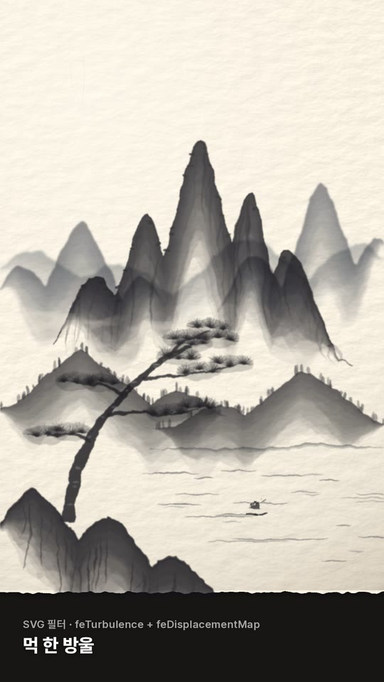</a><br><a href="skills/aimotion/demos/01-svg-ink/NOTES.md"><b>01</b> 먹 한 방울</a><br><sub>SVG 필터 · feTurbulence + feDisplacementMap</sub></td>
<td align="center" valign="top" width="20%"><a href="https://kstost.github.io/cokacmotion/02-css-popup/">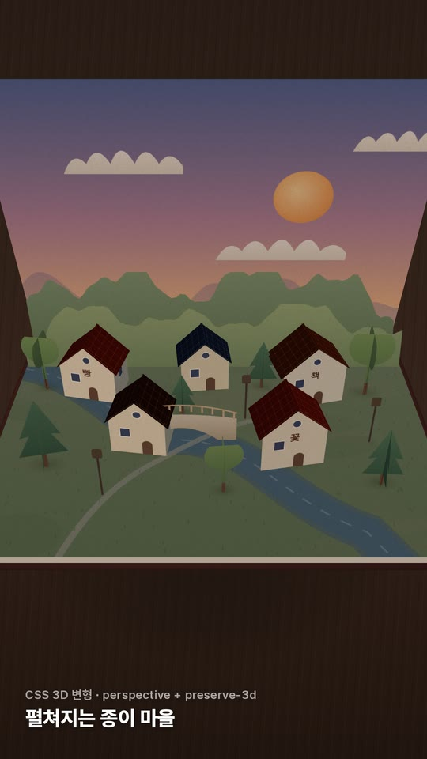</a><br><a href="skills/aimotion/demos/02-css-popup/NOTES.md"><b>02</b> 펼쳐지는 종이 마을</a><br><sub>CSS 3D 변형 · perspective + preserve-3d</sub></td>
<td align="center" valign="top" width="20%"><a href="https://kstost.github.io/cokacmotion/03-coral-growth/">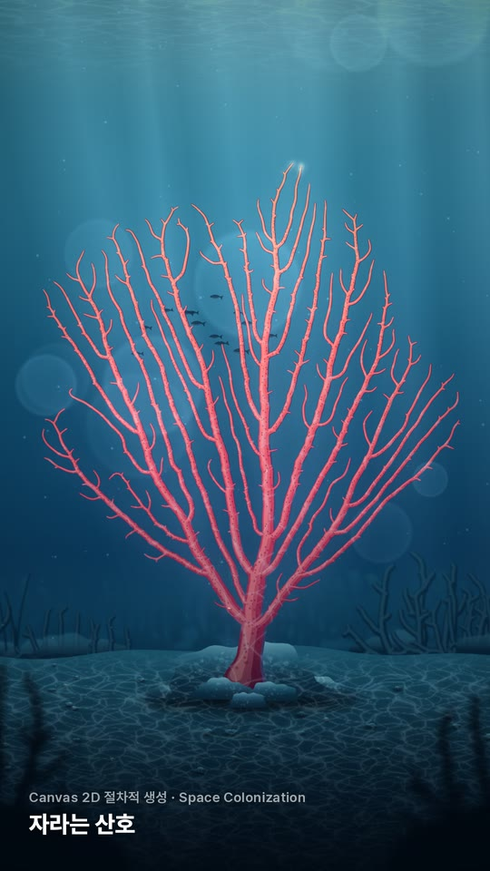</a><br><a href="skills/aimotion/demos/03-coral-growth/NOTES.md"><b>03</b> 자라는 산호</a><br><sub>Canvas 2D 절차적 생성 · Space Colonization</sub></td>
<td align="center" valign="top" width="20%"><a href="https://kstost.github.io/cokacmotion/05-fbm-nebula/">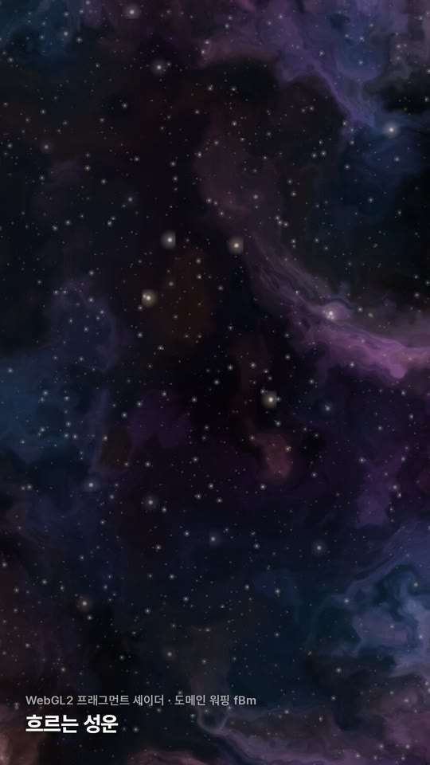</a><br><a href="skills/aimotion/demos/05-fbm-nebula/NOTES.md"><b>05</b> 흐르는 성운</a><br><sub>WebGL2 프래그먼트 셰이더 · 도메인 워핑 fBm</sub></td>
<td align="center" valign="top" width="20%"><a href="https://kstost.github.io/cokacmotion/06-aurora-raymarch/">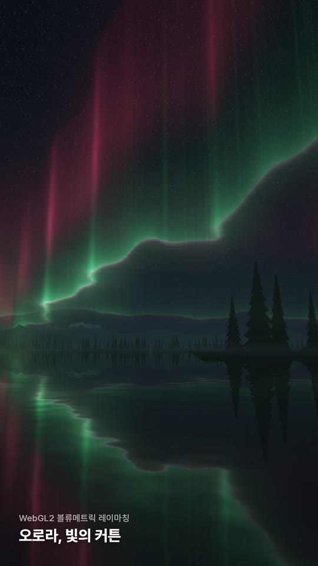</a><br><a href="skills/aimotion/demos/06-aurora-raymarch/NOTES.md"><b>06</b> 오로라, 빛의 커튼</a><br><sub>WebGL2 볼류메트릭 레이마칭</sub></td>
</tr>
<tr>
<td align="center" valign="top" width="20%"><a href="https://kstost.github.io/cokacmotion/07-sdf-planet/">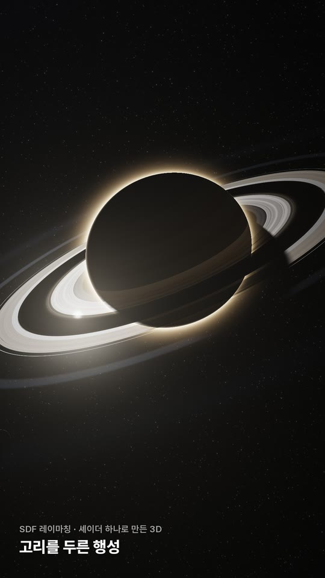</a><br><a href="skills/aimotion/demos/07-sdf-planet/NOTES.md"><b>07</b> 고리를 두른 행성</a><br><sub>SDF 레이마칭 · 셰이더 하나로 만든 3D</sub></td>
<td align="center" valign="top" width="20%"><a href="https://kstost.github.io/cokacmotion/08-caustics/">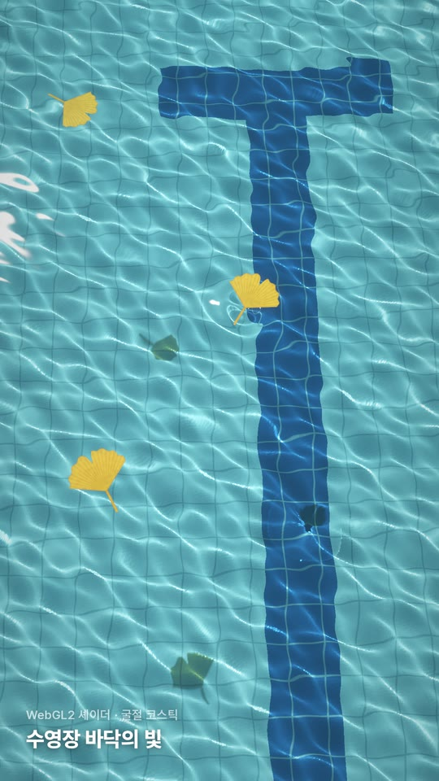</a><br><a href="skills/aimotion/demos/08-caustics/NOTES.md"><b>08</b> 수영장 바닥의 빛</a><br><sub>WebGL2 셰이더 · 굴절 코스틱</sub></td>
<td align="center" valign="top" width="20%"><a href="https://kstost.github.io/cokacmotion/09-gpu-galaxy/">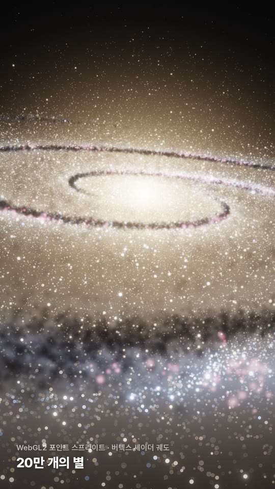</a><br><a href="skills/aimotion/demos/09-gpu-galaxy/NOTES.md"><b>09</b> 20만 개의 별</a><br><sub>WebGL2 포인트 스프라이트 · 버텍스 셰이더 궤도</sub></td>
<td align="center" valign="top" width="20%"><a href="https://kstost.github.io/cokacmotion/10-curl-flow/">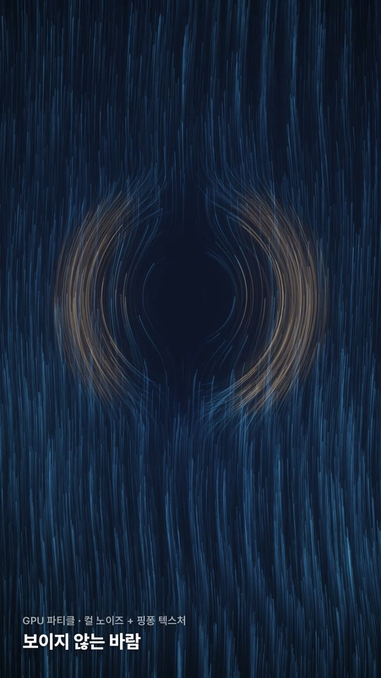</a><br><a href="skills/aimotion/demos/10-curl-flow/NOTES.md"><b>10</b> 보이지 않는 바람</a><br><sub>GPU 파티클 · 컬 노이즈 + 핑퐁 텍스처</sub></td>
<td align="center" valign="top" width="20%"><a href="https://kstost.github.io/cokacmotion/11-reaction-diffusion/">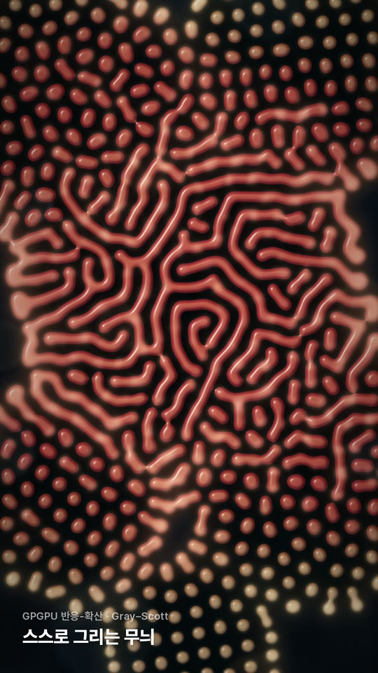</a><br><a href="skills/aimotion/demos/11-reaction-diffusion/NOTES.md"><b>11</b> 스스로 그리는 무늬</a><br><sub>GPGPU 반응-확산 · Gray–Scott</sub></td>
</tr>
<tr>
<td align="center" valign="top" width="20%"><a href="https://kstost.github.io/cokacmotion/12-stable-fluids/">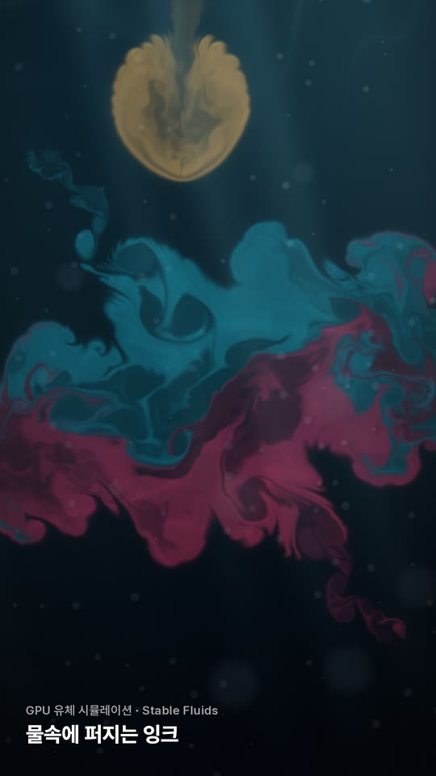</a><br><a href="skills/aimotion/demos/12-stable-fluids/NOTES.md"><b>12</b> 물속에 퍼지는 잉크</a><br><sub>GPU 유체 시뮬레이션 · Stable Fluids</sub></td>
<td align="center" valign="top" width="20%"><a href="https://kstost.github.io/cokacmotion/13-glass-jellyfish/">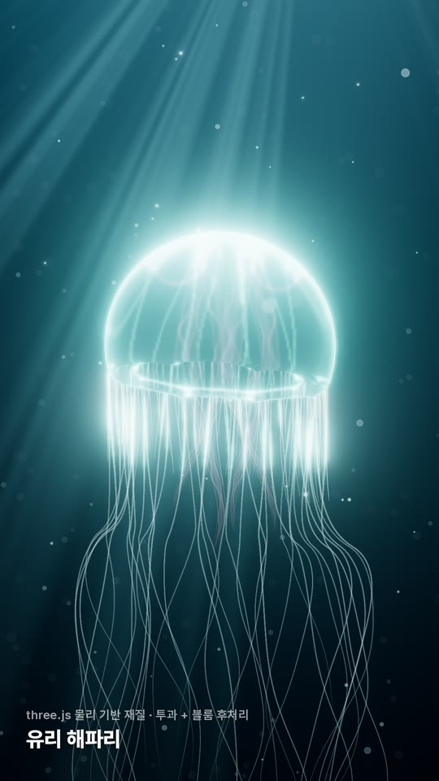</a><br><a href="skills/aimotion/demos/13-glass-jellyfish/NOTES.md"><b>13</b> 유리 해파리</a><br><sub>three.js 물리 기반 재질 · 투과 + 블룸 후처리</sub></td>
<td align="center" valign="top" width="20%"><a href="https://kstost.github.io/cokacmotion/14-instanced-coral/">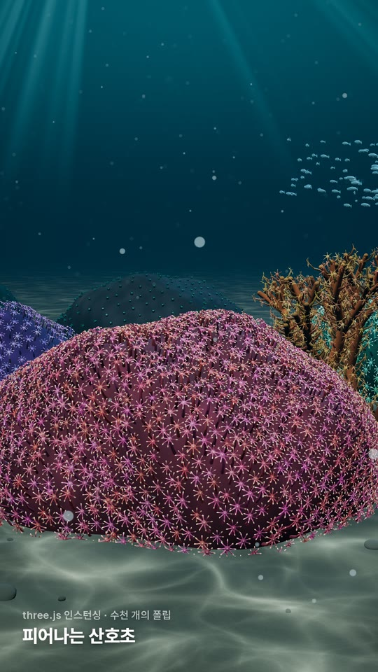</a><br><a href="skills/aimotion/demos/14-instanced-coral/NOTES.md"><b>14</b> 피어나는 산호초</a><br><sub>three.js 인스턴싱 · 수천 개의 폴립</sub></td>
<td align="center" valign="top" width="20%"><a href="https://kstost.github.io/cokacmotion/17-hangul-particles/">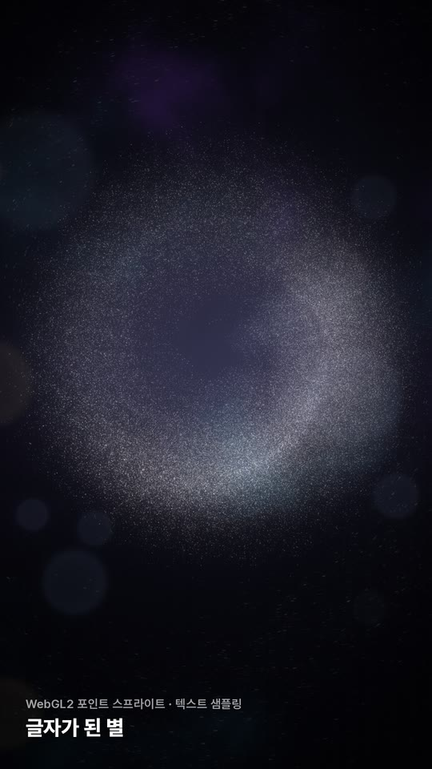</a><br><a href="skills/aimotion/demos/17-hangul-particles/NOTES.md"><b>17</b> 글자가 된 별</a><br><sub>WebGL2 포인트 스프라이트 · 텍스트 샘플링</sub></td>
</tr>
</table>

### 아날로그 표현 · 19편

수채화·유화·판화·필름·목탄·붓글씨·암실·활판·자수·네온 — 재료와 매체의 질감을 코드로

<table>
<tr>
<td align="center" valign="top" width="20%"><a href="https://kstost.github.io/cokacmotion/18-watercolor/">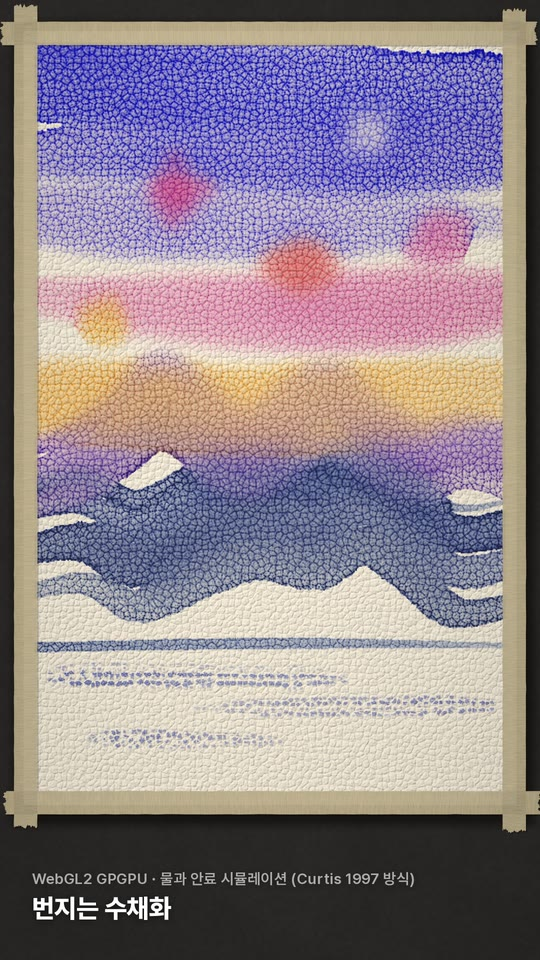</a><br><a href="skills/aimotion/demos/18-watercolor/NOTES.md"><b>18</b> 번지는 수채화</a><br><sub>WebGL2 GPGPU · 물과 안료 시뮬레이션 (Curtis 1997 방식)</sub></td>
<td align="center" valign="top" width="20%"><a href="https://kstost.github.io/cokacmotion/19-impasto/">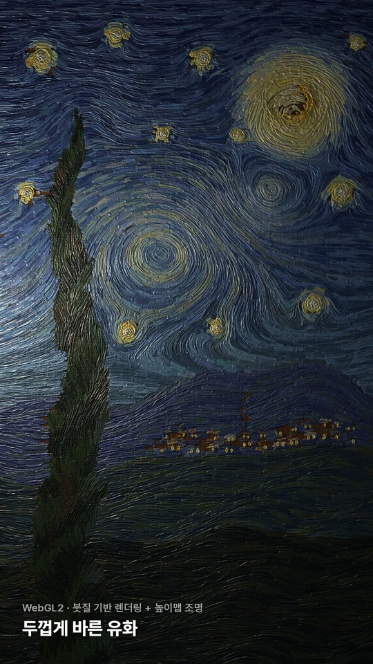</a><br><a href="skills/aimotion/demos/19-impasto/NOTES.md"><b>19</b> 두껍게 바른 유화</a><br><sub>WebGL2 · 붓질 기반 렌더링 + 높이맵 조명</sub></td>
<td align="center" valign="top" width="20%"><a href="https://kstost.github.io/cokacmotion/20-woodcut/">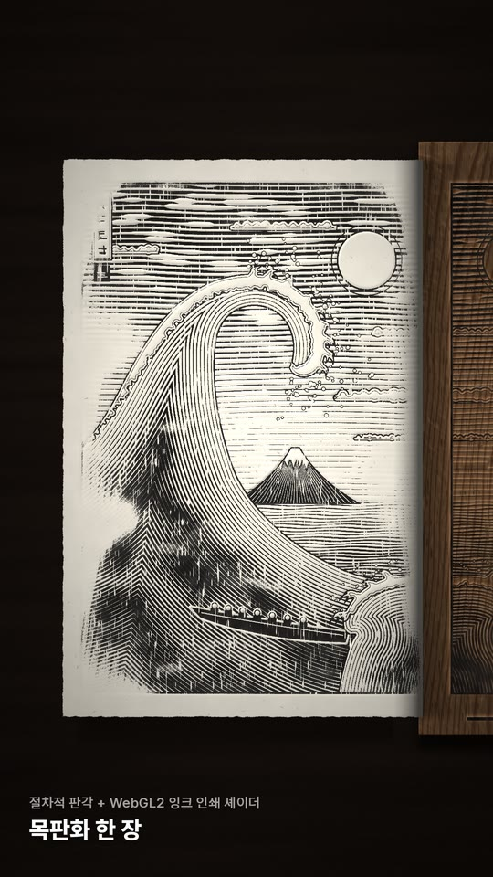</a><br><a href="skills/aimotion/demos/20-woodcut/NOTES.md"><b>20</b> 목판화 한 장</a><br><sub>절차적 판각 + WebGL2 잉크 인쇄 셰이더</sub></td>
<td align="center" valign="top" width="20%"><a href="https://kstost.github.io/cokacmotion/21-risograph/">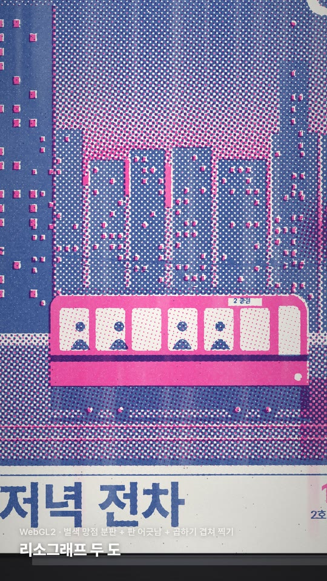</a><br><a href="skills/aimotion/demos/21-risograph/NOTES.md"><b>21</b> 리소그래프 두 도</a><br><sub>WebGL2 · 별색 망점 분판 + 판 어긋남 + 곱하기 겹쳐 찍기</sub></td>
<td align="center" valign="top" width="20%"><a href="https://kstost.github.io/cokacmotion/22-super8/">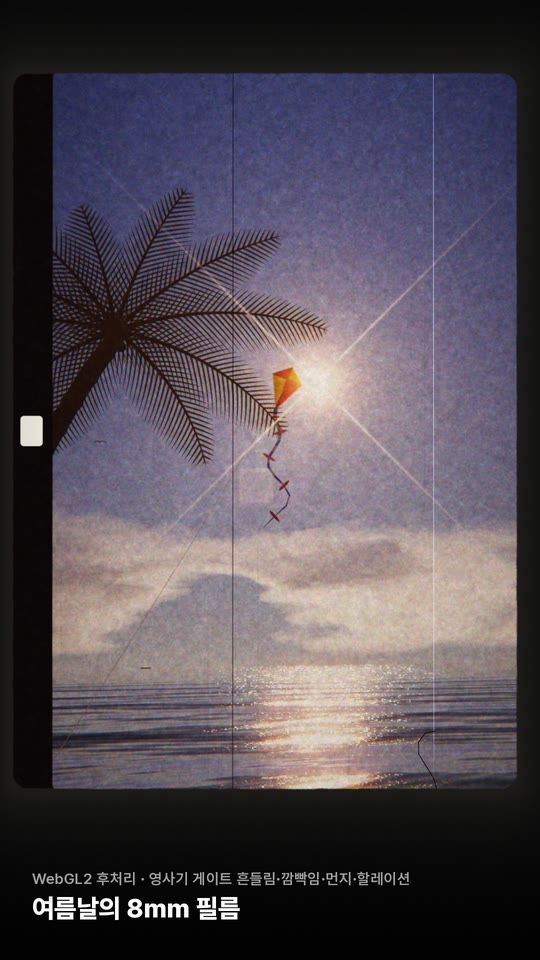</a><br><a href="skills/aimotion/demos/22-super8/NOTES.md"><b>22</b> 여름날의 8mm 필름</a><br><sub>WebGL2 후처리 · 영사기 게이트 흔들림·깜빡임·먼지·할레이션</sub></td>
</tr>
<tr>
<td align="center" valign="top" width="20%"><a href="https://kstost.github.io/cokacmotion/23-vhs/">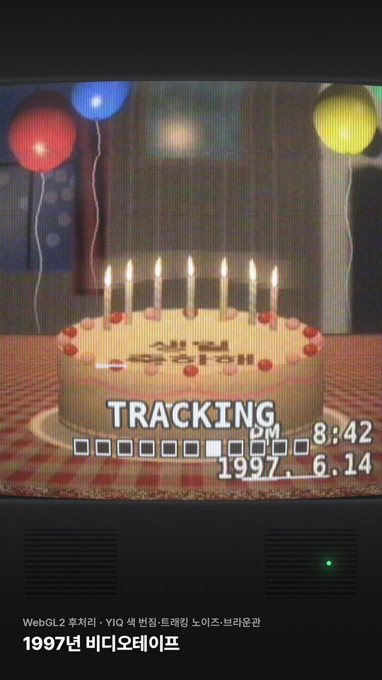</a><br><a href="skills/aimotion/demos/23-vhs/NOTES.md"><b>23</b> 1997년 비디오테이프</a><br><sub>WebGL2 후처리 · YIQ 색 번짐·트래킹 노이즈·브라운관</sub></td>
<td align="center" valign="top" width="20%"><a href="https://kstost.github.io/cokacmotion/24-paper-stopmotion/">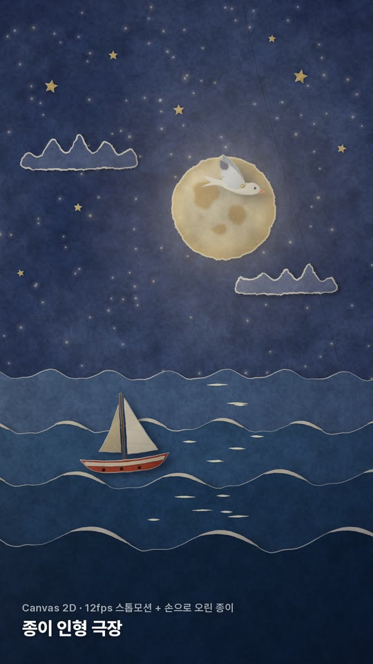</a><br><a href="skills/aimotion/demos/24-paper-stopmotion/NOTES.md"><b>24</b> 종이 인형 극장</a><br><sub>Canvas 2D · 12fps 스톱모션 + 손으로 오린 종이</sub></td>
<td align="center" valign="top" width="20%"><a href="https://kstost.github.io/cokacmotion/25-charcoal/">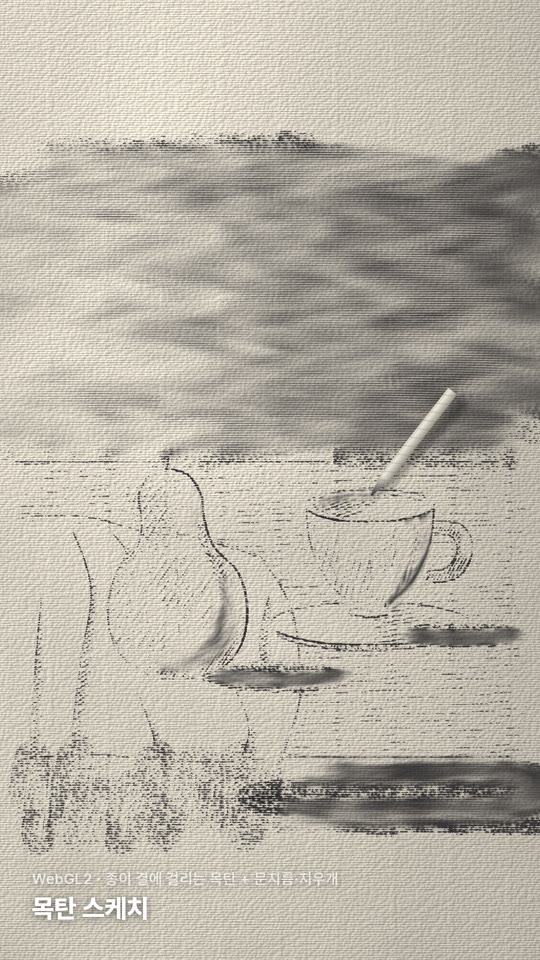</a><br><a href="skills/aimotion/demos/25-charcoal/NOTES.md"><b>25</b> 목탄 스케치</a><br><sub>WebGL2 · 종이 결에 걸리는 목탄 + 문지름·지우개</sub></td>
<td align="center" valign="top" width="20%"><a href="https://kstost.github.io/cokacmotion/26-engraving/">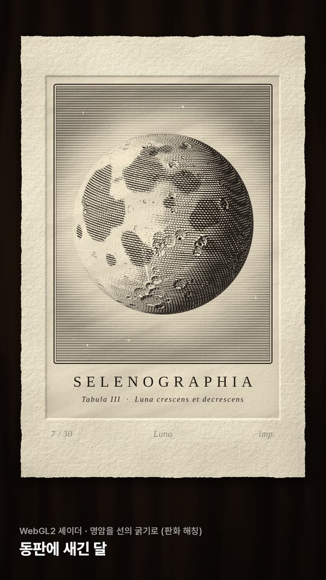</a><br><a href="skills/aimotion/demos/26-engraving/NOTES.md"><b>26</b> 동판에 새긴 달</a><br><sub>WebGL2 셰이더 · 명암을 선의 굵기로 (판화 해칭)</sub></td>
<td align="center" valign="top" width="20%"><a href="https://kstost.github.io/cokacmotion/27-marbling/">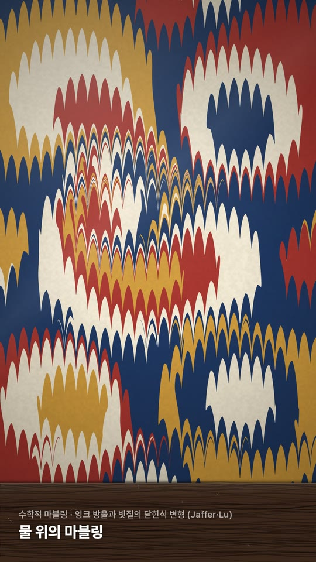</a><br><a href="skills/aimotion/demos/27-marbling/NOTES.md"><b>27</b> 물 위의 마블링</a><br><sub>수학적 마블링 · 잉크 방울과 빗질의 닫힌식 변형 (Jaffer·Lu)</sub></td>
</tr>
<tr>
<td align="center" valign="top" width="20%"><a href="https://kstost.github.io/cokacmotion/42-calligraphy/">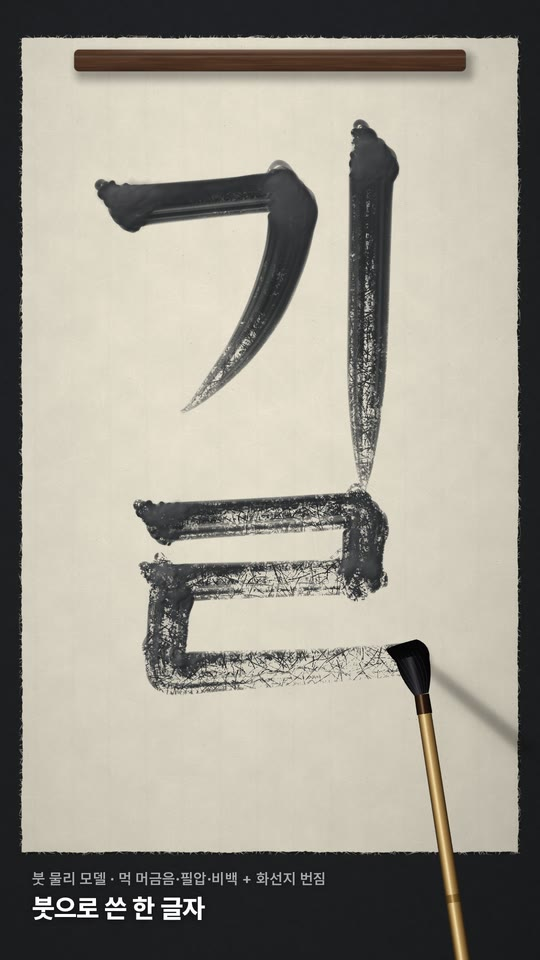</a><br><a href="skills/aimotion/demos/42-calligraphy/NOTES.md"><b>42</b> 붓으로 쓴 한 글자</a><br><sub>붓 물리 모델 · 먹 머금음·필압·비백 + 화선지 번짐</sub></td>
<td align="center" valign="top" width="20%"><a href="https://kstost.github.io/cokacmotion/43-darkroom/">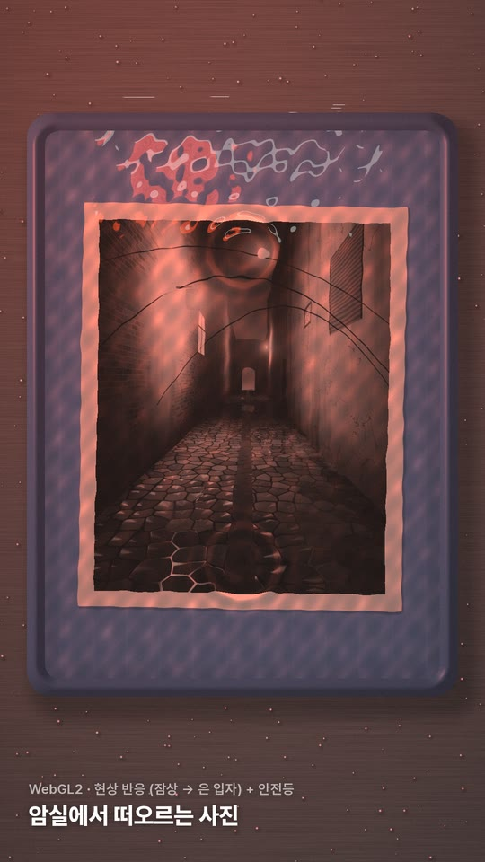</a><br><a href="skills/aimotion/demos/43-darkroom/NOTES.md"><b>43</b> 암실에서 떠오르는 사진</a><br><sub>WebGL2 · 현상 반응 (잠상 → 은 입자) + 안전등</sub></td>
<td align="center" valign="top" width="20%"><a href="https://kstost.github.io/cokacmotion/44-polaroid/">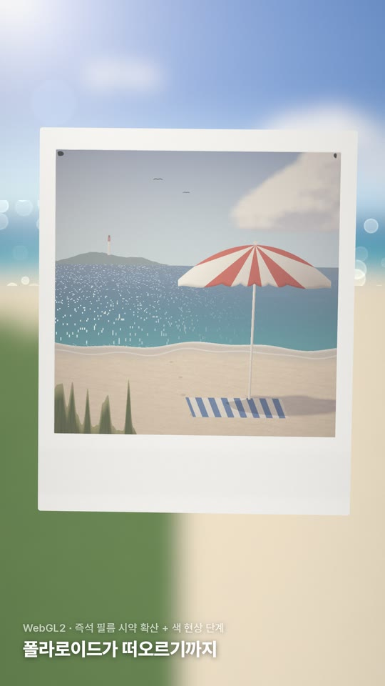</a><br><a href="skills/aimotion/demos/44-polaroid/NOTES.md"><b>44</b> 폴라로이드가 떠오르기까지</a><br><sub>WebGL2 · 즉석 필름 시약 확산 + 색 현상 단계</sub></td>
<td align="center" valign="top" width="20%"><a href="https://kstost.github.io/cokacmotion/45-stained-glass/">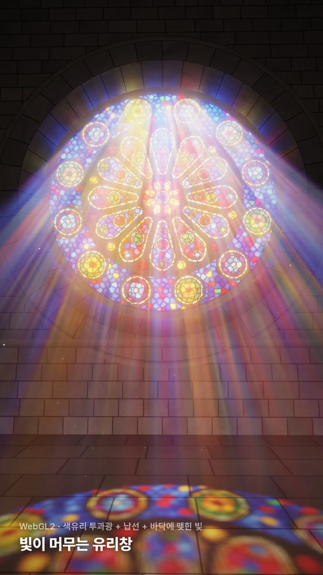</a><br><a href="skills/aimotion/demos/45-stained-glass/NOTES.md"><b>45</b> 빛이 머무는 유리창</a><br><sub>WebGL2 · 색유리 투과광 + 납선 + 바닥에 맺힌 빛</sub></td>
<td align="center" valign="top" width="20%"><a href="https://kstost.github.io/cokacmotion/46-letterpress/">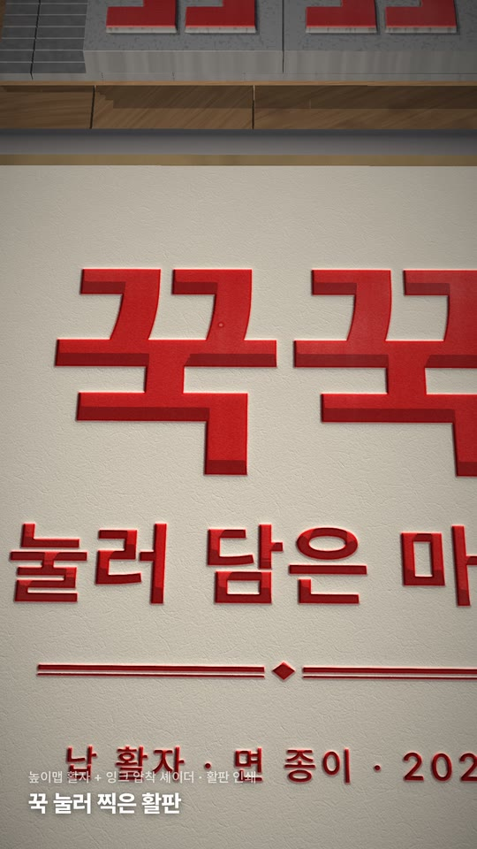</a><br><a href="skills/aimotion/demos/46-letterpress/NOTES.md"><b>46</b> 꾹 눌러 찍은 활판</a><br><sub>높이맵 활자 + 잉크 압착 셰이더 · 활판 인쇄</sub></td>
</tr>
<tr>
<td align="center" valign="top" width="20%"><a href="https://kstost.github.io/cokacmotion/47-embroidery/">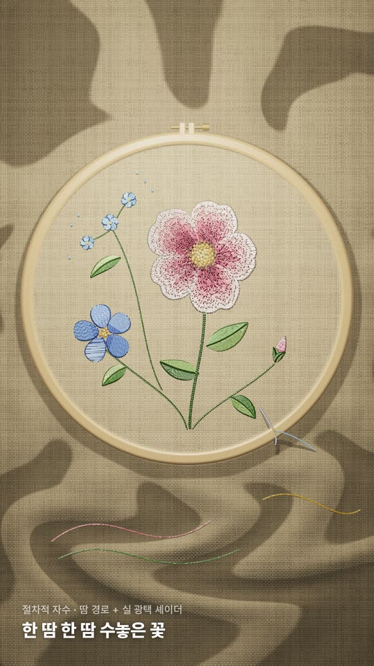</a><br><a href="skills/aimotion/demos/47-embroidery/NOTES.md"><b>47</b> 한 땀 한 땀 수놓은 꽃</a><br><sub>절차적 자수 · 땀 경로 + 실 광택 셰이더</sub></td>
<td align="center" valign="top" width="20%"><a href="https://kstost.github.io/cokacmotion/48-scratch-art/">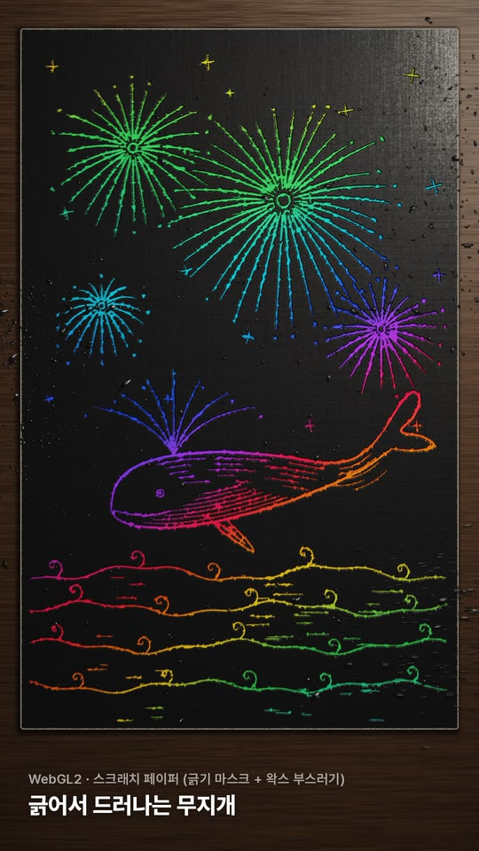</a><br><a href="skills/aimotion/demos/48-scratch-art/NOTES.md"><b>48</b> 긁어서 드러나는 무지개</a><br><sub>WebGL2 · 스크래치 페이퍼 (긁기 마스크 + 왁스 부스러기)</sub></td>
<td align="center" valign="top" width="20%"><a href="https://kstost.github.io/cokacmotion/49-zoetrope/">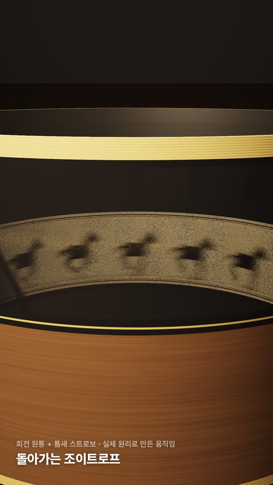</a><br><a href="skills/aimotion/demos/49-zoetrope/NOTES.md"><b>49</b> 돌아가는 조이트로프</a><br><sub>회전 원통 + 틈새 스트로보 · 실제 원리로 만든 움직임</sub></td>
<td align="center" valign="top" width="20%"><a href="https://kstost.github.io/cokacmotion/50-neon/">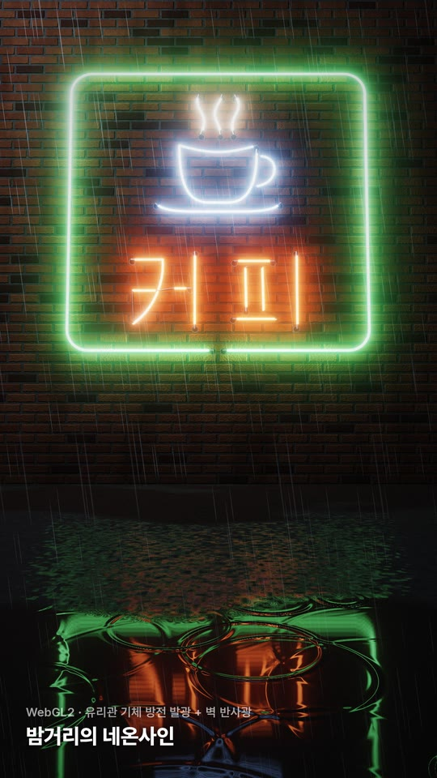</a><br><a href="skills/aimotion/demos/50-neon/NOTES.md"><b>50</b> 밤거리의 네온사인</a><br><sub>WebGL2 · 유리관 기체 방전 발광 + 벽 반사광</sub></td>
</tr>
</table>

### 웹 플랫폼 기술 · 3편

WebGPU 컴퓨트, Web Audio 분석, 가변 폰트 축 — 라이브러리 없이 브라우저 API로

<table>
<tr>
<td align="center" valign="top" width="20%"><a href="https://kstost.github.io/cokacmotion/28-webgpu-particles/">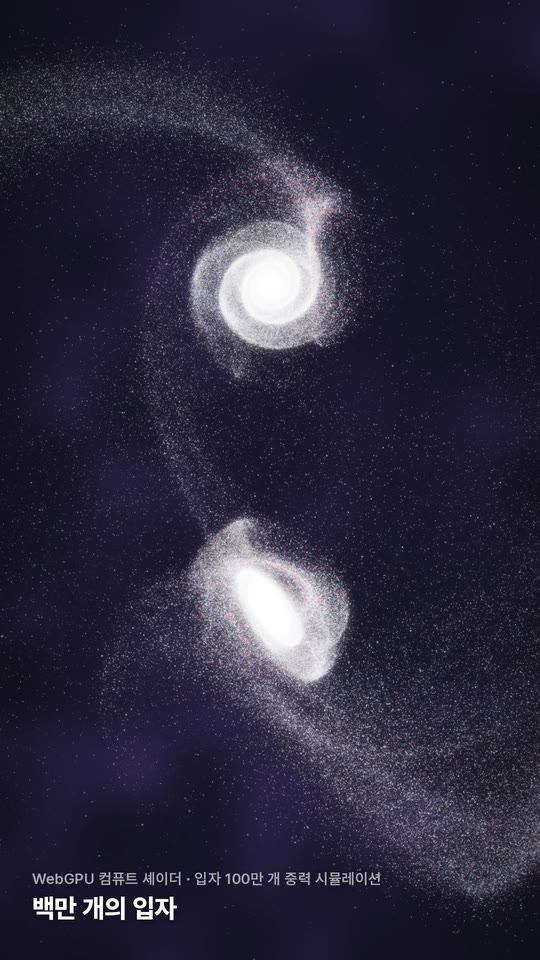</a><br><a href="skills/aimotion/demos/28-webgpu-particles/NOTES.md"><b>28</b> 백만 개의 입자</a><br><sub>WebGPU 컴퓨트 셰이더 · 입자 100만 개 중력 시뮬레이션</sub></td>
<td align="center" valign="top" width="20%"><a href="https://kstost.github.io/cokacmotion/29-audio-sync/">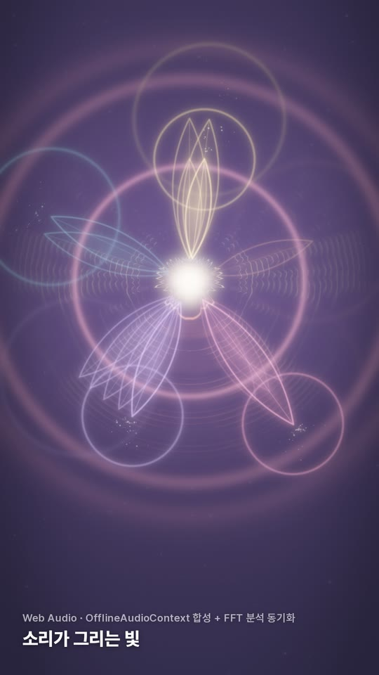</a><br><a href="skills/aimotion/demos/29-audio-sync/NOTES.md"><b>29</b> 소리가 그리는 빛</a><br><sub>Web Audio · OfflineAudioContext 합성 + FFT 분석 동기화</sub></td>
<td align="center" valign="top" width="20%"><a href="https://kstost.github.io/cokacmotion/30-kinetic-type/">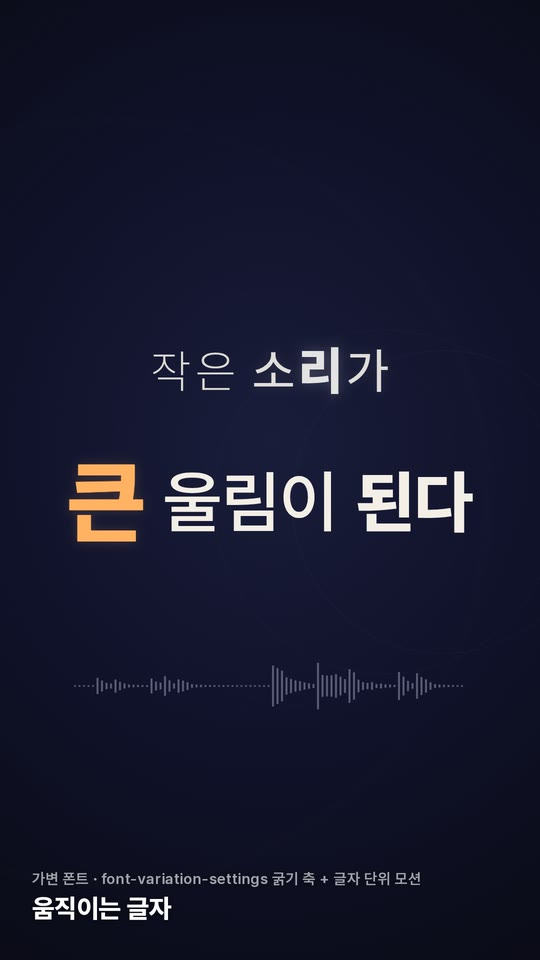</a><br><a href="skills/aimotion/demos/30-kinetic-type/NOTES.md"><b>30</b> 움직이는 글자</a><br><sub>가변 폰트 · font-variation-settings 굵기 축 + 글자 단위 모션</sub></td>
</tr>
</table>

### 자연 현상 · 광학 · 수학 · 9편

바다·구름·침식·천·군집, 빛의 간섭과 분산, 프랙털 딥 줌

<table>
<tr>
<td align="center" valign="top" width="20%"><a href="https://kstost.github.io/cokacmotion/33-ocean/">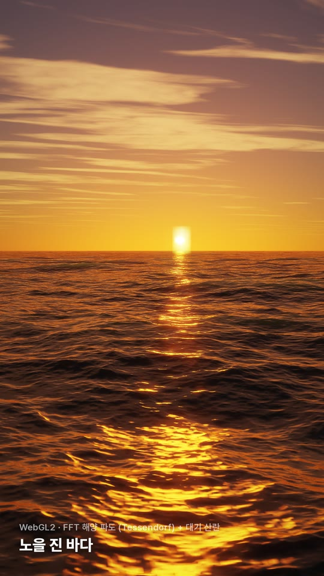</a><br><a href="skills/aimotion/demos/33-ocean/NOTES.md"><b>33</b> 노을 진 바다</a><br><sub>WebGL2 · FFT 해양 파도 (Tessendorf) + 대기 산란</sub></td>
<td align="center" valign="top" width="20%"><a href="https://kstost.github.io/cokacmotion/34-clouds/">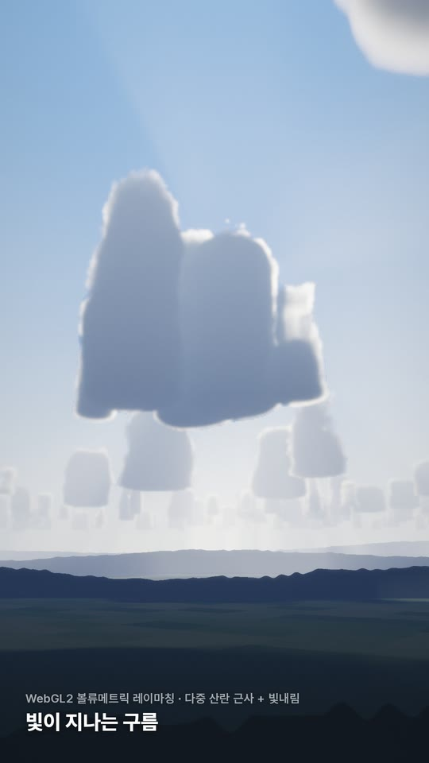</a><br><a href="skills/aimotion/demos/34-clouds/NOTES.md"><b>34</b> 빛이 지나는 구름</a><br><sub>WebGL2 볼류메트릭 레이마칭 · 다중 산란 근사 + 빛내림</sub></td>
<td align="center" valign="top" width="20%"><a href="https://kstost.github.io/cokacmotion/35-erosion/">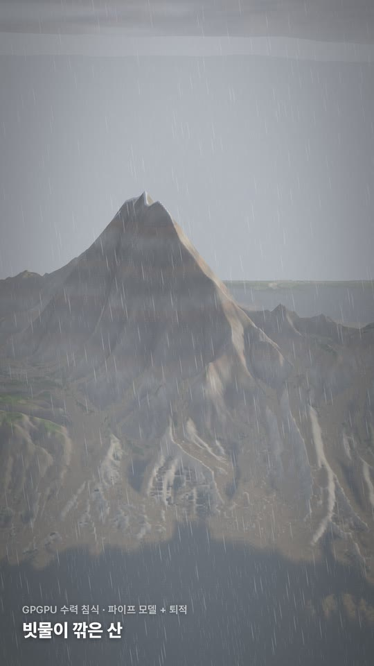</a><br><a href="skills/aimotion/demos/35-erosion/NOTES.md"><b>35</b> 빗물이 깎은 산</a><br><sub>GPGPU 수력 침식 · 파이프 모델 + 퇴적</sub></td>
<td align="center" valign="top" width="20%"><a href="https://kstost.github.io/cokacmotion/36-cloth/">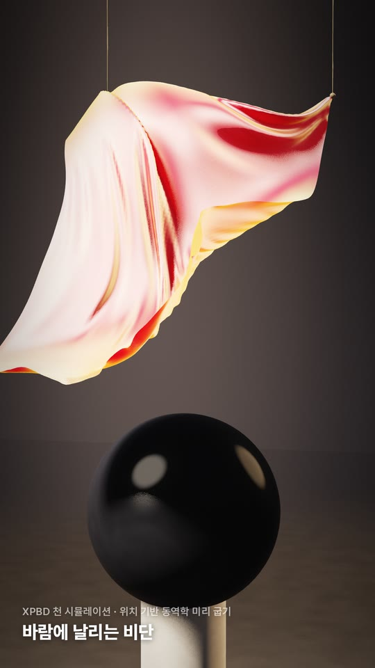</a><br><a href="skills/aimotion/demos/36-cloth/NOTES.md"><b>36</b> 바람에 날리는 비단</a><br><sub>XPBD 천 시뮬레이션 · 위치 기반 동역학 미리 굽기</sub></td>
<td align="center" valign="top" width="20%"><a href="https://kstost.github.io/cokacmotion/37-fracture/">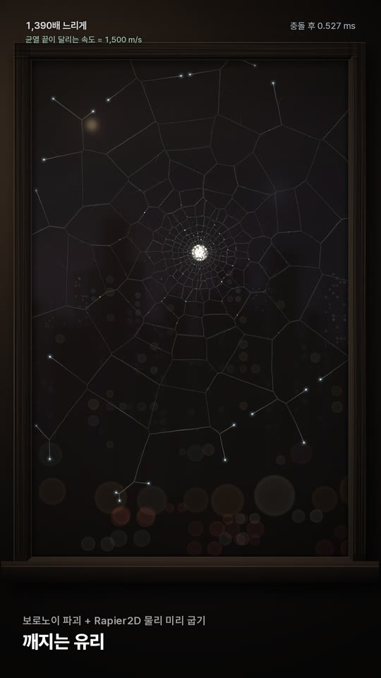</a><br><a href="skills/aimotion/demos/37-fracture/NOTES.md"><b>37</b> 깨지는 유리</a><br><sub>보로노이 파괴 + Rapier2D 물리 미리 굽기</sub></td>
</tr>
<tr>
<td align="center" valign="top" width="20%"><a href="https://kstost.github.io/cokacmotion/38-murmuration/">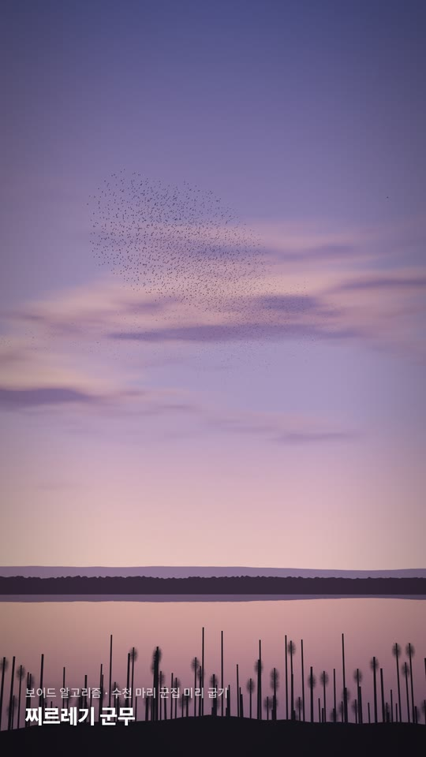</a><br><a href="skills/aimotion/demos/38-murmuration/NOTES.md"><b>38</b> 찌르레기 군무</a><br><sub>보이드 알고리즘 · 수천 마리 군집 미리 굽기</sub></td>
<td align="center" valign="top" width="20%"><a href="https://kstost.github.io/cokacmotion/39-thin-film/">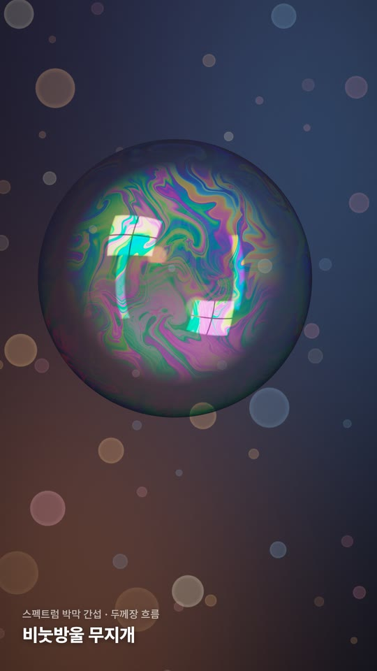</a><br><a href="skills/aimotion/demos/39-thin-film/NOTES.md"><b>39</b> 비눗방울 무지개</a><br><sub>스펙트럼 박막 간섭 · 두께장 흐름</sub></td>
<td align="center" valign="top" width="20%"><a href="https://kstost.github.io/cokacmotion/40-prism/">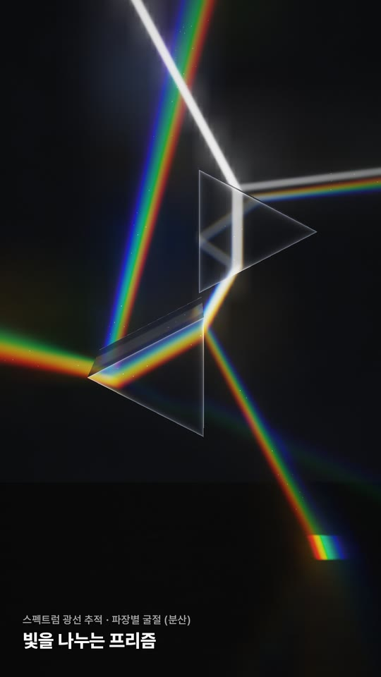</a><br><a href="skills/aimotion/demos/40-prism/NOTES.md"><b>40</b> 빛을 나누는 프리즘</a><br><sub>스펙트럼 광선 추적 · 파장별 굴절 (분산)</sub></td>
<td align="center" valign="top" width="20%"><a href="https://kstost.github.io/cokacmotion/41-deep-zoom/">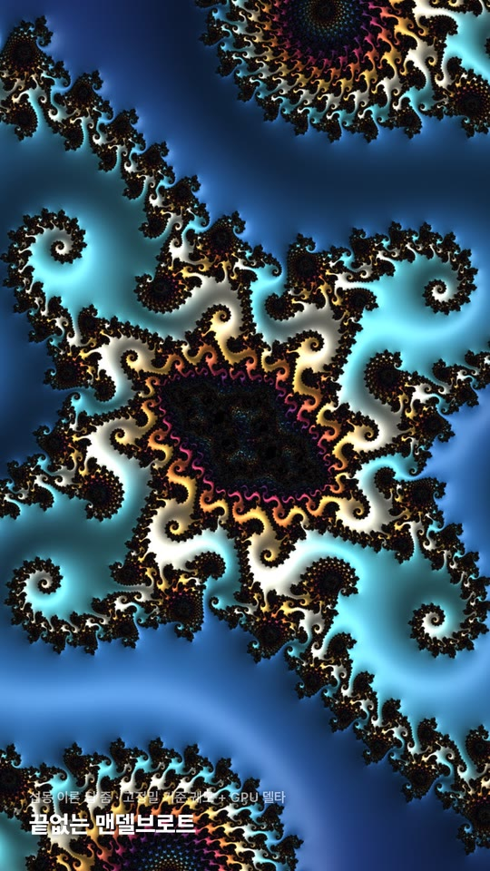</a><br><a href="skills/aimotion/demos/41-deep-zoom/NOTES.md"><b>41</b> 끝없는 맨델브로트</a><br><sub>섭동 이론 딥 줌 · 고정밀 기준 궤도 + GPU 델타</sub></td>
</tr>
</table>

### 실험 타이포그래피 · 21편

거리장·파라메트릭 글꼴·연체 물리·불·커스틱·점균·파동·모양 안 조판·슬릿스캔·스캐니메이션·레이저 각인·스텐실 — 글자에 시뮬레이션, 셰이더, 광학과 재료의 원리를 건 실험

<table>
<tr>
<td align="center" valign="top" width="20%"><a href="https://kstost.github.io/cokacmotion/51-topo-type/">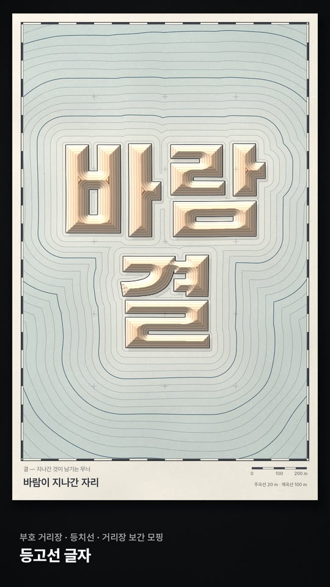</a><br><a href="skills/aimotion/demos/51-topo-type/NOTES.md"><b>51</b> 등고선 글자</a><br><sub>부호 거리장 · 등치선 · 거리장 보간 모핑</sub></td>
<td align="center" valign="top" width="20%"><a href="https://kstost.github.io/cokacmotion/52-parametric-hangul/">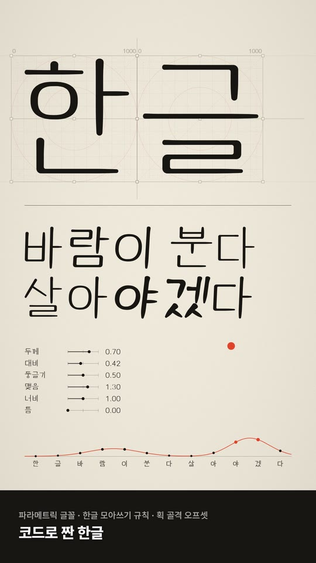</a><br><a href="skills/aimotion/demos/52-parametric-hangul/NOTES.md"><b>52</b> 코드로 짠 한글</a><br><sub>파라메트릭 글꼴 · 한글 모아쓰기 규칙 · 획 골격 오프셋</sub></td>
<td align="center" valign="top" width="20%"><a href="https://kstost.github.io/cokacmotion/53-swiss-grid/">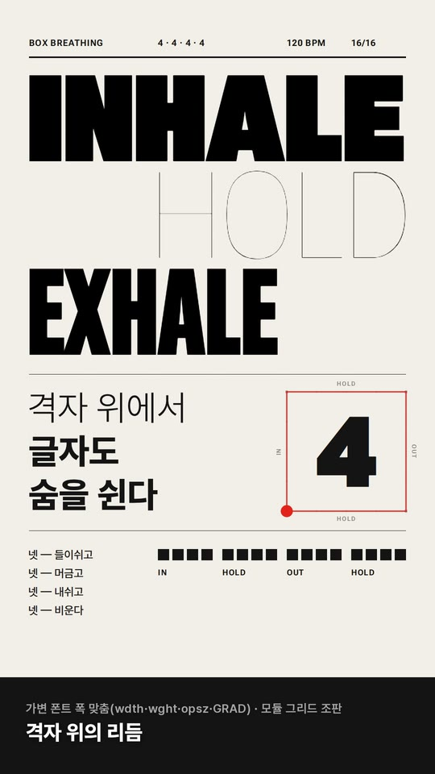</a><br><a href="skills/aimotion/demos/53-swiss-grid/NOTES.md"><b>53</b> 격자 위의 리듬</a><br><sub>가변 폰트 폭 맞춤(wdth·wght·opsz·GRAD) · 모듈 그리드 조판</sub></td>
<td align="center" valign="top" width="20%"><a href="https://kstost.github.io/cokacmotion/54-title-sequence/">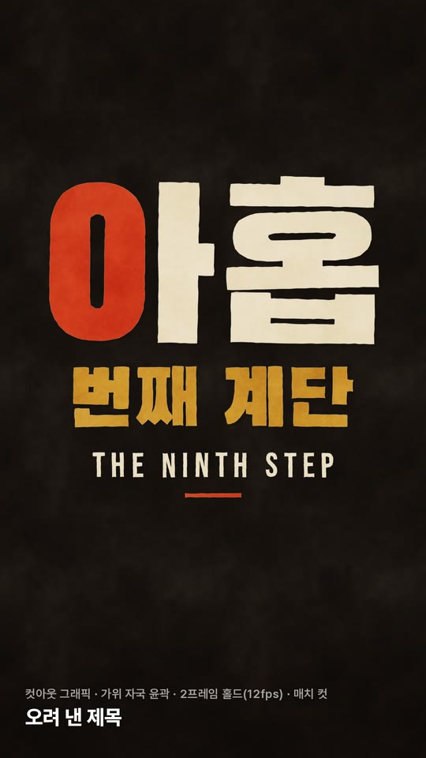</a><br><a href="skills/aimotion/demos/54-title-sequence/NOTES.md"><b>54</b> 오려 낸 제목</a><br><sub>컷아웃 그래픽 · 가위 자국 윤곽 · 2프레임 홀드(12fps) · 매치 컷</sub></td>
<td align="center" valign="top" width="20%"><a href="https://kstost.github.io/cokacmotion/55-truchet-type/">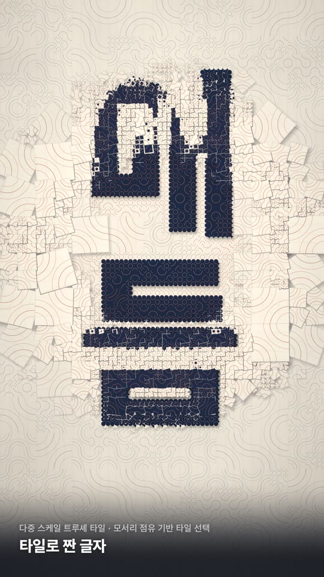</a><br><a href="skills/aimotion/demos/55-truchet-type/NOTES.md"><b>55</b> 타일로 짠 글자</a><br><sub>다중 스케일 트루셰 타일 · 모서리 점유 기반 타일 선택</sub></td>
</tr>
<tr>
<td align="center" valign="top" width="20%"><a href="https://kstost.github.io/cokacmotion/56-ribbon-text/"></a><br><a href="skills/aimotion/demos/56-ribbon-text/NOTES.md"><b>56</b> 글자의 강</a><br><sub>SDF 글리프 아틀라스 · 회전 최소화 프레임 위 글자 배치 · 인스턴싱 · 피사계 심도</sub></td>
<td align="center" valign="top" width="20%"><a href="https://kstost.github.io/cokacmotion/57-quilling-type/"></a><br><a href="skills/aimotion/demos/57-quilling-type/NOTES.md"><b>57</b> 종이 띠로 세운 글자</a><br><sub>글리프 윤곽 → 세운 종이 띠 · 말림이 풀리는 띠 · 부드러운 그림자</sub></td>
<td align="center" valign="top" width="20%"><a href="https://kstost.github.io/cokacmotion/58-pixel-sort/"></a><br><a href="skills/aimotion/demos/58-pixel-sort/NOTES.md"><b>58</b> 정렬된 소란</a><br><sub>GPU 픽셀 정렬(비토닉 정렬망) · 밝기 구간 분할 정렬 · 색수차</sub></td>
<td align="center" valign="top" width="20%"><a href="https://kstost.github.io/cokacmotion/59-glyph-mosaic/"></a><br><a href="skills/aimotion/demos/59-glyph-mosaic/NOTES.md"><b>59</b> 글자로 빚은 등대</a><br><sub>9단 굵기 글리프 SDF 아틀라스 · 휘도→굵기 하프톤 · 레이마칭 장면</sub></td>
<td align="center" valign="top" width="20%"><a href="https://kstost.github.io/cokacmotion/60-jelly-type/"></a><br><a href="skills/aimotion/demos/60-jelly-type/NOTES.md"><b>60</b> 말랑한 글자</a><br><sub>XPBD 연체(거리·면적 제약) · 글리프 외곽선 삼각분할 · 충돌</sub></td>
</tr>
<tr>
<td align="center" valign="top" width="20%"><a href="https://kstost.github.io/cokacmotion/61-shadow-type/"></a><br><a href="skills/aimotion/demos/61-shadow-type/NOTES.md"><b>61</b> 그림자로 읽는 글자</a><br><sub>두 글자 돌출의 교집합(투영 조형) · 다중 광원 그림자</sub></td>
<td align="center" valign="top" width="20%"><a href="https://kstost.github.io/cokacmotion/62-fogged-glass/"></a><br><a href="skills/aimotion/demos/62-fogged-glass/NOTES.md"><b>62</b> 김 서린 창</a><br><sub>김 밀도장 · 물방울 입자(병합·흘러내림) · 굴절 법선 맵 · 보케</sub></td>
<td align="center" valign="top" width="20%"><a href="https://kstost.github.io/cokacmotion/63-burning-type/"></a><br><a href="skills/aimotion/demos/63-burning-type/NOTES.md"><b>63</b> 타고 남은 글자</a><br><sub>도착 시간장(16방향 다익스트라) · 불꽃 전선 셰이딩(흑체 색) · 불씨 입자</sub></td>
<td align="center" valign="top" width="20%"><a href="https://kstost.github.io/cokacmotion/64-caustic-type/"></a><br><a href="skills/aimotion/demos/64-caustic-type/NOTES.md"><b>64</b> 빛으로 쓴 글자</a><br><sub>역설계 커스틱(최적 수송·포아송 반복) · 광자 메시 래스터화 · 분산</sub></td>
<td align="center" valign="top" width="20%"><a href="https://kstost.github.io/cokacmotion/65-physarum-type/"></a><br><a href="skills/aimotion/demos/65-physarum-type/NOTES.md"><b>65</b> 점균이 쓴 글자</a><br><sub>Physarum 에이전트(감지·회전·이동·침착) · 확산·감쇠 · 먹이장</sub></td>
</tr>
<tr>
<td align="center" valign="top" width="20%"><a href="https://kstost.github.io/cokacmotion/66-rain-poem/"></a><br><a href="skills/aimotion/demos/66-rain-poem/NOTES.md"><b>66</b> 빗속의 시</a><br><sub>GPU 2D 파동 방정식 · 굴절 · 프레넬 반사 · 수면 커스틱</sub></td>
<td align="center" valign="top" width="20%"><a href="https://kstost.github.io/cokacmotion/141-shape-text/"></a><br><a href="skills/aimotion/demos/141-shape-text/NOTES.md"><b>141</b> 글로 그린 고래</a><br><sub>모양 안 조판 · 스캔라인 구간 + Knuth–Plass 줄 나누기 + 단어 재배치</sub></td>
<td align="center" valign="top" width="20%"><a href="https://kstost.github.io/cokacmotion/143-slit-scan/"></a><br><a href="skills/aimotion/demos/143-slit-scan/NOTES.md"><b>143</b> 기다림</a><br><sub>슬릿스캔 · 시간 변위 표본 (x, y, t 볼륨)</sub></td>
<td align="center" valign="top" width="20%"><a href="https://kstost.github.io/cokacmotion/144-scanimation/"></a><br><a href="skills/aimotion/demos/144-scanimation/NOTES.md"><b>144</b> 줄무늬 너머의 글자</a><br><sub>스캐니메이션 · 바리어 그리드 인터레이스 + 모아레 확대</sub></td>
<td align="center" valign="top" width="20%"><a href="https://kstost.github.io/cokacmotion/145-laser-engrave/"></a><br><a href="skills/aimotion/demos/145-laser-engrave/NOTES.md"><b>145</b> 나무에 새긴 이름</a><br><sub>레이저 각인 · 래스터 주사 + 머문 시간에 따른 탄 깊이 + 흑체 열 자국</sub></td>
</tr>
<tr>
<td align="center" valign="top" width="20%"><a href="https://kstost.github.io/cokacmotion/146-spray-stencil/"></a><br><a href="skills/aimotion/demos/146-spray-stencil/NOTES.md"><b>146</b> 벽에 뿌린 한마디</a><br><sub>스프레이 스텐실 · 가우스 분사 + 다리 있는 스텐실 + 흘러내림</sub></td>
</tr>
</table>

### GSAP · 6편

SplitText, MorphSVG, Flip, MotionPath — PixiJS·three.js와 함께

<table>
<tr>
<td align="center" valign="top" width="20%"><a href="https://kstost.github.io/cokacmotion/67-gsap-splittext/"></a><br><a href="skills/aimotion/demos/67-gsap-splittext/NOTES.md"><b>67</b> 글자가 입장하는 법</a><br><sub>GSAP SplitText · ScrambleText · CustomEase — 라인 마스크 · 글자 스태거 · 스크램블</sub></td>
<td align="center" valign="top" width="20%"><a href="https://kstost.github.io/cokacmotion/68-gsap-morphsvg/"></a><br><a href="skills/aimotion/demos/68-gsap-morphsvg/NOTES.md"><b>68</b> 모양의 여행</a><br><sub>GSAP MorphSVG · DrawSVG · MotionPath</sub></td>
<td align="center" valign="top" width="20%"><a href="https://kstost.github.io/cokacmotion/69-gsap-flip/"></a><br><a href="skills/aimotion/demos/69-gsap-flip/NOTES.md"><b>69</b> 다시 놓이는 것들</a><br><sub>GSAP Flip · FLIP 레이아웃 전환 · CSS 그리드/플렉스</sub></td>
<td align="center" valign="top" width="20%"><a href="https://kstost.github.io/cokacmotion/70-gsap-motionpath/"></a><br><a href="skills/aimotion/demos/70-gsap-motionpath/NOTES.md"><b>70</b> 종이비행기 편지</a><br><sub>GSAP MotionPath(캔버스 객체) · CustomWiggle · Physics2D</sub></td>
<td align="center" valign="top" width="20%"><a href="https://kstost.github.io/cokacmotion/71-gsap-pixi/"></a><br><a href="skills/aimotion/demos/71-gsap-pixi/NOTES.md"><b>71</b> 물결 넘김 포스터</a><br><sub>PixiJS 8 · DisplacementFilter · GSAP PixiPlugin</sub></td>
</tr>
<tr>
<td align="center" valign="top" width="20%"><a href="https://kstost.github.io/cokacmotion/72-gsap-three/"></a><br><a href="skills/aimotion/demos/72-gsap-three/NOTES.md"><b>72</b> 카메라 안무</a><br><sub>GSAP 타임라인 × three.js · 카메라 경로 · 장면 연출</sub></td>
</tr>
</table>

### 유명 라이브러리 · 14편

d3, rough.js, Rapier2D, anime.js, Motion, Lottie, p5.js, Paper.js, Zdog, matter-js, mo.js, Babylon.js, Tone.js

<table>
<tr>
<td align="center" valign="top" width="20%"><a href="https://kstost.github.io/cokacmotion/04-sketch-diagram/"></a><br><a href="skills/aimotion/demos/04-sketch-diagram/NOTES.md"><b>04</b> 손으로 그린 설명</a><br><sub>rough.js + perfect-freehand · 손그림 렌더링</sub></td>
<td align="center" valign="top" width="20%"><a href="https://kstost.github.io/cokacmotion/15-geo-globe/"></a><br><a href="skills/aimotion/demos/15-geo-globe/NOTES.md"><b>15</b> 지구 위를 나는 길</a><br><sub>d3-geo · 실제 해안선 + 정사영</sub></td>
<td align="center" valign="top" width="20%"><a href="https://kstost.github.io/cokacmotion/16-rapier-marbles/"></a><br><a href="skills/aimotion/demos/16-rapier-marbles/NOTES.md"><b>16</b> 쏟아지는 구슬</a><br><sub>Rapier2D (WebAssembly) 물리 · 미리 굽기</sub></td>
<td align="center" valign="top" width="20%"><a href="https://kstost.github.io/cokacmotion/32-dataviz-motion/"></a><br><a href="skills/aimotion/demos/32-dataviz-motion/NOTES.md"><b>32</b> 숫자가 움직일 때</a><br><sub>d3 · 데이터 전환 애니메이션 (막대 순위 → 산키 → 지도)</sub></td>
<td align="center" valign="top" width="20%"><a href="https://kstost.github.io/cokacmotion/73-anime-stagger/"></a><br><a href="skills/aimotion/demos/73-anime-stagger/NOTES.md"><b>73</b> 점들의 합창</a><br><sub>anime.js 4 · 그리드 스태거 · SVG 드로잉/모프</sub></td>
</tr>
<tr>
<td align="center" valign="top" width="20%"><a href="https://kstost.github.io/cokacmotion/74-motion-spring/"></a><br><a href="skills/aimotion/demos/74-motion-spring/NOTES.md"><b>74</b> 알림이 내려앉을 때</a><br><sub>Motion(motion.dev) · 스프링 물리 · 수동 시계 seek</sub></td>
<td align="center" valign="top" width="20%"><a href="https://kstost.github.io/cokacmotion/75-lottie-code/"></a><br><a href="skills/aimotion/demos/75-lottie-code/NOTES.md"><b>75</b> 코드로 쓴 로티</a><br><sub>lottie-web · 트림 패스 · 리피터 · 매트 · 셰이프 모프 (JSON을 코드로 작성)</sub></td>
<td align="center" valign="top" width="20%"><a href="https://kstost.github.io/cokacmotion/76-p5-tree/"></a><br><a href="skills/aimotion/demos/76-p5-tree/NOTES.md"><b>76</b> 바람 부는 나무</a><br><sub>p5.js · 재귀 가지치기 · noise 바람 · 인스턴스 모드</sub></td>
<td align="center" valign="top" width="20%"><a href="https://kstost.github.io/cokacmotion/77-paper-boolean/"></a><br><a href="skills/aimotion/demos/77-paper-boolean/NOTES.md"><b>77</b> 오리고 붙인 풍경</a><br><sub>Paper.js · 불리언 연산(unite/subtract/intersect) · 경로 스무딩</sub></td>
<td align="center" valign="top" width="20%"><a href="https://kstost.github.io/cokacmotion/78-zdog-planet/"></a><br><a href="skills/aimotion/demos/78-zdog-planet/NOTES.md"><b>78</b> 작은 행성</a><br><sub>Zdog · 평면 의사 3D 일러스트 · 팔레트 낮/밤 전환</sub></td>
</tr>
<tr>
<td align="center" valign="top" width="20%"><a href="https://kstost.github.io/cokacmotion/79-matter-galton/"></a><br><a href="skills/aimotion/demos/79-matter-galton/NOTES.md"><b>79</b> 갈톤 보드</a><br><sub>matter-js 강체 물리 · 고정 dt 굽기 · 이항분포 → 정규분포</sub></td>
<td align="center" valign="top" width="20%"><a href="https://kstost.github.io/cokacmotion/80-mojs-burst/"></a><br><a href="skills/aimotion/demos/80-mojs-burst/NOTES.md"><b>80</b> 축하의 순간</a><br><sub>mo.js · Burst · Shape · ShapeSwirl · Html · Timeline.setProgress</sub></td>
<td align="center" valign="top" width="20%"><a href="https://kstost.github.io/cokacmotion/81-babylon-greenhouse/"></a><br><a href="skills/aimotion/demos/81-babylon-greenhouse/NOTES.md"><b>81</b> 아침의 온실</a><br><sub>Babylon.js · PBR 유리 · 그림자 생성기(PCF) · GlowLayer · 부피광 산란</sub></td>
<td align="center" valign="top" width="20%"><a href="https://kstost.github.io/cokacmotion/82-tone-shapes/"></a><br><a href="skills/aimotion/demos/82-tone-shapes/NOTES.md"><b>82</b> 소리가 그린 도형</a><br><sub>Tone.js(오프라인 합성) · 악보 기반 모션 · GSAP 타임라인 · SVG</sub></td>
</tr>
</table>

### 웹 네이티브 애니메이션 · 3편

CSS @keyframes, SVG SMIL, 스크롤 기반 애니메이션

<table>
<tr>
<td align="center" valign="top" width="20%"><a href="https://kstost.github.io/cokacmotion/83-css-keyframes/"></a><br><a href="skills/aimotion/demos/83-css-keyframes/NOTES.md"><b>83</b> CSS로만 그린 일출</a><br><sub>CSS @keyframes · @property · conic/radial-gradient · clip-path · mix-blend-mode</sub></td>
<td align="center" valign="top" width="20%"><a href="https://kstost.github.io/cokacmotion/84-svg-smil/"></a><br><a href="skills/aimotion/demos/84-svg-smil/NOTES.md"><b>84</b> 태엽 장치</a><br><sub>SVG SMIL(animateTransform · animateMotion · animate) · setCurrentTime</sub></td>
<td align="center" valign="top" width="20%"><a href="https://kstost.github.io/cokacmotion/85-scroll-timeline/"></a><br><a href="skills/aimotion/demos/85-scroll-timeline/NOTES.md"><b>85</b> 스크롤로 읽는 이야기</a><br><sub>CSS 스크롤 기반 애니메이션(scroll() · view()) · 스크롤 위치 제어</sub></td>
</tr>
</table>

### 영상 표현력 · 27편

표정 리그·립싱크, 임팩트, 장면 전환, 멀티플레인·사진 시차, 스케일 줌, 시선 유도, 시간 재매핑, 색 보정, 전후 비교, 웹툰 칸, 팝아웃 착시, 화면비, 타임랩스, 데이터모시, 재조명, 1인칭 시점, 숏 문법, 스미어 작화, 불릿 타임 — 짧은 영상의 연출 장치

<table>
<tr>
<td align="center" valign="top" width="20%"><a href="https://kstost.github.io/cokacmotion/31-ik-character/"></a><br><a href="skills/aimotion/demos/31-ik-character/NOTES.md"><b>31</b> 손을 뻗는 아이</a><br><sub>2D 뼈대 · FABRIK 역기구학 + 스키닝</sub></td>
<td align="center" valign="top" width="20%"><a href="https://kstost.github.io/cokacmotion/86-face-rig/"></a><br><a href="skills/aimotion/demos/86-face-rig/NOTES.md"><b>86</b> 에… 에… 에취!</a><br><sub>얼굴 리그 · 표정 채널 + 연기 곡선</sub></td>
<td align="center" valign="top" width="20%"><a href="https://kstost.github.io/cokacmotion/87-sensor-vision/"></a><br><a href="skills/aimotion/demos/87-sensor-vision/NOTES.md"><b>87</b> 밤 숲의 한 사람</a><br><sub>센서 시점 · 스칼라장 + 거짓 색 + 스캔 전환</sub></td>
<td align="center" valign="top" width="20%"><a href="https://kstost.github.io/cokacmotion/88-loupe-lens/"></a><br><a href="skills/aimotion/demos/88-loupe-lens/NOTES.md"><b>88</b> 날개의 파랑</a><br><sub>돋보기 렌즈 · 굴절 왜곡 + 숨은 층 + 아이리스 전환</sub></td>
<td align="center" valign="top" width="20%"><a href="https://kstost.github.io/cokacmotion/89-impact-kit/"></a><br><a href="skills/aimotion/demos/89-impact-kit/NOTES.md"><b>89</b> 세 번 찍는 도장</a><br><sub>임팩트 키트 · 한 박자를 세게 만드는 겹침</sub></td>
</tr>
<tr>
<td align="center" valign="top" width="20%"><a href="https://kstost.github.io/cokacmotion/90-measure-hud/"></a><br><a href="skills/aimotion/demos/90-measure-hud/NOTES.md"><b>90</b> 구름 위의 아침</a><br><sub>재는 연출 · 오도미터 + 계기 바늘 + 줄자</sub></td>
<td align="center" valign="top" width="20%"><a href="https://kstost.github.io/cokacmotion/91-gait-cycle/"></a><br><a href="skills/aimotion/demos/91-gait-cycle/NOTES.md"><b>91</b> 눈 위의 박자</a><br><sub>닫힌식 보행 주기 · 발 고정 · 발자국 박자</sub></td>
<td align="center" valign="top" width="20%"><a href="https://kstost.github.io/cokacmotion/93-transition-kit/"></a><br><a href="skills/aimotion/demos/93-transition-kit/NOTES.md"><b>93</b> 종이배의 하루</a><br><sub>장면 전환 키트 · 와이프·아이리스·휩 팬·매치 컷</sub></td>
<td align="center" valign="top" width="20%"><a href="https://kstost.github.io/cokacmotion/94-multiplane/"></a><br><a href="skills/aimotion/demos/94-multiplane/NOTES.md"><b>94</b> 이슬 너머 먼 불빛</a><br><sub>멀티플레인 카메라 · 평면 일러스트의 깊이</sub></td>
<td align="center" valign="top" width="20%"><a href="https://kstost.github.io/cokacmotion/95-closed-form-physics/"></a><br><a href="skills/aimotion/demos/95-closed-form-physics/NOTES.md"><b>95</b> 다 같이, 멈춰</a><br><sub>닫힌식 물리 · 시뮬레이션 없이 튕기고 흔들리기</sub></td>
</tr>
<tr>
<td align="center" valign="top" width="20%"><a href="https://kstost.github.io/cokacmotion/127-before-after/"></a><br><a href="skills/aimotion/demos/127-before-after/NOTES.md"><b>127</b> 정리 전, 정리 후</a><br><sub>비교 장면 · 한 장면의 두 상태 + 와이프 슬라이더 + 분할 화면</sub></td>
<td align="center" valign="top" width="20%"><a href="https://kstost.github.io/cokacmotion/128-scale-zoom/"></a><br><a href="skills/aimotion/demos/128-scale-zoom/NOTES.md"><b>128</b> 한 방울에서 지구까지</a><br><sub>스케일 줌 · 지수 줌 + 단계별 장면 + 원점 재설정</sub></td>
<td align="center" valign="top" width="20%"><a href="https://kstost.github.io/cokacmotion/131-spotlight-focus/"></a><br><a href="skills/aimotion/demos/131-spotlight-focus/NOTES.md"><b>131</b> 책방 고양이는 어디에</a><br><sub>시선 유도 · 스포트라이트 마스크 + 초점 이동(피사계 심도)</sub></td>
<td align="center" valign="top" width="20%"><a href="https://kstost.github.io/cokacmotion/132-photo-parallax/"></a><br><a href="skills/aimotion/demos/132-photo-parallax/NOTES.md"><b>132</b> 새벽 호숫가</a><br><sub>2.5D 사진 시차 · 깊이맵 광선 진행 + 돌리 줌</sub></td>
<td align="center" valign="top" width="20%"><a href="https://kstost.github.io/cokacmotion/133-speed-ramp/"></a><br><a href="skills/aimotion/demos/133-speed-ramp/NOTES.md"><b>133</b> 웅덩이 위의 알리</a><br><sub>시간 재매핑 · 속도 곡선 적분과 노출 모션 블러, 정지 화면</sub></td>
</tr>
<tr>
<td align="center" valign="top" width="20%"><a href="https://kstost.github.io/cokacmotion/134-lip-sync/"></a><br><a href="skills/aimotion/demos/134-lip-sync/NOTES.md"><b>134</b> 아침 라디오</a><br><sub>립싱크 · 한글 자모 → 입 모양 + 조음 결합</sub></td>
<td align="center" valign="top" width="20%"><a href="https://kstost.github.io/cokacmotion/136-color-grade/"></a><br><a href="skills/aimotion/demos/136-color-grade/NOTES.md"><b>136</b> 같은 골목, 세 개의 기억</a><br><sub>컬러 그레이딩 · 3D LUT + 낮을 밤으로</sub></td>
<td align="center" valign="top" width="20%"><a href="https://kstost.github.io/cokacmotion/157-webtoon-panels/"></a><br><a href="skills/aimotion/demos/157-webtoon-panels/NOTES.md"><b>157</b> 칸 너머로 점프</a><br><sub>웹툰 칸 연출 · 스크롤이 곧 시간 + 칸 사이 여백 + 칸 깨기</sub></td>
<td align="center" valign="top" width="20%"><a href="https://kstost.github.io/cokacmotion/158-pop-out/"></a><br><a href="skills/aimotion/demos/158-pop-out/NOTES.md"><b>158</b> 액자를 넘은 고래</a><br><sub>팝아웃 착시 · 깊이 기준 막대 + 피사체 매트 + 액자 밖 그림자</sub></td>
<td align="center" valign="top" width="20%"><a href="https://kstost.github.io/cokacmotion/159-aspect-ratio/"></a><br><a href="skills/aimotion/demos/159-aspect-ratio/NOTES.md"><b>159</b> 기차가 닿는 곳</a><br><sub>화면비 연출 · 레터박스 → 4:3 회상 → 전체 화면이 열리는 순간</sub></td>
</tr>
<tr>
<td align="center" valign="top" width="20%"><a href="https://kstost.github.io/cokacmotion/160-time-lapse/"></a><br><a href="skills/aimotion/demos/160-time-lapse/NOTES.md"><b>160</b> 창밖의 하루</a><br><sub>타임랩스 · 시간 압축 + 셔터 누적(빛 궤적·별 궤적·흐린 행인)</sub></td>
<td align="center" valign="top" width="20%"><a href="https://kstost.github.io/cokacmotion/161-datamosh/"></a><br><a href="skills/aimotion/demos/161-datamosh/NOTES.md"><b>161</b> 녹아내리는 컷</a><br><sub>데이터모시 · 키프레임을 빼면 움직임 벡터가 앞 장면을 끌고 간다</sub></td>
<td align="center" valign="top" width="20%"><a href="https://kstost.github.io/cokacmotion/162-relight/"></a><br><a href="skills/aimotion/demos/162-relight/NOTES.md"><b>162</b> 성냥 하나의 방</a><br><sub>평면 그림 재조명 · 높이맵 노멀 + 화면 공간 그림자 + 빛 색온도</sub></td>
<td align="center" valign="top" width="20%"><a href="https://kstost.github.io/cokacmotion/163-pov-wakeup/"></a><br><a href="skills/aimotion/demos/163-pov-wakeup/NOTES.md"><b>163</b> 눈 뜨는 아침</a><br><sub>1인칭 시점 · 눈꺼풀 마스크 + 초점 맞춤 + 걸음 흔들림 + 노출 순응</sub></td>
<td align="center" valign="top" width="20%"><a href="https://kstost.github.io/cokacmotion/164-shot-coverage/"></a><br><a href="skills/aimotion/demos/164-shot-coverage/NOTES.md"><b>164</b> 마지막 한 조각</a><br><sub>숏 문법 · 한 무대 여러 카메라 + 180도 규칙 + 동작에서 자르기</sub></td>
</tr>
<tr>
<td align="center" valign="top" width="20%"><a href="https://kstost.github.io/cokacmotion/165-smear-frames/"></a><br><a href="skills/aimotion/demos/165-smear-frames/NOTES.md"><b>165</b> 도토리 낚아채기</a><br><sub>작화 연출 · 스미어 · 다중상 · 2프레임 찍기 + 타이밍 차트</sub></td>
<td align="center" valign="top" width="20%"><a href="https://kstost.github.io/cokacmotion/166-bullet-time/"></a><br><a href="skills/aimotion/demos/166-bullet-time/NOTES.md"><b>166</b> 물풍선이 멈춘 순간</a><br><sub>불릿 타임 · 장면 시간 τ(t)와 카메라 시간 분리 + 카메라 레일</sub></td>
</tr>
</table>

### 타이포그래피 모션그래픽 · 26편

말하는 자막, 예능 자막, 손글씨 쓰기, 뜻을 연기하는 글자, 플랩 전광판, 한글 조합, 글자 뒤 피사체, 엔딩 크레딧, 광학 자간 — 글자가 주인공인 장면

<table>
<tr>
<td align="center" valign="top" width="20%"><a href="https://kstost.github.io/cokacmotion/92-type-acting/"></a><br><a href="skills/aimotion/demos/92-type-acting/NOTES.md"><b>92</b> 고백하던 날</a><br><sub>뜻을 연기하는 글자 · 채널 기반 글자 효과</sub></td>
<td align="center" valign="top" width="20%"><a href="https://kstost.github.io/cokacmotion/96-kinetic-camera/"></a><br><a href="skills/aimotion/demos/96-kinetic-camera/NOTES.md"><b>96</b> 오늘은 그냥, 한 번</a><br><sub>키네틱 타이포그래피 · 글자 지도 위를 나는 카메라</sub></td>
<td align="center" valign="top" width="20%"><a href="https://kstost.github.io/cokacmotion/97-karaoke-captions/"></a><br><a href="skills/aimotion/demos/97-karaoke-captions/NOTES.md"><b>97</b> 양말 도둑</a><br><sub>말하는 자막 · 단어 단위 타이밍 + 하이라이트 필 + 강조 팝</sub></td>
<td align="center" valign="top" width="20%"><a href="https://kstost.github.io/cokacmotion/98-split-flap/"></a><br><a href="skills/aimotion/demos/98-split-flap/NOTES.md"><b>98</b> 집으로 가는 막차</a><br><sub>플랩 전광판 · 반쪽 판이 넘어가는 기계식 글자</sub></td>
<td align="center" valign="top" width="20%"><a href="https://kstost.github.io/cokacmotion/99-knockout-zoom/"></a><br><a href="skills/aimotion/demos/99-knockout-zoom/NOTES.md"><b>99</b> 여름으로 난 창</a><br><sub>녹아웃 글자 · 카운터를 통과하는 줌</sub></td>
</tr>
<tr>
<td align="center" valign="top" width="20%"><a href="https://kstost.github.io/cokacmotion/100-echo-type/"></a><br><a href="skills/aimotion/demos/100-echo-type/NOTES.md"><b>100</b> 지금</a><br><sub>에코와 늘임 · 시간 지연 반복 + 늘어나는 글자</sub></td>
<td align="center" valign="top" width="20%"><a href="https://kstost.github.io/cokacmotion/101-marker-annotate/"></a><br><a href="skills/aimotion/demos/101-marker-annotate/NOTES.md"><b>101</b> 여백에 남긴 비법</a><br><sub>형광펜과 손 주석 · 손으로 긋는 강조의 문법</sub></td>
<td align="center" valign="top" width="20%"><a href="https://kstost.github.io/cokacmotion/102-iso-blocks/"></a><br><a href="skills/aimotion/demos/102-iso-blocks/NOTES.md"><b>102</b> 쌓으면, 꿈</a><br><sub>아이소메트릭 복셀 글자 · 블록 조립과 재조립</sub></td>
<td align="center" valign="top" width="20%"><a href="https://kstost.github.io/cokacmotion/103-word-swap/"></a><br><a href="skills/aimotion/demos/103-word-swap/NOTES.md"><b>103</b> 오늘의 빈칸</a><br><sub>단어 교체 키트 · 한 자리에서 바뀌는 낱말</sub></td>
<td align="center" valign="top" width="20%"><a href="https://kstost.github.io/cokacmotion/104-type-tunnel/"></a><br><a href="skills/aimotion/demos/104-type-tunnel/NOTES.md"><b>104</b> 오늘이라는 터널</a><br><sub>글자 터널 · 3D 공간을 지나가는 글자</sub></td>
</tr>
<tr>
<td align="center" valign="top" width="20%"><a href="https://kstost.github.io/cokacmotion/105-comic-sfx/"></a><br><a href="skills/aimotion/demos/105-comic-sfx/NOTES.md"><b>105</b> 택배 왔다</a><br><sub>만화 의성어 레터링 · 소리를 그리는 글자</sub></td>
<td align="center" valign="top" width="20%"><a href="https://kstost.github.io/cokacmotion/106-ime-compose/"></a><br><a href="skills/aimotion/demos/106-ime-compose/NOTES.md"><b>106</b> 보내기 전에</a><br><sub>조합되는 한글 · 입력기 조합 + 쓰고 지우는 문장</sub></td>
<td align="center" valign="top" width="20%"><a href="https://kstost.github.io/cokacmotion/107-unroll-text/"></a><br><a href="skills/aimotion/demos/107-unroll-text/NOTES.md"><b>107</b> 돌고 돌아 제자리</a><br><sub>경로 위 조판 · 호 길이로 맞춘 경로 모핑</sub></td>
<td align="center" valign="top" width="20%"><a href="https://kstost.github.io/cokacmotion/108-liquid-fill/"></a><br><a href="skills/aimotion/demos/108-liquid-fill/NOTES.md"><b>108</b> 가득 찬 아침</a><br><sub>차오르는 글자 · 글자를 그릇으로 쓰는 액체</sub></td>
<td align="center" valign="top" width="20%"><a href="https://kstost.github.io/cokacmotion/109-paper-unfold/"></a><br><a href="skills/aimotion/demos/109-paper-unfold/NOTES.md"><b>109</b> 접힌 쪽지</a><br><sub>펼쳐지는 종이 글자 · 접힘선 따라 열리는 타이포그래피</sub></td>
</tr>
<tr>
<td align="center" valign="top" width="20%"><a href="https://kstost.github.io/cokacmotion/110-sticker-peel/"></a><br><a href="skills/aimotion/demos/110-sticker-peel/NOTES.md"><b>110</b> 나중에 말고 지금</a><br><sub>다이컷 스티커 · 말려 올라가는 떼기</sub></td>
<td align="center" valign="top" width="20%"><a href="https://kstost.github.io/cokacmotion/111-chrome-sting/"></a><br><a href="skills/aimotion/demos/111-chrome-sting/NOTES.md"><b>111</b> 오늘의 발견</a><br><sub>방송 타이틀 스팅 · 금속 입체 글자 + 반사 + 빛 쓸기</sub></td>
<td align="center" valign="top" width="20%"><a href="https://kstost.github.io/cokacmotion/112-projection-map/"></a><br><a href="skills/aimotion/demos/112-projection-map/NOTES.md"><b>112</b> 이 골목도 무대였다</a><br><sub>프로젝션 매핑 타이포그래피 · 건물 면의 호모그래피와 아나모픽</sub></td>
<td align="center" valign="top" width="20%"><a href="https://kstost.github.io/cokacmotion/113-puffy-type/"></a><br><a href="skills/aimotion/demos/113-puffy-type/NOTES.md"><b>113</b> 빵빵하게</a><br><sub>거리장 부풀림 셰이딩 · 높이장 법선 · 광택과 접촉 그림자</sub></td>
<td align="center" valign="top" width="20%"><a href="https://kstost.github.io/cokacmotion/114-beat-type/"></a><br><a href="skills/aimotion/demos/114-beat-type/NOTES.md"><b>114</b> 하나 둘 셋 넷</a><br><sub>박자에 맞춘 글자 · 마디·박·엇박으로 짜는 타이포 레이아웃</sub></td>
</tr>
<tr>
<td align="center" valign="top" width="20%"><a href="https://kstost.github.io/cokacmotion/115-marquee-tape/"></a><br><a href="skills/aimotion/demos/115-marquee-tape/NOTES.md"><b>115</b> 취급주의, 오늘의 주인공</a><br><sub>흐르는 글자 띠 · 무한 마키 테이프</sub></td>
<td align="center" valign="top" width="20%"><a href="https://kstost.github.io/cokacmotion/137-pen-write-on/"></a><br><a href="skills/aimotion/demos/137-pen-write-on/NOTES.md"><b>137</b> 펜으로 쓴 안부</a><br><sub>손글씨 쓰기 · 글리프 골격화 + 획 순서 + 납작펜 굵기</sub></td>
<td align="center" valign="top" width="20%"><a href="https://kstost.github.io/cokacmotion/138-variety-captions/"></a><br><a href="skills/aimotion/demos/138-variety-captions/NOTES.md"><b>138</b> 라면 물 조절 실패</a><br><sub>예능 자막 · 겹 테두리 + 튀어나오기 + 화자 색 + 상황 자막</sub></td>
<td align="center" valign="top" width="20%"><a href="https://kstost.github.io/cokacmotion/139-text-behind/"></a><br><a href="skills/aimotion/demos/139-text-behind/NOTES.md"><b>139</b> 구름 위 봉우리</a><br><sub>글자 뒤 피사체 · 깊이 사이에 끼운 제목 + 매트 + 깊이 안개</sub></td>
<td align="center" valign="top" width="20%"><a href="https://kstost.github.io/cokacmotion/140-end-credits/"></a><br><a href="skills/aimotion/demos/140-end-credits/NOTES.md"><b>140</b> 빈 의자</a><br><sub>엔딩 크레딧 · 가운데 거터 정렬 + 일정 속도 스크롤 + 크레딧 스퀴즈</sub></td>
</tr>
<tr>
<td align="center" valign="top" width="20%"><a href="https://kstost.github.io/cokacmotion/142-optical-kerning/"></a><br><a href="skills/aimotion/demos/142-optical-kerning/NOTES.md"><b>142</b> 글자 사이의 공기</a><br><sub>광학 자간 · 글자 사이 면적을 고르게 맞추기</sub></td>
</tr>
</table>

### 모션그래픽 디자인 · 14편

로고 리빌, 아이소메트릭 설명, 앱 소개, 방송 그래픽, 지도 경로, 아이소타입 통계, 연표, 퀴즈, 메신저 대화 — 모션 디자인의 단골 장면

<table>
<tr>
<td align="center" valign="top" width="20%"><a href="https://kstost.github.io/cokacmotion/116-logo-reveal/"></a><br><a href="skills/aimotion/demos/116-logo-reveal/NOTES.md"><b>116</b> 동틀녘 러닝 클럽</a><br><sub>로고 리빌 · 도형이 모여 심벌과 워드마크로</sub></td>
<td align="center" valign="top" width="20%"><a href="https://kstost.github.io/cokacmotion/117-gooey-blobs/"></a><br><a href="skills/aimotion/demos/117-gooey-blobs/NOTES.md"><b>117</b> 몽글몽글</a><br><sub>메타볼 블롭 · 붙고 갈라지고 글자를 감싸는 액체</sub></td>
<td align="center" valign="top" width="20%"><a href="https://kstost.github.io/cokacmotion/118-dot-matrix/"></a><br><a href="skills/aimotion/demos/118-dot-matrix/NOTES.md"><b>118</b> 점 하나로 여는 무대</a><br><sub>점 격자 모션 · 점의 크기와 색으로 그리는 도형과 글자</sub></td>
<td align="center" valign="top" width="20%"><a href="https://kstost.github.io/cokacmotion/119-iso-explainer/"></a><br><a href="skills/aimotion/demos/119-iso-explainer/NOTES.md"><b>119</b> 편지 한 통이 집에 닿기까지</a><br><sub>아이소메트릭 설명 장면 · 흐름이 보이는 작은 세계</sub></td>
<td align="center" valign="top" width="20%"><a href="https://kstost.github.io/cokacmotion/120-perfect-loop/"></a><br><a href="skills/aimotion/demos/120-perfect-loop/NOTES.md"><b>120</b> 끝에서 처음으로</a><br><sub>완벽한 루프 · 끝과 처음이 이어지는 기하 패턴</sub></td>
</tr>
<tr>
<td align="center" valign="top" width="20%"><a href="https://kstost.github.io/cokacmotion/121-mesh-gradient/"></a><br><a href="skills/aimotion/demos/121-mesh-gradient/NOTES.md"><b>121</b> 숨 고르는 아침</a><br><sub>흐르는 그라데이션 메시 · 필름 그레인 · 유리 카드</sub></td>
<td align="center" valign="top" width="20%"><a href="https://kstost.github.io/cokacmotion/122-app-promo/"></a><br><a href="skills/aimotion/demos/122-app-promo/NOTES.md"><b>122</b> 목마르기 전에</a><br><sub>앱 소개 모션 · 폰 목업 + 화면 전환 + 탭 + 기능 콜아웃</sub></td>
<td align="center" valign="top" width="20%"><a href="https://kstost.github.io/cokacmotion/123-lower-thirds/"></a><br><a href="skills/aimotion/demos/123-lower-thirds/NOTES.md"><b>123</b> 모퉁이 라이브</a><br><sub>방송 그래픽 패키지 · 로어서드 · 티커 · 버그 · 스팅어</sub></td>
<td align="center" valign="top" width="20%"><a href="https://kstost.github.io/cokacmotion/124-shape-mascot/"></a><br><a href="skills/aimotion/demos/124-shape-mascot/NOTES.md"><b>124</b> 네모, 무게를 싣다</a><br><sub>도형 마스코트 · 애니메이션 원칙과 스미어 프레임</sub></td>
<td align="center" valign="top" width="20%"><a href="https://kstost.github.io/cokacmotion/125-route-map/"></a><br><a href="skills/aimotion/demos/125-route-map/NOTES.md"><b>125</b> 바람섬 사흘 걷기</a><br><sub>지도 경로 모션 · 가상의 섬 위의 여정</sub></td>
</tr>
<tr>
<td align="center" valign="top" width="20%"><a href="https://kstost.github.io/cokacmotion/126-isotype/"></a><br><a href="skills/aimotion/demos/126-isotype/NOTES.md"><b>126</b> 출근길 100명</a><br><sub>아이소타입 통계 · 반복 아이콘 + 격자→무리 재배치</sub></td>
<td align="center" valign="top" width="20%"><a href="https://kstost.github.io/cokacmotion/129-timeline/"></a><br><a href="skills/aimotion/demos/129-timeline/NOTES.md"><b>129</b> 개업</a><br><sub>타임라인 · 비선형 시간 축 + 카메라 추적 + 연도 카운터</sub></td>
<td align="center" valign="top" width="20%"><a href="https://kstost.github.io/cokacmotion/130-quiz-countdown/"></a><br><a href="skills/aimotion/demos/130-quiz-countdown/NOTES.md"><b>130</b> 다음 숫자는?</a><br><sub>퀴즈 연출 · 카운트다운 링 + 긴장 리듬 + 정답 공개</sub></td>
<td align="center" valign="top" width="20%"><a href="https://kstost.github.io/cokacmotion/135-chat-thread/"></a><br><a href="skills/aimotion/demos/135-chat-thread/NOTES.md"><b>135</b> 오늘 저녁 뭐 먹지</a><br><sub>메신저 대화 장면 · 말풍선 레이아웃 + 스프링 스크롤 + 입력 중 표시</sub></td>
</tr>
</table>

### 3D 장면 · 10편

제품 턴테이블, 분해도, 툰 셰이딩, 3D 캐릭터 리그, 틸트시프트 미니어처, 점구름 스캔, 입자 디졸브, 도미노 연쇄, 볼류메트릭 빛, 지구본 경로 — three.js로 짓는 3D 장면의 조명·재질·카메라·물리

<table>
<tr>
<td align="center" valign="top" width="20%"><a href="https://kstost.github.io/cokacmotion/147-product-turntable/"></a><br><a href="skills/aimotion/demos/147-product-turntable/NOTES.md"><b>147</b> 실리콘 패킹</a><br><sub>제품 턴테이블 샷 · 3점 조명 + PBR 재질 + 접지 그림자</sub></td>
<td align="center" valign="top" width="20%"><a href="https://kstost.github.io/cokacmotion/148-exploded-view/"></a><br><a href="skills/aimotion/demos/148-exploded-view/NOTES.md"><b>148</b> 손전등 속을 들여다보면</a><br><sub>분해도 · 부품 계층 + 분해 벡터 + 3D 설명선</sub></td>
<td align="center" valign="top" width="20%"><a href="https://kstost.github.io/cokacmotion/149-toon-shading/"></a><br><a href="skills/aimotion/demos/149-toon-shading/NOTES.md"><b>149</b> 비 오는 정류장</a><br><sub>툰 셰이딩 · 계단 명암 + 뒤집은 껍질 외곽선 + 림 라이트</sub></td>
<td align="center" valign="top" width="20%"><a href="https://kstost.github.io/cokacmotion/150-character-rig/"></a><br><a href="skills/aimotion/demos/150-character-rig/NOTES.md"><b>150</b> 안녕, 하고 손 흔들기</a><br><sub>3D 캐릭터 리그 · 코드로 짠 스키닝 + 걷기 주기 + 두 마디 IK</sub></td>
<td align="center" valign="top" width="20%"><a href="https://kstost.github.io/cokacmotion/151-tilt-shift/"></a><br><a href="skills/aimotion/demos/151-tilt-shift/NOTES.md"><b>151</b> 장난감 마을의 아침</a><br><sub>틸트시프트 미니어처 · 로우폴리 디오라마 + 피사계 심도 + 끊는 시간</sub></td>
</tr>
<tr>
<td align="center" valign="top" width="20%"><a href="https://kstost.github.io/cokacmotion/152-point-cloud-scan/"></a><br><a href="skills/aimotion/demos/152-point-cloud-scan/NOTES.md"><b>152</b> 돌 정자를 읽는 빛</a><br><sub>점구름 3D 스캔 · 표면 표본 + 스캔 평면 + 점→선→면 굳기</sub></td>
<td align="center" valign="top" width="20%"><a href="https://kstost.github.io/cokacmotion/153-particle-dissolve/"></a><br><a href="skills/aimotion/demos/153-particle-dissolve/NOTES.md"><b>153</b> 흩어졌다 다시 피어나는</a><br><sub>입자 디졸브 · 노이즈 임계값 + 발광 가장자리 + 표면 입자 흐름</sub></td>
<td align="center" valign="top" width="20%"><a href="https://kstost.github.io/cokacmotion/154-domino-chain/"></a><br><a href="skills/aimotion/demos/154-domino-chain/NOTES.md"><b>154</b> 넘어지며 쓰는 말</a><br><sub>도미노 연쇄 · 경첩 회전 강체 + 충돌 전달 미리 굽기</sub></td>
<td align="center" valign="top" width="20%"><a href="https://kstost.github.io/cokacmotion/155-volumetric-light/"></a><br><a href="skills/aimotion/demos/155-volumetric-light/NOTES.md"><b>155</b> 창으로 지나가는 하루</a><br><sub>볼류메트릭 빛 · 그림자 맵 광선 진행 + 먼지 입자 + 해 각도 타임랩스</sub></td>
<td align="center" valign="top" width="20%"><a href="https://kstost.github.io/cokacmotion/156-globe-arcs/"></a><br><a href="skills/aimotion/demos/156-globe-arcs/NOTES.md"><b>156</b> 철새의 길</a><br><sub>3D 지구본 · 대기 빛 번짐 + 낮밤 경계 + 대권 호</sub></td>
</tr>
</table>

